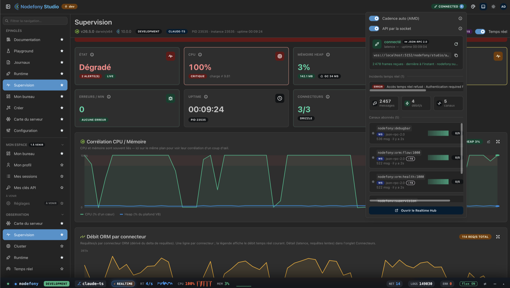
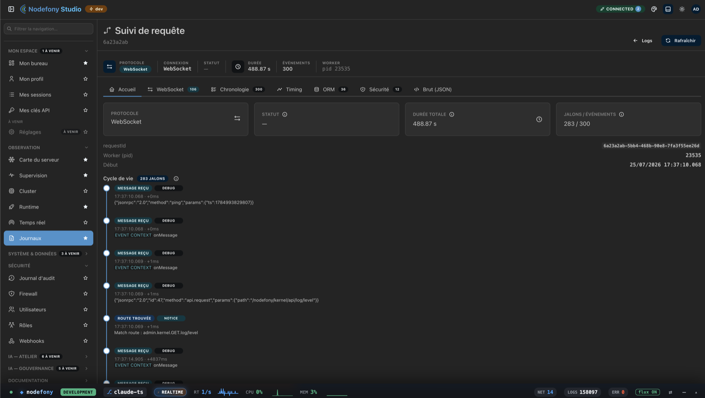

<!-- GÉNÉRÉ par scripts/generate/readmes.mjs (npm run readme:build) depuis scripts/generate/readme/ — ne pas éditer ici. -->

<div align="center">


# Nodefony

**Le framework Node.js fullstack : temps réel natif, développement agentic-ready, sur un socle TypeScript isomorphe.**

_Une action de contrôleur. Deux transports. La même session, la même sécurité, le même code._

[](LICENSE.txt)
[](package.json)
[](tsconfig.json)
[](package.json)

**[📖 Documentation](https://nodefony.net/docs/)** · [Par où commencer](https://nodefony.net/docs/demarrer/) · [Application de démonstration](https://github.com/nodefony/nodefony)

</div>

---

> **A note on language.** Nodefony is written by a French-speaking author. The **code** —
> identifiers, public API, types — is in English, because it travels: npm, editor autocompletion,
> search. The **prose** — documentation, agent skills, messages — is in French, the language in
> which the author explains the _why_ most precisely. Coding agents read it without difficulty;
> human readers may not, and translating the framework's texts is planned
> ([#378](https://github.com/nodefony/nodefony-core/issues/378)).

> **Et NestJS ?** Nodefony en partage le modèle — injection, décorateurs, modules — et s'en inspire
> volontiers. Ses priorités portent ailleurs : une même route sert HTTP et WebSocket, avec la même
> session et le même pare-feu ; et l'application est pensée pour être lue par un agent de code —
> générateurs pilotables, catalogue, `AGENTS.md` dérivé du projet. Deux frameworks, deux accents :
> le bon choix dépend de ce que ton projet met en avant.

**État** — version `10.0.0` · **préversion `10.0.0-beta.6` en ligne**, sous le canal `beta`
uniquement : `npm install nodefony` sert toujours la `7.0.2` (JavaScript), et le fera jusqu'à la
sortie stable · branche par défaut `main` (dernière publication), développement sur `dev` · ~7 700 tests quand toute
l'infrastructure répond (`npm run test:all`).

> ⚠️ **Ce dépôt est l'atelier du framework, pas ce qu'une application installe** — agent : [`AGENTS.md`](AGENTS.md).
> Pour juger le produit, lire une application générée ([`github.com/nodefony/nodefony`](https://github.com/nodefony/nodefony),
> sortie brute de `create app`) ou en générer une : `npm create nodefony@beta <app>`.

---

## Nodefony en bref

Nodefony est un framework serveur fullstack pour Node.js, écrit en TypeScript strict et bâti
directement sur les modules natifs de la plateforme — `node:http`, `node:http2`, WebSocket. Il
apporte un noyau à injection de dépendances qui donne à chaque requête son propre conteneur, un
système de modules, un pare-feu applicatif, une
persistance portable, une console d'administration et la construction des frontends.

**Né du modèle Symfony, devenu un framework de l'écosystème Node.js.** Ses premières versions
transposaient Symfony en JavaScript : bundles, conteneur, configuration. La version 10 s'en est
nettement écartée pour rejoindre sa famille, l'écosystème Node.js : serveurs natifs de la
plateforme, ESM, TypeScript et décorateurs, et pour tout ce que l'écosystème fait déjà bien — Vite
pour les frontends, Drizzle pour la persistance, Zod pour la validation — ses outils plutôt que des
briques maison.

Sa particularité tient en une propriété : **le WebSocket n'y est pas un ajout.** C'est un transport
de première classe, servi par le même pipeline, la même table de routes et la même sécurité que le
HTTP. Une application temps réel s'y écrit comme une application web ordinaire.

**Conçu pour le cloud.** Un processus par conteneur : l'orchestrateur le réplique et le relance,
le framework n'embarque aucun gestionnaire de processus. Sondes de vie et de disponibilité, arrêt
propre sur `SIGTERM` — l'instance quitte la répartition, termine ses requêtes en cours et ferme ses
WebSockets proprement —, configuration par variables d'environnement, journaux sur la sortie
standard, traçage OpenTelemetry par le
[canal de diagnostic](https://nodefony.net/docs/modules/http/diagnostics-channel/) de Node.
L'application générée porte son image et sa tâche de migration ; les manifestes Kubernetes sont
documentés, pas encore générés — [Docker et cloud](https://nodefony.net/docs/guides/docker-cloud-native/)
· [Kubernetes](https://nodefony.net/docs/guides/kubernetes/).

<div align="center">

```bash
npm create nodefony@beta mon-app
```

</div>

### Chaque requête a son propre conteneur

Un processus Node sert des centaines de requêtes **entrelacées** : pendant que l'une attend sa base
de données, une autre s'exécute. Nodefony donne donc à chaque requête **son propre conteneur de
services**, posé comme un **calque** sur celui de l'application.

- **Le mécanisme.** Le conteneur du kernel est la carte ; à l'entrée d'une requête, le pipeline pose
  un calque (`enterScope`) — un objet dont le prototype est la carte. À la fin, `leaveScope` le jette.
- **Ce qu'on y fait.** On lit toute la carte à travers le calque (les services de l'application
  s'héritent) ; on n'écrit que sur son calque. Deux requêtes concurrentes ont deux calques et ne se
  voient jamais ; rien de ce qui est posé sur un calque ne survit à la requête.
- **Le fil qui relie tout : `AsyncLocalStorage`.** Chaque requête s'exécute dans une bulle ALS de
  Node (`RequestContext`) : son identifiant, l'utilisateur, la trace W3C et le calque suivent chaque
  `await`, jusque dans un service ou un adaptateur ORM, sans qu'on les passe d'appel en appel.
- **Comment on l'atteint.** Depuis n'importe quel code de la requête, sans passer le contexte :
  `RequestContext.getScope()` rend le calque courant (ou `undefined`), `requireScope()` lève en
  nommant la cause. La bulle ALS de la requête dit **lequel** est le tien. Un hook
  `onAfterResponse` le voit encore ouvert ; une promesse non attendue qui continue après la réponse,
  non.
- **HTTP et WebSocket.** Une requête HTTP = un calque. Une connexion WebSocket = un calque, partagé
  par tous ses messages, concurrents compris.
- **Des services par requête.** `@injectable({ scope: "request" })` donne un exemplaire par requête,
  créé seulement si la requête le demande, et nettoyé (`clean()`, dans l'ordre inverse des
  créations) à sa fermeture. Un singleton qui en dépendrait est refusé dès le démarrage,
  plutôt que de devenir lui-même, sans qu'on l'ait écrit, un service par requête.
- **Le coût, avec son décor.** Poser puis jeter un calque ≈ 1,43 µs (sonde dans le serveur, un
  processus en production, paires alternées) ; une requête qui ne résout aucun service par requête
  ne paie rien de plus.

```ts
import { Service, injectable, RequestContext } from "nodefony";
import type { Scope } from "nodefony";

@injectable({ name: "requestStamp", scope: "request" })
export class RequestStamp extends Service {
  readonly requestId: string;
  constructor(scope: Scope) {
    super("requestStamp", scope, false); // un exemplaire pour CETTE requête
    this.requestId = RequestContext.getRequestId() ?? "?";
  }
}
```

Le détail — les trois durées de vie, l'accès par `RequestContext`, les pièges :
[Injection & portées](https://nodefony.net/docs/architecture/injection-portees/).

Les frontends ne sont pas laissés dehors. Nodefony pilote **Vite** : en développement il démarre
les serveurs de développement — React, Vue, Angular, Svelte —, les surveille, relaie leur rechargement à
chaud et sert leurs pages ; en production il construit les bundles et les distribue. Une
application peut en porter plusieurs, chacun monté sur sa route.

Le socle, lui, est **isomorphe** : le même paquet s'importe côté serveur et côté navigateur. Le
client temps réel, les règles d'autorisation, les types d'une ressource sont écrits une fois et
s'exécutent là où ils servent — une règle corrigée l'est des deux côtés.

## D'où ça vient

Nodefony est publié depuis **2017**, en JavaScript, et a mûri jusqu'à sa version 7 : des
applications réelles tournent encore dessus. Fin 2023, plutôt que de le migrer par petits pas, le
choix a été fait d'une **réécriture complète en TypeScript**, fichier par fichier, en gardant les
concepts et en jetant tout le reste.

Pourquoi une réécriture et pas une migration progressive ? Parce qu'un framework ne se contente pas
d'exécuter du code : il **contraint** celui qu'on écrit contre lui. Une couche de types posée après
coup sur du JavaScript décrit ce que le code fait ; elle ne garantit rien. Les partis pris de cette
réécriture sont donc structurels, et chacun ferme une porte :

| Décision                                 | Ce qu'elle rend impossible                                    |
| ---------------------------------------- | ------------------------------------------------------------- |
| TypeScript **strict**, zéro `@ts-ignore` | qu'un contrat se dégrade en silence entre deux modules        |
| **ESM** exclusivement                    | la double résolution CommonJS/ESM et ses pièges de chargement |
| Décorateurs plutôt que convention        | qu'une route existe sans être déclarée là où on la lit        |
| Configuration **validée** au boot        | qu'une clé mal orthographiée soit ignorée sans un mot         |
| Un processus = une instance, par défaut  | une supervision imposée ; l'échelle revient à l'orchestrateur |

La version 10 est l'aboutissement de cette réécriture. Ce n'est pas un portage : c'est le même
projet, repensé pour ce que Node.js et TypeScript sont devenus.

## Une action, deux transports

Ce contrôleur est celui que `nodefony create controller` produit. La première action répond en REST ;
la seconde est un point d'entrée WebSocket. Même classe, même session, mêmes règles d'accès :

```typescript
import {
  route,
  controller,
  Controller,
  CurrentUser,
} from "@nodefony/framework";
import type { ContextType } from "@nodefony/http";

@controller("/api/blog")
class BlogController extends Controller {
  constructor(context: ContextType) {
    super("blog", context);
  }

  @route("blog-index", { path: "", method: "GET" })
  async index(@CurrentUser() user?: { identifier?: string }) {
    return this.renderJson({
      hello: "blog",
      who: user?.identifier ?? "anonyme",
    });
  }

  // Même classe, même décorateur : seul le transport déclaré change.
  @route("blog-echo", {
    path: "/echo",
    requirements: { methods: ["WEBSOCKET"] },
  })
  async echo(message: string | Buffer | null) {
    if (!message) return this.renderJson({ handshake: true });
    return this.renderJson({ echo: message.toString() });
  }
}
```

<details>
<summary><b>Ce que ça implique sous le capot</b> — pourquoi ce n'est pas du sucre syntaxique</summary>

- La pseudo-méthode `WEBSOCKET` est traitée comme un verbe HTTP ordinaire : **une seule table de
  routes** pour les deux transports, un seul résolveur de contrôleur.
- Le WebSocket ouvre **la même bulle `AsyncLocalStorage`** que le HTTP et la propage à chaque
  message : l'identifiant de requête et l'utilisateur restent stables du handshake à la fermeture.
- Conséquence directe : une règle d'autorisation protège une action **quel que soit le transport**,
  et une session ouverte en HTTP est celle que voit la socket. Pas de passerelle, pas de seconde
  pile d'authentification, pas de logique dupliquée.
- C'est aussi ce qui fait du **streaming** — d'un fichier, d'un événement, d'un modèle de langage —
  un cas d'usage naturel plutôt qu'un montage : un générateur asynchrone branché sur un canal, dans
  le même contexte de sécurité que le reste de l'application.

</details>

## Un seul langage, du serveur au navigateur

Le client n'est pas une bibliothèque à part, publiée séparément et rattrapée à chaque version : il
est **dans le même paquet que le serveur**, et il partage ses types. Le contrat d'un canal, la forme
d'un message, la hiérarchie des rôles — on les écrit une fois, et les deux côtés en dépendent :

```typescript
import { NodefonySocket } from "nodefony/client";

const socket = NodefonySocket.shared({ url: "wss://localhost:5152" });

await socket.subscribe("chat:room"); // canaux
socket.on("chat:room", (message) => render(message));

const modules = await socket.get("/nodefony/kernel/api/modules"); // appel de service
```

Les mêmes sous-chemins servent le reste : `nodefony/react` pour les hooks, `nodefony/roles` pour
évaluer une autorisation dans l'interface **avec la règle exacte du serveur** — un bouton caché parce
que le rôle manque est caché par la même logique que celle qui refusera l'appel.

> **Pourquoi TypeScript, et pas un portage vers un langage plus rapide ?** Parce que l'isomorphisme
> se paierait exactement là. Réécrire le cœur ailleurs ferait gagner des microsecondes et perdre la
> seule chose qu'un framework fullstack peut vraiment offrir : un contrat unique, vérifié par le
> compilateur, du contrôleur jusqu'au composant. Ce qui coûte cher dans une application temps réel,
> ce n'est pas le langage — c'est la frontière entre deux mondes qui doivent se redire la même chose
> et finissent par diverger. Nodefony supprime la frontière plutôt que d'optimiser le passage.

## Le temps réel, de bout en bout

**Nodefony est un framework temps réel.** Une application vivante pose toujours les mêmes questions :
pousser au navigateur, dans un sens ou dans les deux ; ouvrir des salons et savoir qui s'y trouve ;
décider qui entre ; faire passer des octets ; tenir à plusieurs instances ; voir ce qui se passe
quand ça coince. Chacune a sa réponse dans le framework, écrite contre la norme qui la définit, et
éprouvée par des tests.

| Ce qu'il te faut                      | Ce que Nodefony fournit                                                                                                                                                                                                   |
| ------------------------------------- | ------------------------------------------------------------------------------------------------------------------------------------------------------------------------------------------------------------------------- |
| **Échanger dans les deux sens**       | La **socket Nodefony** : des canaux à volonté sur une seule connexion — le serveur diffuse, le client appelle et attend la réponse, ou pousse sans attendre. JSON-RPC 2.0 sur WebSocket (RFC 6455), dans le pipeline HTTP |
| **Pousser dans un seul sens**         | Les **flux SSE** (`text/event-stream`) : une action répond par `this.renderSse()`, en HTTP/1.1 comme en HTTP/2. Le client isomorphe se reconnecte avec `Last-Event-ID`, et sait envoyer un `POST` et des en-têtes         |
| **Des salons et leurs membres**       | **Canaux à membres** : lister qui est là, abonner d'office, éjecter un compte, fermer le salon, sur toutes les instances. Un message privé atteint une personne par `publishToUser`                                       |
| **Décider qui entre**                 | Une **règle d'admission** par canal (`allow`, fonction ou service injecté), sous le même pare-feu que le HTTP. Origine vérifiée à la poignée de main ; un jeton expiré ferme la socket avec un code dédié                 |
| **Faire passer des octets**           | **CBOR** (RFC 8949), négocié connexion par connexion — détaillé ci-dessous                                                                                                                                                |
| **Tenir à plusieurs instances**       | Un bus de diffusion entre workers ou par Redis, messages scellés (HMAC-SHA256). Un seul producteur par canal et par processus, quel que soit le nombre d'abonnés                                                          |
| **Tenir la charge**                   | Contre-pression en sortie, débit borné en entrée, cadence de diffusion qui s'adapte à chaque client                                                                                                                       |
| **Des types de bout en bout**         | Un **contrat** écrit une fois type le contrôleur, la socket et les hooks React, Vue, Svelte et Angular. Les routes qu'il annonce sont vérifiées au démarrage                                                              |
| **Voir et tester**                    | Une sonde, la console d'administration, les onglets Socket et SSE de la barre de débogage, un traceur de trames ; une identité d'essai pour tester un canal protégé                                                       |
| **gRPC** — _à venir en 10.0.0-beta.7_ | Des services gRPC servis par le même pipeline HTTP/2, déclarés depuis un module, avec la réflexion et la santé standard                                                                                                   |

Chaque besoin a son exemple complet et testé : jeu (déplacements, recherche de partie), salon privé
sur invitation, sonde industrielle, tableau de bord partagé, notification privée, tâche d'agent.

### Le binaire, sans conversion

JSON reste le format par défaut. Dès que des octets circulent — image, son, mesures de capteur,
état d'une partie —, le serveur accepte **CBOR**, un JSON binaire. Nodefony embarque son propre
codec : isomorphe, sans dépendance, environ 5,5 Ko compressés, et téléchargé seulement par la page
qui l'importe. Il rend exactement ce que JSON rendrait, à une exception près : un `Uint8Array`
voyage en octets et revient en `Uint8Array`. Un message ordinaire pèse 30 à 45 % de moins, et 64 Ko
d'octets en occupent 65,6 au lieu des 87,4 du base64.

Le codec se **négocie connexion par connexion**. Le client qui l'offre parle CBOR ; celui qui ne
l'offre pas reste en texte et reçoit les mêmes données. Aucun client ne casse, et un canal suivi par
les deux sortes de connexions paie un encodage par codec, jamais un par abonné.

```ts
// nodefony.config.ts — le serveur accepte CBOR
use("@nodefony/realtime", { codec: "cbor" });
```

```ts
// navigateur — le client l'offre à l'ouverture
import { NodefonySocket } from "nodefony/client";
import { CBOR_FRAME_CODEC } from "nodefony/cbor";

const socket = NodefonySocket.shared({
  url: "/chat/realtime",
  codec: CBOR_FRAME_CODEC,
});
```

→ [La socket Nodefony](https://nodefony.net/docs/modules/realtime/) ·
[Les cas d'usage](https://nodefony.net/docs/modules/realtime/cas-d-usage/) ·
[Les flux SSE](https://nodefony.net/docs/modules/http/sse/) ·
[Le codec CBOR](https://nodefony.net/docs/modules/core/cbor/)

## Prêt pour les agents — ce que ça veut dire ici

Une application est aujourd'hui écrite à deux mains : la personne et l'agent qu'elle pilote. Or un
agent lâché dans un projet bâti sur un framework qu'il connaît mal **invente**. Il produit du code
plausible : un CRUD écrit à la main là où un générateur existait, un import direct du driver de base
de données qui contourne la façade, une socket bas niveau là où le framework offre un canal. Ce code
compile, il passe même les tests — et il aura vieilli avant d'être relu.

La réponse de Nodefony n'est pas un assistant intégré. C'est de rendre **l'application capable de se
décrire**, pour que l'agent lise au lieu de deviner :

| Ce qui est posé                        | Ce que ça évite                                                                              |
| -------------------------------------- | -------------------------------------------------------------------------------------------- |
| Un **`AGENTS.md` généré** à la racine  | la convention périmée : le fichier est dérivé du projet réel, il ne peut pas mentir          |
| La **doc voyage dans les paquets npm** | l'agent qui cherche sur le web une version qui n'est pas la tienne                           |
| Un **catalogue des briques** publié    | le choix de module fait au jugé, sans savoir ce qu'un adaptateur ne couvre pas               |
| `inspect` · `check` · `env`            | la déduction depuis le code de ce que l'application fait vraiment : routes, services, config |
| Des générateurs **pilotables en JSON** | l'imitation d'un fichier d'exemple, au lieu d'appeler l'outil qui produit le vrai code       |
| Un **graphe symbolique** du code       | la fouille par `grep` : qui étend quoi, qui implémente quoi, en une lecture                  |

Le standard retenu — [`AGENTS.md`](https://agents.md) — est celui que lisent la plupart des outils
de codage, avec la règle « le plus proche gagne ». Rien n'est propriétaire : le fichier est un
index, court par construction, qui **pointe** vers la documentation installée plutôt que de la
recopier.

<details>
<summary><b>Et surtout : c'est mesuré</b> — un banc de découvrabilité, pas une intention</summary>

Une application témoin est générée, puis un agent y reçoit des tâches réelles : « ajoute un CRUD
produit », « protège une route », « écris une commande CLI », « configure l'application par
l'environnement », « choisis la brique adaptée à ce besoin ». Le harnais lit ensuite le transcript
et le code produit, et répond à une seule question : **l'agent a-t-il lu, ou deviné ?**

La métrique n'est pas « le code marche » — il marche souvent, c'est bien le piège. C'est : a-t-il
lancé le générateur ? ouvert le catalogue ? interrogé la configuration effective plutôt que de la
supposer ? Le banc n'est pas entièrement vert aujourd'hui, et chaque échec désigne un endroit précis
où l'application ne se rend pas assez évidente. C'est exactement à ça qu'il sert.

</details>

Ce que Nodefony revendique n'est pas d'écrire un `AGENTS.md` — n'importe quel projet peut le
faire — mais de traiter la découvrabilité comme une propriété **mesurée** : le banc ci-dessus est
rejouable, et ses échecs sont publics. C'est cette place-là que le framework occupe délibérément.

## L'IA : ton application, ouverte aux agents

**Un agent d'IA atteint une application par une porte standard : le Model Context Protocol
(MCP).** Il demande quels outils elle offre, reçoit pour chacun un nom, une description et un
schéma d'entrée, puis les appelle. `@nodefony/ai` donne cette porte à ton application et tient
le protocole à ta place — versions, erreurs, autorisation, progression, annulation. Tu écris
une fonction ; elle devient un outil, que Claude, ChatGPT, Copilot ou l'agent d'un client savent
appeler.

| Ce qu'il te faut                     | Ce que Nodefony fournit                                                                                                                                                                                   |
| ------------------------------------ | --------------------------------------------------------------------------------------------------------------------------------------------------------------------------------------------------------- |
| **Ouvrir une porte MCP**             | `npx nodefony create controller mcp --kind mcp` génère la porte, deux outils d'exemple et leur test. MCP révision `2026-07-28`, clients plus anciens acceptés                                             |
| **Suivre un outil long**             | Sur la même requête HTTP, la réponse passe en **flux SSE** : l'agent reçoit l'avancement (`notifications/progress`), puis le résultat — et peut annuler en route, l'outil s'arrête proprement             |
| **Servir un agent sans serveur**     | Le transport **stdio** : `npx nodefony ai:stdio`, pour une intégration continue ou un agent qui lance lui-même son serveur. Les mêmes outils, la même fonction                                            |
| **Ouvrir en production**             | `--expose oauth` : jeton exigé, serveur d'autorisation annoncé (RFC 9728), un scope par outil — un appelant ne voit que ce qu'il peut appeler. `--expose mixte` : des outils publics, les autres réservés |
| **Agir au nom de quelqu'un**         | `actsForUser` : l'outil s'exécute avec le compte de l'appelant, sous les mêmes règles qu'une route protégée                                                                                               |
| **Dire ce que fait l'outil**         | Chaque outil annonce s'il lit ou s'il modifie, pour que l'agent sache quand demander confirmation ; le test généré refuse un outil qui ne le dit pas                                                      |
| **Des outils dans chaque module**    | Un module déclare les siens par `getMcpTools()` ; une porte les ramasse tous, sans registre à tenir                                                                                                       |
| **Développer avec un agent de code** | `@nodefony/devkit` ouvre en développement la porte `/nodefony/mcp` : l'agent interroge l'application qui tourne — carte, santé, routes, trafic, profil d'une route — au lieu de deviner                   |

`@nodefony/ai` ne monte aucune route tant que tu n'ouvres pas de porte ; paquet **expérimental**, il suit la spécification MCP et peut évoluer en version mineure, toujours annoncé au journal des versions.

→ [Le module IA](https://nodefony.net/docs/modules/ai/) ·
[La boîte à outils MCP](https://nodefony.net/docs/modules/ai/mcp/)

## Démarrage

Une préversion `10.0.0-beta.6` est en ligne sous le canal `beta`. Une bêta n'est pas une version
stable : une rupture reste possible d'une bêta à la suivante — chacune est alors annoncée en tête
du [CHANGELOG](CHANGELOG.md) — et elle n'est pas destinée à la production. Elle s'installe en
nommant ce canal :

```bash
npm create nodefony@beta mon-app
cd mon-app
npm run dev
```

Le canal se nomme tant que la 10 n'est pas stable : c'est lui qui garantit de recevoir la
préversion, et non la `7.0.2` que `npm install nodefony` sert encore — la version JavaScript
d'avant, sans rapport avec ce que cette page décrit.

L'application répond sur `http://127.0.0.1:5151` — ou le premier port libre, annoncé au
démarrage — et la console d'administration sur `/nodefony`.

**À quoi ressemble ce que la commande produit :**
[`github.com/nodefony/nodefony`](https://github.com/nodefony/nodefony). Ce dépôt n'est pas une
démonstration écrite à la main pour la vitrine — c'est la sortie littérale de
`nodefony create app --preset complete --frontend react`, poussée telle quelle et **régénérée à
chaque publication**. Base de données et migration initiale, sécurité et comptes, temps réel,
console d'administration, front React, infra docker de développement, chaîne d'intégration
continue : tout ce que tu y lis a été engendré, rien n'y a été retouché. C'est le moyen le plus
court de juger le code qu'on aura à maintenir, avant d'installer quoi que ce soit.

Générer du code — une application, un module, un contrôleur, une entité et toute sa chaîne :

```bash
npx nodefony create module blog --frontend react
npx nodefony create entity Article title:string body:text views:int
npx nodefony create controller admin --kind rest --role ROLE_ADMIN
```

Chaque générateur montre **le plan et le diff avant d'écrire quoi que ce soit**. Un refus ne laisse
rien derrière lui. Il publie aussi son catalogue en JSON et accepte ses réponses par fichier : la
même porte sert la personne au terminal, la console d'administration et un agent.

## Le framework se regarde tourner

`@nodefony/studio` est une console d'administration livrée avec le framework : topologie du runtime,
journaux en direct avec rejeu, suivi d'une requête de bout en bout par son identifiant, schéma de la
base, graphe des classes par module, gouvernance de la sécurité (audit, pare-feu, rôles, sessions,
clés d'API), et les générateurs de code pilotables à la souris, la sortie diffusée comme un terminal.



Sa force est en dessous : **elle ne consomme aucune API privée.** Toutes ses données viennent d'un
plan de données JSON protégé par les mêmes règles d'accès que le reste, **auto-décrit** — un appel en
renvoie le catalogue — et **duplex** : le même point d'accès répond en HTTP et par la socket. Ce
qu'affiche la console, un script ou un agent peut le lire tel quel.

Le suivi d'une requête en est l'illustration la plus directe : chaque requête porte un identifiant
propagé dans tout le pipeline, et la console rejoue son trajet complet — phases, requêtes de base de
données, décisions du pare-feu.



## La sécurité, fermée par défaut

Le pare-feu découpe l'application en **zones**, chacune avec sa chaîne d'authentification. Il refuse
plutôt que d'ouvrir : une configuration invalide capture le trafic et répond 401.

|                   |                                                                                                      |
| ----------------- | ---------------------------------------------------------------------------------------------------- |
| **Identités**     | session serveur pour le web · jetons et clés d'API pour les machines · OAuth2/OIDC · WebAuthn · TOTP |
| **Cryptographie** | Argon2id pour les mots de passe · signatures Ed25519 · secrets chiffrés au repos                     |
| **Défenses**      | CSRF par métadonnées de requête · en-têtes de sécurité · limitation de débit · journal d'audit       |
| **Autorisation**  | hiérarchie de rôles vérifiée au démarrage, refus par défaut                                          |

### Équipe rouge, équipe bleue

Ces briques ne sont pas éprouvées par des cas nominaux — « le login fonctionne » ne prouve rien. Les
campagnes se mènent en **deux passes, et l'ordre est le cœur du dispositif** :

1. **Passe rouge — la menace d'abord.** La matrice d'attaque est construite depuis les standards et
   les faiblesses connues **avant d'avoir lu le code**. C'est un garde-fou contre son propre biais :
   qui lit l'implémentation en premier ne teste que ce qu'elle prévoit, et rate précisément ce
   qu'elle a oublié.
2. **Passe bleue — le code ensuite.** On lit l'implémentation, on couvre les branches restantes,
   on regarde les chemins que la passe rouge n'imaginait pas.
3. **Le cycle.** Faille trouvée → corrigée → **re-prouvée par un test qui échouait avant elle**. Un
   correctif sans son test de non-retour ne compte pas comme corrigé.

Ce qui distingue ces attaques d'un scan générique : beaucoup visent des surfaces **propres à cette
architecture** — les portées de l'injection de dépendances, les messages du pipeline WebSocket
partagé, le jeton porté par le contexte asynchrone, les zones du pare-feu et leurs contournements.
Aucun outil sur étagère ne connaît ces surfaces : il faut concevoir les attaques.

> ⚠️ **À savoir avant de concevoir ton application.** Le refus par défaut opère **par zone du
> pare-feu**, pas route par route : une route située hors de toute zone déclarée est publique.
> Déclare tes zones.

## L'application générée, de la machine à la production

Une application sortie de `npm create nodefony` naît avec son infra de développement, ses tests,
ses contrôles de qualité, sa marche à suivre quand ça casse et sa mise en production. Les chapitres
ci-dessous sont **extraits tels quels** de son README — celui de
[l'application de démonstration](https://github.com/nodefony/nodefony), rendue avec
`--preset complete --frontend react` : ce qui se lit ici est exactement ce qu'elle porte.

### Infra de développement (docker)

L'app démarre **sans docker** : la base est une **sqlite locale** (`var/databases/`),
retenue à la création. Le `compose.yaml` fournit le cran au-dessus :

```bash
npm run infra:up                          # Redis (sessions partagées, realtime multi-process)
docker compose --profile loki up -d       # + Loki + Grafana (logs centralisés)
npm run infra:down                        # arrêt (les volumes survivent)
```

#### Éprouver la topologie de PRODUCTION — l'app derrière son frontal

En production ton application vit derrière un proxy, et c'est lui qui décide de
l'adresse cliente retenue, du protocole annoncé et du sort d'une WebSocket
silencieuse. Le profil `edge` monte cette topologie en local — l'application en
image, **sans aucun port publié**, et un frontal nginx devant :

```bash
npx nodefony http:certificates            # une fois — le certificat de développement
docker compose --profile edge up -d --build
curl -k https://localhost:8443/livez
```

La configuration du frontal n'est pas écrite : elle est **dérivée de ton
application** à la construction de l'image (`nodefony proxy:generate nginx`),
avec tes hôtes de confiance, tes fichiers statiques, ta taille de corps acceptée
et le battement de tes WebSockets. Tu changes l'application, tu reconstruis : la
configuration suit.

Rejouer ta suite de bout en bout **à travers le proxy**, sans la modifier :

```bash
NF_E2E_BASE_URL=https://localhost:8443 \
NODE_EXTRA_CA_CERTS=nodefony/config/certificates/ca/nodefony-root-ca.crt.pem \
  npm run test:e2e
```

> Le certificat est **monté**, jamais gravé dans l'image : une clé privée dans
> une image reste lisible par qui la télécharge, même effacée par une couche
> suivante. En production, c'est ton hébergeur ou ton ingress qui le fournit.

Câblage côté app — une variable, tout le reste se dérive (`store: "auto"`) :

```bash
NF_REDIS_URL="redis://:nodefony-dev@127.0.0.1:6379"   # dans .env
```

Pour passer sur une vraie base SQL : déclare `NF_DATABASE_URL`. Le dialecte est
déduit du **scheme de l'URL** (`postgres://`, `mysql://`, `sqlite:`) — changer de
base ne change **rien d'autre** dans l'app. Le service docker correspondant n'est
pas dans ce `compose.yaml` (une app y retient un seul dialecte) : ajoute-le, ou
recrée une app avec `nodefony create app <nom> --database postgres`.

### Tests — `npm test` est ton PREMIER diagnostic

```bash
npm test             # unitaires : l'app se CHARGE (imports, décorateurs, config) — < 1 s
npm run test:e2e     # build + boot RÉEL (production --detach --wait) + HTTP + WS + probes
```

**Réflexe** : quelque chose semble cassé → `npm test` AVANT de relire du code ou
de redémarrer. En une seconde il prouve que l'app s'importe, que les décorateurs
compilent et que la config valide — ou te donne le fichier exact qui casse.

Le rapport est **franc** : les e2e ont leur propre config (`vitest.e2e.config.ts`),
`npm test` n'affiche jamais de tests « skipped » qui semblent verts sans avoir
rien prouvé. Le test e2e utilise le lancement détaché natif du framework :
`--wait` ne rend la main que quand la readiness est sondée (aucun `sleep`
arbitraire), et `nodefony stop` arrête proprement. Le client WebSocket est le
`WebSocket` **natif** de Node — zéro dépendance de test.

### Qualité du code

```bash
npm run typecheck    # tsgo — le bundler ne type-check PAS : gate séparé, obligatoire
npm run doctor        # cohérence du projet : config, modules déclarés, wiring
npm run lint         # oxlint — garde-fous en warn, non-intrusif
npm run format       # prettier — le style, c'est lui qui décide
```

Le lint et le typecheck sont **deux gates distincts**, et c'est volontaire :
`tsgo` juge les TYPES, `oxlint` juge tout ce qu'un type ne dit pas — code mort,
promesse mal formée, import Node sans son préfixe. Aucun des deux ne remplace
l'autre.

`oxlint` s'appuie sur le même analyseur que le bundler (`rolldown`) : un seul
lecteur de ta syntaxe, donc aucun risque que l'un accepte ce que l'autre refuse.
Il n'a **pas** besoin du paquet `typescript` — celui-ci ne reste dans les
dépendances que pour ton éditeur.

Les règles sont dans `.oxlintrc.json`, commentées par leur intention. Deux
familles ne pardonnent pas : le code mort (il finit par mentir) et le préfixe
`node:` sur les modules du runtime (sans lui, un paquet npm homonyme peut prendre
la place d'un module natif). Le reste avertit sans bloquer.

### Quand ça casse

Dans l'ordre — chaque étape isole un étage, du moins cher au plus cher :

1. **`npm test`** — l'app se charge-t-elle ? Import cassé, décorateur, config
   invalide : le fichier fautif est nommé.
2. **`npm run typecheck`** — un vert vitest ne type-check RIEN (les types sont
   effacés à la transpilation) ; `tsgo` attrape ce que le build laisse passer.
3. **`npx nodefony status`** — un serveur tourne-t-il déjà ? (port occupé,
   vieux process détaché). `npx nodefony stop` arrête proprement. Si le port est
   tenu par une AUTRE application Nodefony, `status` la nomme :
   `npx nodefony stop <nom>` l'arrête sans changer de dossier.
4. **Rebuild** — comportement fantôme après un gros changement : `npm run build`
   puis relance (le serveur charge `dist/`, pas tes sources).

#### `npm install` s'arrête sur « gyp ERR! find Python »

Ton manifeste porte ceci, et il faut l'y laisser :

```json
"allowScripts": { "better-sqlite3": false }
```

`better-sqlite3` (le pilote SQLite, tiré par `@nodefony/drizzle`) livre ses
binaires **déjà compilés** et demande à npm de ne pas le recompiler. npm oublie
cette demande dès qu'un `package-lock.json` existe — donc dès ton premier
`npm install` — et lance alors `node-gyp rebuild`, qui exige Python et un
compilateur C++ ([npm/cli#9837](https://github.com/npm/cli/issues/9837)). La
ligne ci-dessus le lui interdit explicitement, ce qu'il respecte dans toutes
les versions.

Si tu l'as retirée et que l'installation casse : remets-la, supprime
`node_modules`, relance `npm install`. Rien à compiler, SQLite fonctionne.

### Production (cloud-native)

```bash
npm run build        # backend (rolldown) + frontend (vite → public/dist, fingerprinté)
npm start            # nodefony production — bind 0.0.0.0, logs stdout, probes /livez /readyz
```

**Plusieurs processus.** Par défaut, un seul process Node par pod : la mise à
l'échelle est le travail de l'orchestrateur. Sur une machine dédiée, trois voies
règlent le nombre de workers, de la plus forte à la plus faible :
`npx nodefony production --workers <n|auto>` (ou `npx nodefony cluster`) >
`NF_WORKERS=<n|auto>` (déclarée dans `env.ts`) >
`nodefony/config/cluster/cluster.config.ts`. Ce fichier n'est **pas généré** : sa
valeur serait le défaut (`workers: 1`), et chaque application porterait un
fichier qui ne dit rien. Crée-le si la topologie doit vivre en git :

```ts
// nodefony/config/cluster/cluster.config.ts — lu par le maître AVANT le boot,
// donc sans le moindre import du kernel.
import type { IClusterConfig } from "nodefony";
export default { workers: "auto" } satisfies IClusterConfig;
```

`auto` = un worker par cœur **alloué** (quota cgroup du conteneur), jamais
`os.cpus()`. `npm run dev` ignore ce réglage : le développement est toujours
mono-process.

> Le front de production est un build Vite figé (`public/dist/`), servi en
> statics par Nodefony — `npm run build` le produit (il chaîne
> `nodefony frontend:build`). Si tu lances `npm start` sans build, le boot le
> construit une fois pour toi quand Vite est installé (poste de dev) et le DIT
> dans les logs ; dans une image de production sans devDependencies, builde à
> l'image — sinon la page est servie sans interface et le boot le signale en
> ERROR.

#### Image de container

`Dockerfile` et `.dockerignore` sont générés avec l'app ; la doctrine y est
commentée ligne à ligne (multi-stage, `USER 1000:1000`, sonde sur `/readyz`,
forme exec du `CMD`).

```bash
docker build -t nodefony .
docker run -p 5151:5151 -v nodefony-var:/app/var nodefony
docker stop -t 20 <container>   # SIGTERM → drain → exit 0
```

> 🔴 **Le `-v` n'est pas optionnel si tu veux garder tes données.** L'app
> persiste par défaut en sqlite, dans `var/databases/` : sans volume, comptes,
> sessions, jetons et passkeys disparaissent au premier `docker rm`, **sans
> aucun message**. Le volume nommé les met hors du conteneur.
>
> Et tant que la base est sqlite, **une seule réplique** : c'est un fichier, pas
> un serveur. Deux conteneurs sur le même volume se corrompent mutuellement ;
> deux conteneurs sur deux volumes travaillent sur deux bases divergentes, ce
> que rien ne signale. Pour répliquer, passer à PostgreSQL ou MySQL — il suffit
> de poser `NF_DATABASE_URL`, l'ORM déduit le dialecte du scheme et rien d'autre
> ne change dans l'app.

> ⚠️ **La période de grâce doit rester au-dessus de `shutdownDeadline`** (15 s
> par défaut) : `docker stop` n'attend que 10 s sans `-t`, et k8s 30 s. En
> dessous, le drain est coupé par un SIGKILL et les requêtes en vol meurent —
> sans erreur ni trace, à chaque déploiement.

Le code de l'image appartient à `root` et le processus tourne en `1000:1000` :
l'application ne peut pas réécrire son propre `dist/`. Seuls `tmp/` et `var/`
lui appartiennent, ce qui est exactement ce dont elle a besoin pour écrire.

##### Sur quelle base l'image est construite

`node:24-alpine`, et c'est un choix **mesuré** — les trois candidates ont été
construites avec un contenu identique, scannées, puis **démarrées** :

| Base                                  | Image finale | Critiques | Hautes | Node  | libc  | Shell dedans |
| ------------------------------------- | -----------: | --------: | -----: | ----- | ----- | ------------ |
| **`node:24-alpine`** — actuelle       |   **438 Mo** |     **0** |  **4** | 24.21 | musl  | oui (`sh`)   |
| `node:24-slim`                        |       519 Mo |         2 |     14 | 24.18 | glibc | oui (`bash`) |
| `gcr.io/distroless/nodejs24-debian12` |       400 Mo |         0 |      8 | 24.14 | glibc | **non**      |

Distroless est la plus légère et perd quand même : elle embarque un Node plus
ANCIEN et le suivra toujours avec du retard — ce qui l'expose aux CVE déjà
corrigées en amont **et** aux API récentes que ton code appelle. Et l'objection
historique contre Alpine est tombée : `better-sqlite3` et `@node-rs/argon2`
publient leurs binaires musl et s'exécutent après une installation
`--ignore-scripts`.

**Pour en changer**, le `Dockerfile` porte deux lignes `FROM` — elles se changent
**ensemble**, les deux étages devant partager la même libc :

```dockerfile
FROM node:24-slim AS build   # glibc : si un paquet natif n'a pas de binaire musl
FROM node:24-slim            # le symptôme est au DÉMARRAGE, pas à l'installation
```

Le détail de chaque candidate, et ce que distroless impose en plus (réécrire
`CMD` et `HEALTHCHECK` en `/nodejs/bin/node`), est commenté en tête du
`Dockerfile`.

##### Si tu PUBLIES cette image

L'image emporte `node_modules` élagué : la **publier** — sur un registre public,
ou en la livrant à un tiers — te rend distributeur du code de tes dépendances.
MIT, BSD, ISC et Apache-2.0 demandent alors que leur texte et leur copyright
accompagnent le code. C'est déjà le cas matériellement : chaque paquet porte son
propre fichier de licence dans `node_modules`, et l'image les emporte avec lui.

Ce qui manque, c'est l'inventaire — npm le produit sans rien installer :

```bash
npm sbom --sbom-format spdx --omit=dev > sbom.spdx.json
```

> Un **déploiement interne** (ton propre registre, ton cluster) n'est pas une
> distribution : ces obligations ne s'y appliquent pas. Et un inventaire écrit à
> la main serait faux dès le premier `npm install` — c'est pourquoi il se
> régénère plutôt qu'il ne se commite.

Un process Node = un pod/container ; le scaling horizontal vient de
l'orchestrateur (k8s, Swarm, Cloud Run…). Studio est chargé en dev seulement
(`policy: "dev"`) — pour l'exposer en production, protège `/nodefony` par une
zone firewall puis passe la policy à `"mandatory"` (la recette est commentée
dans `nodefony.config.ts`).

## Ce qu'il y a dans la boîte

<!-- prettier-ignore -->
| Brique | Rôle |
| --- | --- |
| [`nodefony`](https://nodefony.net/docs/modules/core/) | Noyau : modules, injection de dépendances, configuration validée au démarrage, journalisation structurée corrélée, CLI — et le client temps réel partagé avec le navigateur |
| [`@nodefony/http`](https://nodefony.net/docs/modules/http/) | Serveurs HTTP, HTTPS, HTTP/2 et WebSocket natifs, flux SSE, sessions, contextes de requête, certificats TLS |
| [`@nodefony/framework`](https://nodefony.net/docs/modules/framework/) | Routeur, contrôleurs, décorateurs, vues — le modèle de programmation |
| [`@nodefony/security`](https://nodefony.net/docs/modules/security/) · [`@nodefony/user`](https://nodefony.net/docs/modules/user/) | Pare-feu par zones, authentification, autorisation par rôles, CSRF, audit |
| [`@nodefony/realtime`](https://nodefony.net/docs/modules/realtime/) | Socket à canaux, salons et leurs membres, admission par canal, binaire CBOR, contre-pression, diffusion entre plusieurs instances |
| [`@nodefony/ai`](https://nodefony.net/docs/modules/ai/) | Porte MCP : les outils de l'application offerts aux agents d'IA, en HTTP avec flux SSE ou en stdio |
| [`@nodefony/orm-core`](https://nodefony.net/docs/modules/orm-core/) | Un contrat de dépôt de données, plusieurs moteurs : [Drizzle](https://nodefony.net/docs/modules/drizzle/) (SQLite, PostgreSQL, MySQL), [Mongoose](https://nodefony.net/docs/modules/mongoose/), [Redis](https://nodefony.net/docs/modules/redis/) |
| [`@nodefony/frontend`](https://nodefony.net/docs/modules/frontend/) | Construction et rechargement à chaud des frontends de chaque module |
| [`@nodefony/studio`](https://nodefony.net/docs/modules/studio/) | Console d'administration |

Par défaut, un processus Node égale une instance : le passage à l'échelle revient à l'orchestrateur,
et les journaux partent sur la sortie standard. Sans orchestrateur, `nodefony cluster -w N` démarre N
workers isolés, relancés s'ils tombent.

## Développer le framework lui-même

Pour travailler sur le framework, c'est ce dépôt qu'on clone :

```bash
git clone https://github.com/nodefony/nodefony-core.git
cd nodefony-core
npm install && npm run build
npm run dev
```

Une application peut alors suivre ce checkout plutôt que npm : `nodefony create app <nom> --link`
lie ses dépendances `nodefony`/`@nodefony/*` en `file:` — tu modifies le framework, tu le rebâtis,
l'application le voit.

## Où aller ensuite

- [Par où commencer](https://nodefony.net/docs/demarrer/) — cinq parcours selon ce que tu viens faire
- [Documentation](https://nodefony.net/docs/) · [Guides](https://nodefony.net/docs/guides/) · [Première application](https://nodefony.net/docs/tutoriels/premiere-application/)
- [L'architecture en vue d'ensemble](https://nodefony.net/docs/architecture/vue-ensemble/) — ce que le framework est, et ce que ses partis pris coûtent
- [Performance](https://nodefony.net/performance/) — ce qui a été mesuré, avec quel
  protocole, et ce que ces chiffres ne permettent pas de conclure ; une page par version publiée,
  dont [la version courante](https://nodefony.net/performance/latest/)
- [Décisions d'architecture](docs/adr/) — les choix structurants et leur pourquoi
- [Signaler une faille](SECURITY.md) — canal privé, jamais en ticket public
- Contribuer : ouvre une issue avant toute contribution substantielle. Le dépôt impose les
  _Conventional Commits_ et un `npm run typecheck` complet avant chaque envoi.

## État du projet

Le cœur — serveurs, routage, sécurité, temps réel, persistance, console d'administration,
construction des frontends — est couvert par des suites de tests exécutables sur infrastructure
réelle (`npm run test:all`), et le dépôt versionne des seuils de fuite mémoire et de charge
opposables à chaque exécution.

**Ce que ça donne en charge.** À travail égal — mêmes journaux, même contexte de requête, mêmes
en-têtes de sécurité, même protection CSRF —, Nodefony se tient **dans la même zone qu'Express et
NestJS munis des mêmes intergiciels** : entre 93,6 et 112,7 % de leur débit sur une route qui ne
fait rien (21 686 requêtes/s, p99 4,4 ms sur la machine de référence), entre 95,9 et 96,7 % sur une
route qui lit et écrit une base — pour une résolution de banc de 3 %. Quatre-vingt-huit minutes de
charge continue et 97,5 millions de requêtes laissent **le tas, l'empreinte mémoire et le `rss`
plats** : 0,021 Mo par million de requêtes. La page de mesures de la version courante —
**[peut-on partir en production ?](https://nodefony.net/performance/latest/)** — porte le comparatif, la
tenue dans la durée, le dimensionnement d'un pod et un calculateur ; elle nomme aussi ce que ces
chiffres **ne** prouvent pas. Le dossier [`docs/performance/`](https://nodefony.net/performance/) donne le
protocole, les scripts qui rejouent chaque chiffre et les instruments qui ont menti avant qu'on
s'en aperçoive — aucun absolu pris derrière un chemin virtualisé n'est transposable.

Ce qu'il faut savoir avant de bâtir dessus : les versions JavaScript historiques (≤ 7.x) ne
reçoivent plus de correctifs.

**Une seule personne en répond, et le projet est écrit pour être repris.** Nodefony est libre et
développé bénévolement par son auteur. Si l'auteur s'arrête, la connaissance ne part pas avec lui :
chaque décision d'architecture est consignée dans un ADR, la documentation renvoie aux symboles du
code source et un contrôle refuse un renvoi devenu faux, et le dépôt porte ses consignes pour agents,
ses tests et sa chaîne de publication. Ce qui dépend vraiment d'une personne, c'est la
responsabilité : publier un correctif, trancher une rupture. La
[gouvernance](https://github.com/nodefony/nodefony-core/blob/main/GOVERNANCE.md) le dit sans
détour, avec ce qui protège ceux qui s'en servent.

Licence [Apache 2.0](LICENSE.txt) — permissive, avec concession de brevet explicite.
**Christophe Camensuli** · [ccamensuli@gmail.com](mailto:ccamensuli@gmail.com)

---

<div align="center">

_La suite est une couche d'agents IA construite sur ce socle : le même pipeline, la même sécurité, le
même temps réel — et une application qui sait déjà se décrire à une machine._

</div>
