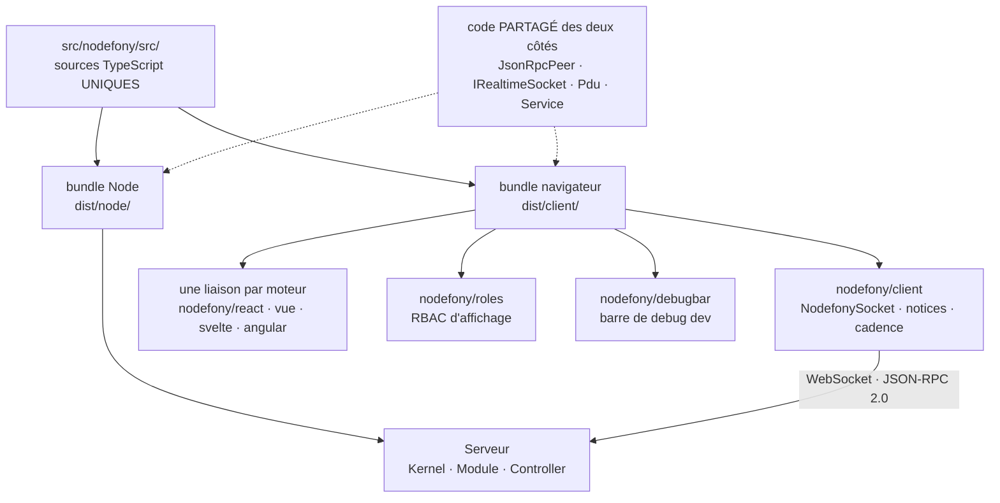
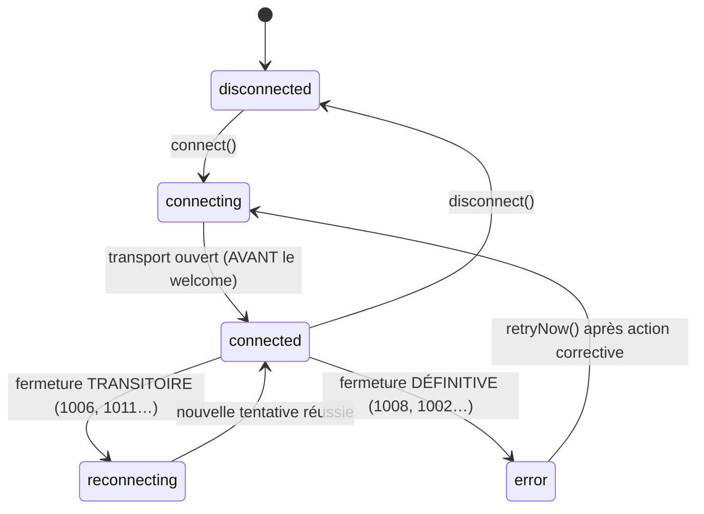

# Le client isomorphe — Nodefony dans le navigateur

> Le paquet `nodefony` ne s'arrête pas au serveur : une partie de son code est **compilée pour le
> navigateur** et publiée sous plusieurs points d'entrée : le socle (`nodefony/client`,
> `nodefony/roles`, `nodefony/debugbar`) et **une liaison par moteur front** — `nodefony/react`,
> `nodefony/vue`, `nodefony/svelte`, `nodefony/angular`. Ton front n'importe donc pas une bibliothèque cliente
> « compagnon » qu'il faudrait tenir à jour en parallèle du back — il importe **le même paquet**, avec
> les mêmes types, le même protocole et les mêmes règles de rôles. Ancré sur `src/nodefony/src/client/`.

📍 [Documentation](../../../docs/index.md) › [Cœur — @nodefony/core](index.md) › **Client isomorphe**

## 🧠 Le modèle mental — un paquet, deux compilations

Une application temps réel a toujours deux moitiés qui doivent **se mettre d'accord** : le serveur qui
pousse, le navigateur qui reçoit. La méthode habituelle consiste à écrire deux fois le contrat — une
fois en TypeScript côté back, une fois en JavaScript côté front — puis à réparer les divergences.

Nodefony supprime la deuxième écriture. Le même dépôt de code produit **deux sorties** depuis les
mêmes sources : un bundle Node et un bundle navigateur. Le champ `exports` du paquet aiguille selon
qui demande.



Trois idées portent toute la page :

1. **Le contrat n'est pas dupliqué, il est partagé.** Le moteur de protocole `JsonRpcPeer` est le
   **même objet** des deux côtés : le navigateur l'exécute dans son client, le serveur en instancie un
   par connexion.
2. **Le navigateur n'a droit qu'à ce qui a du sens pour lui.** Le barrel client ne réexporte pas le
   Kernel, ni les serveurs, ni la validation de schéma — on n'expédie pas 400 Kio de back au client.
3. **Ce que le client sait faire, le serveur n'a pas à le faire.** La reconnexion, la mémoire des
   abonnements et la **négociation de cadence** vivent côté navigateur : le serveur reste bête et
   sans état par connexion.

## 📖 Lexique

| Terme                  | Sens                                                                                                       |
| ---------------------- | ---------------------------------------------------------------------------------------------------------- |
| **Isomorphe**          | Un même code source qui s'exécute **des deux côtés** (serveur et navigateur), sans réécriture.             |
| **Subpath**            | Point d'entrée secondaire d'un paquet npm (`nodefony/client`), déclaré dans le champ `exports`.            |
| **Condition d'export** | Clé du champ `exports` (`browser`, `import`, `types`) qui choisit **quel fichier** un outil résout.        |
| **Barrel**             | Fichier `index.ts` qui réexporte la surface publique d'un dossier. C'est lui qui décide ce qui est public. |
| **JSON-RPC 2.0**       | Protocole d'appel de méthode par messages ; Nodefony l'emploie sur WebSocket dans les deux sens.           |
| **Canal**              | Sujet logique multiplexé sur l'unique connexion (`orders:new`). On s'y **abonne**, on y **publie**.        |
| **Notification**       | Message JSON-RPC **sans identifiant** — aucune réponse attendue. C'est la forme du pub/sub.                |
| **Ref-comptage**       | Compter les consommateurs d'un abonnement pour n'émettre le trafic qu'aux transitions 0↔1.                 |
| **Welcome**            | Première trame poussée par le serveur à l'ouverture : identité résolue + capacités annoncées.              |
| **Notice**             | Message normalisé prêt à afficher (`level`, `title`, `message`) — le format unique des alertes du client.  |
| **Close code**         | Code numérique de fermeture d'une WebSocket (RFC 6455 §7.4) : il dit **pourquoi** ça s'est fermé.          |
| **AIMD**               | _Additive Increase / Multiplicative Decrease_ — la loi de contrôle de congestion de TCP, reprise ici.      |
| **Famine**             | Les trames arrivent nettement plus lentement que la cadence demandée : le producteur est sous pression.    |
| **Latest-wins**        | Canal d'**état** où seule la dernière valeur compte — on peut décimer sans rien perdre.                    |
| **RBAC**               | _Role-Based Access Control_ — décider d'un droit à partir de rôles (`ROLE_ADMIN`).                         |
| **Shim**               | Petit remplacement d'une API absente du navigateur (`node:events`, `node:util`) pour que le code compile.  |
| **Tree-shaking**       | Élimination du code non importé au build : un subpath qu'on n'importe pas pèse **zéro octet**.             |
| **HMR**                | _Hot Module Replacement_ — remplacement d'un module à chaud pendant le développement, sans recharger.      |

## Qu'est-ce qu'un client isomorphe — et ce que ça change concrètement

Un « client » de framework, d'habitude, c'est un second paquet npm (`mon-framework-client`) publié à
côté du serveur. Il embarque sa propre copie du protocole, sa propre définition des types échangés, et
son propre calendrier de versions. Tant que les deux avancent ensemble, tout va bien. Le jour où le
serveur renomme un champ, la divergence ne se voit **qu'à l'exécution**, chez l'utilisateur.

Un client isomorphe supprime la question : il n'y a **qu'un** paquet, donc **qu'une** version. Trois
conséquences pratiques, dans l'ordre où on les rencontre.

- **Les types sont les mêmes objets, pas des copies.** Le contrat de socket `IRealtimeSocket` décrit
  la prise côté navigateur **et** côté serveur. Une méthode qui change de signature casse la
  compilation des deux côtés, au build, pas en production.
- **Les règles de rôles s'évaluent à l'identique.** `hasAnyRole()` (`client/roles/roles.ts#hasAnyRole`) est
  la fonction que le front appelle pour griser un bouton et que le back peut appeler dans un jury
  d'autorisation. Plus de « le front croyait que `ROLE_ADMIN` suffisait ».
- **Les erreurs se traduisent une seule fois.** Le serveur ferme la connexion avec un code RFC 6455 ;
  le client traduit ce code en message lisible via `closeCodeToNotice()` (`client/realtime/notice.ts#closeCodeToNotice`).
  La table de correspondance vit à un seul endroit.

> [!IMPORTANT]
> Isomorphe ne veut pas dire « identique ». Le navigateur n'a ni kernel, ni serveurs, ni accès à la
> base. Le barrel client publie une **sélection** — `NodefonySocket`, `Syslog`, `Pdu`, `Service`,
> `Container` (`client/index.ts`) : les briques qui ont un sens dans un onglet. Le reste n'est
> simplement pas là, et n'alourdit donc pas ton bundle.

## La vision Nodefony

Le champ `exports` du paquet est le pivot de tout le dispositif. Il déclare **sept** points d'entrée
navigateur — le socle (`client`, `roles`, `debugbar`) et une liaison par moteur front (`react`, `vue`,
`svelte`, `angular`) —, plus une condition `browser` sur l'entrée principale.

| Ce que tu importes    | Ce que tu obtiens                                                                          | Quand l'utiliser                                    |
| --------------------- | ------------------------------------------------------------------------------------------ | --------------------------------------------------- |
| `nodefony/client`     | Le client temps réel, les notices, la cadence adaptative, `Syslog`/`Pdu`                   | Toujours — c'est le point d'entrée de référence     |
| `nodefony/react`      | Les hooks `useNodefony*` (peer optionnelle `react`)                                        | App React qui consomme des canaux                   |
| `nodefony/vue`        | Le plugin `nodefonyVue` et les composables `useNodefony*`                                  | App Vue 3 qui consomme des canaux                   |
| `nodefony/svelte`     | `configureNodefony` et des sources réactives lues `.current`                               | App Svelte 5 qui consomme des canaux                |
| `nodefony/angular`    | `provideNodefony` et les fonctions `injectNodefony*` (signals)                             | App Angular qui consomme des canaux                 |
| `nodefony/roles`      | `hasRole` & co, `RoleSet`, `RoleRegistry`                                                  | Afficher/masquer selon les rôles                    |
| `nodefony/syslog`     | Les règles de lecture des journaux (protocole, étape, ligne d'accès, trafic de la console) | Écrire un visualiseur de journaux                   |
| `nodefony/debugbar`   | La barre de debug de développement + son modèle pur                                        | Dev, ou réutiliser le calcul de cascade             |
| `nodefony` (au front) | La **même chose** que `nodefony/client`, via la condition `browser`                        | Code partagé front/back ; sinon préfère l'explicite |

Ces entrées navigateur sont produites par une compilation dédiée — `clientConfig`
(`rolldown.config.ts#clientConfig`) déclare exactement ces sept fichiers d'entrée, en conservant la structure
des modules pour que le client temps réel ne soit émis **qu'une fois** même s'il est tiré par deux
subpaths.

Deux choix méritent d'être explicités, parce qu'ils se voient dans ton bundle.

- **Les subpaths ne sont jamais réexportés depuis le barrel principal.** Importer `nodefony/client`
  ne tire ni React, ni la barre de debug. C'est ce qui permet à la barre de peser **zéro octet** en
  production : personne ne l'importe.
- **React, Vue, Angular et Svelte sont des dépendances externes, jamais empaquetées.** `clientExternal`
  (`rolldown.config.ts#clientExternal`) marque `react`/`react-dom`, `vue`, `@angular/*` et `svelte` comme
  externes : c'est **ton** runtime qui sera utilisé, donc pas de double
  instance et pas de règle des hooks violée.

Le compromis assumé : côté navigateur, quelques API Node manquent. Nodefony ne charge pas de
polyfill lourd — il substitue au build deux **shims** minimaux, `browserShim`
(`rolldown.config.ts#browserShim`), qui redirigent `node:events` et `node:util` vers des implémentations
navigateur de quelques dizaines de lignes.

## 🚀 Démarrage rapide

Le scénario : une application générée par `nodefony create app` avec un front servi par
`@nodefony/frontend`. On veut une socket ouverte, un canal écouté, et un appel d'API par cette même
socket.

### 1. La socket de l'application

Le client est une classe : on l'instancie, on la connecte.

```typescript
import { NodefonySocket } from "nodefony/client";

const socket = new NodefonySocket({ url: "/api/live/realtime" });
await socket.connect();
```

C'est ce que fait `shared()` — **plus une garantie** : une application veut **une seule** connexion
WebSocket pour toute la page, et `new` en ouvre une par appel. `NodefonySocket.shared({ url })` rend
donc la **même instance** pour la même URL, depuis n'importe quel fichier, sans passer la socket de
main en main.

> **Retenir** : `new` pour comprendre l'objet, `shared()` partout dans une application.

Un seul fichier, monté une fois au démarrage du front.

```typescript
// frontend/src/realtime.ts — la socket de l'app, importée partout ailleurs.
import { NodefonySocket } from "nodefony/client";
import type { NodefonyNotice } from "nodefony/client";

// Instance PARTAGÉE par URL : deux appels = la même socket, pas deux connexions.
// L'URL relative est normalisée (https → wss) avant l'ouverture.
export const socket = NodefonySocket.shared({
  url: "/api/live/realtime",
});

// Les criticités du temps réel arrivent déjà traduites et prêtes à afficher.
socket.onNotice((notice: NodefonyNotice) => {
  console.warn(`[${notice.level}] ${notice.message}`);
});

// `on` REÇOIT les messages ; `subscribe` DEMANDE au serveur de les pousser.
// Les deux sont nécessaires — et `subscribe` est ré-émis seul au reconnect.
socket.on("orders:new", (payload) => {
  console.log("nouvelle commande", payload);
});
socket.subscribe("orders:new");

// L'identité vient du serveur (trame « welcome ») : aucune route /auth/me.
socket.onIdentity((identity) => {
  if (!identity?.authenticated) console.log("visiteur anonyme");
});

await socket.connect();
```

### 2. Appeler l'API par la socket, pas par `fetch`

La même action de contrôleur répond en HTTP **et** en WebSocket. La socket l'appelle par le **verbe**
que la route déclare — `get`, `post`, `put`, `patch`, `delete` — et pose seule une clé
d'idempotence sur chaque écriture, parce qu'une socket qui reconnecte peut rejouer une trame en vol.
Sous un contrat (`NodefonySocket.fromContract<C>()`), la clé `serverRoutes` type le corps, la query
et le résultat de chaque route déclarée ([actions](../../packages/@nodefony/realtime/docs/actions.md#le-contrat-type-les-routes)).

```typescript
// frontend/src/orders.ts
import { NodefonySocket } from "nodefony/client";

// MÊME URL ⇒ MÊME instance que dans `realtime.ts` : `shared()` se relit de
// n'importe quel fichier, sans passer la socket de main en main.
const socket = NodefonySocket.shared({ url: "/api/live/realtime" });

// Lecture — équivalent strict du GET REST sur la même route.
export async function loadModules(): Promise<{ name: string }[]> {
  return socket.get<{ name: string }[]>("/nodefony/kernel/api/modules");
}

// Écriture — la socket pose la clé d'idempotence : un rejeu ne double pas l'effet.
export async function ship(orderId: string): Promise<void> {
  await socket.post(`/shop/api/orders/${orderId}/ship`);
}

// Mesure du temps d'aller-retour — la convention `nodefony:kernel:ping` vit dans la lib.
export async function latency(): Promise<number> {
  const { rtt } = await socket.ping();
  return rtt;
}
```

### 3. Adapter l'affichage aux rôles

```typescript
// frontend/src/nav.ts — filtrer une navigation. ERGONOMIE, pas sécurité.
import { hasAnyRole, RoleSet } from "nodefony/roles";

export function visibleTabs(roles: readonly string[]): string[] {
  const tabs = ["Commandes"];
  // Contrôle ponctuel : zéro allocation, parcours linéaire.
  if (hasAnyRole(roles, ["ROLE_ADMIN", "ROLE_BILLING"]))
    tabs.push("Facturation");
  // Contrôles RÉPÉTÉS sur le même utilisateur : une allocation, puis O(1).
  const set = new RoleSet(roles);
  if (set.has("ROLE_ADMIN")) tabs.push("Administration");
  return tabs;
}
```

### Ce qu'on observe

```bash
npx nodefony development
```

Dans la console du navigateur, à l'ouverture de la page :

```text
visiteur anonyme                      # la trame welcome est arrivée, non authentifié
nouvelle commande { id: 'CMD-42' }    # le canal orders:new pousse
[warning] Connexion temps réel perdue # le réseau a sauté (close code 1006)
[success] Connexion temps réel rétablie
```

La dernière ligne mérite une remarque : elle n'est émise qu'après une **vraie** perte, jamais à la
première connexion. Le client distingue « je me connecte » de « je me reconnecte » — sinon toute page
afficherait un message de rétablissement au chargement.

> [!TIP]
> Ne câble rien à la main : la liaison de ton moteur front fait l'abonnement, le désabonnement et
> la mise à jour de la vue pour toi. Voir [Hooks React](react-hooks.md), [composables Vue](vue-composables.md),
> [réactivité Svelte](svelte-reactivite.md) ou [services Angular](angular-services.md).

## 🔌 `NodefonySocket` — la socket vue du navigateur

C'est la brique centrale du subpath. `NodefonySocket` (`client/realtime/NodefonySocket.ts#NodefonySocket`)
implémente le contrat de socket isomorphe **et** le contrat de pair JSON-RPC : il sait donc à la fois
recevoir des messages poussés et **répondre** à des requêtes venues du serveur.

### Les options du constructeur

`new NodefonySocket(options)` et `NodefonySocket.shared(options)` prennent le même objet,
`NodefonySocketOptions` (`client/realtime/NodefonySocket.ts#NodefonySocketOptions`). Toutes les clés sont facultatives ;
seule l'adresse doit être connue au moment de `connect()`.

| Option                        | Défaut  | Effet                                                                                                                                                                                                                                                                                   |
| ----------------------------- | ------- | --------------------------------------------------------------------------------------------------------------------------------------------------------------------------------------------------------------------------------------------------------------------------------------- |
| `url`                         | —       | Point d'entrée WebSocket. Relatif (`/api/live/realtime`) : résolu contre la page, `http(s)` devenant `ws(s)`. Absente au `connect()` et sans argument → `requireUrl` lève une erreur qui le dit (`NodefonySocket.ts#NodefonySocket.requireUrl`).                                        |
| `token`                       | —       | Jeton ajouté à l'URL de connexion en paramètre `token` (`NodefonySocket.ts#NodefonySocketOptions.token`). Inutile quand la session passe par le cookie — le cas par défaut, et le seul qui ne fait pas voyager le secret dans une adresse.                                              |
| `autoReconnect`               | `true`  | `false` coupe la reconnexion automatique après une fermeture transitoire (`NodefonySocket.ts#NodefonySocket.settleClose`). Une fermeture définitive ne relance jamais, quelle que soit la valeur.                                                                                       |
| `reconnectDelay`              | `1000`  | Premier délai entre deux tentatives (ms) ; il double à chaque échec, avec une gigue, sans jamais descendre sous 100 ms (`NodefonySocket.ts#reconnectDelay`).                                                                                                                            |
| `reconnectDelayMax`           | `30000` | Plafond de ce délai (ms) (`NodefonySocket.ts#NodefonySocket.scheduleReconnect`).                                                                                                                                                                                                        |
| `connectTimeout`              | `10000` | Délai d'ouverture (ms) : une poignée de main sans réponse est abandonnée, la promesse d'ouverture rejette et la reconnexion prend le relais. `0` retire la borne (`NodefonySocket.ts#NodefonySocket.openSocket`).                                                                       |
| `heartbeatInterval`           | `30000` | Intervalle du ping qui maintient la connexion et en mesure l'aller-retour (ms) (`NodefonySocket.ts#NodefonySocket.startHeartbeat`).                                                                                                                                                     |
| `maxBufferedAmount`           | `0`     | Seuil (octets) de la file d'envoi du navigateur au-delà duquel une frame sortante est **jetée** et comptée (`framesDropped`) au lieu d'être mise en file ; `emit`, `request` et `sendBinary` rendent alors `false` (`NodefonySocket.ts#NodefonySocket.admitOutbound`). `0` = désactivé. |
| `backpressureCloseAfterDrops` | `1000`  | Solde de frames jetées (+1 jetée, −1 partie) qui fait fermer la socket en `4007` puis se reconnecter (`realtime/closeCodes.ts#BACKPRESSURE_CLOSE_CODE`). Sans effet sans `maxBufferedAmount` ; `0` = ne jamais fermer.                                                                  |
| `banner`                      | `true`  | Annonce du framework dans la console et handle `nodefony` (`NodefonySocket.ts#NodefonySocket.constructor`). `false` pour une application publiée qui ne veut rien dans la console de ses utilisateurs.                                                                                  |
| `codec`                       | —       | Codec de trame **binaire** à offrir au serveur — `CBOR_FRAME_CODEC`, importé de `nodefony/cbor` (`NodefonySocket.ts#NodefonySocketOptions.codec`). Absent : JSON-RPC texte, rien n'est offert. Voir [Choisir le codec de trame](#choisir-le-codec-de-trame--texte-ou-cbor).             |

⚠️ Avec `shared()`, les options ne s'appliquent qu'à la **première** création pour une URL : les
appels suivants rendent l'instance existante, réglages compris. Un `codec` demandé après coup est
donc ignoré — et, en développement, la console le dit (`NodefonySocket.ts#NodefonySocket.shared`).

### Ouvrir, perdre, retrouver la connexion



La subtilité utile est la distinction entre fermeture **transitoire** et **définitive**.
`isReconnectableCloseCode()` (`client/realtime/notice.ts#isReconnectableCloseCode`) lit le code de fermeture : une perte
réseau (1006) ou un redémarrage serveur (1011) relancent la boucle de reconnexion ; un refus de
politique (1008, c'est-à-dire un 401/403 traduit), une identité refusée ou révoquée (4001), une
origine refusée (4003), une ressource introuvable (4004) et un **jeton porteur expiré** (4006) ne la
relancent **pas**. Ces codes vivent dans un seul registre, exporté par `nodefony`
(`realtime/closeCodes.ts#TOKEN_EXPIRED_CLOSE_CODE` et ses voisins) : comparez à la constante, jamais
au nombre. Un refus AU HANDSHAKE (le serveur répond 401/403
avant le `101`) arrive, lui, comme un `1006` que le navigateur ne distingue pas d'une panne : le
client pose alors une requête HTTP sur la même adresse (option `probe`) et un 401/403/404 vaut le
même refus définitif. Sans cette règle, un visiteur anonyme martèlerait
indéfiniment un point d'entrée protégé — et une session révoquée rejouerait son identité à chaque
tentative.

Un code privé fait exception dans l'autre sens : **`4007`** est émis par le client lui-même,
quand sa file d'envoi ne se vide plus (`maxBufferedAmount`). Il est **transitoire** : la connexion
repart à vide. Le serveur, pour la même cause, ferme en `1013`, code qu'un navigateur n'a pas le
droit d'émettre (`WebSocket.close` n'admet que `1000` et `3000`-`4999`).

Le délai entre tentatives double à chaque échec — `scheduleReconnect()`
(`client/realtime/NodefonySocket.ts#NodefonySocket.scheduleReconnect`) — plafonné à 30 secondes par défaut. Trois garde-fous
le tiennent face à un serveur qui coupe tout le monde au même instant :

- une **gigue** : le délai tombe entre la moitié et la totalité du doublement, pour que mille
  onglets coupés ensemble ne reviennent pas ensemble ;
- un **plancher** de 100 ms, que ni la configuration ni le serveur ne franchissent ;
- le compteur ne revient à zéro qu'après **5 secondes de connexion stable** : un serveur qui
  accepte puis coupe aussitôt est ménagé de plus en plus, pas sondé à cadence fixe.

La date de la prochaine tentative est exposée en lecture, ce qui permet d'afficher un compte à
rebours exact plutôt qu'un sablier qui ment.

`connect()` se règle sur **sa** tentative : il résout à l'ouverture, et rejette si la socket se
ferme avant de s'ouvrir — serveur absent, délai `connectTimeout` dépassé, `disconnect()`. La
reconnexion, elle, continue en fond. Un appel qu'on n'attend pas s'écrit donc
`socket.connect().catch(() => {})`, jamais `void socket.connect()`, qui laisserait le rejet sans
traitement.

### Les canaux — ref-comptés, et remémorés

C'est le mécanisme qui évite la classe de bugs la plus pénible d'une application temps réel : deux
composants écoutent le même canal, l'un se démonte, et **coupe le flux de l'autre**.

`NodefonySocket.subscribe()` (`client/realtime/NodefonySocket.ts#NodefonySocket.subscribe`) compte les consommateurs et
n'envoie la demande au serveur qu'au **premier**. `NodefonySocket.unsubscribe()`
(`client/realtime/NodefonySocket.ts#NodefonySocket.unsubscribe`) ne coupe qu'au **dernier**. Entre les deux, le trafic réseau
est nul.

Second effet, tout aussi important : la liste des abonnements est **rejouée à chaque reconnexion**.
Le serveur repart d'un état vide après une coupure ; c'est le client qui se souvient de ce qu'il
écoutait, dans la routine d'ouverture de socket (`client/realtime/NodefonySocket.ts#NodefonySocket.replaySubscriptions`).

**`connected` ne veut pas dire « abonné ».** L'état passe à `connected` dès l'ouverture du
transport ; les abonnements ne sont rejoués qu'au `realtime:welcome`, et ne deviennent effectifs
qu'à l'**acquittement** du serveur (`realtime:subscribed`). Ce qui est publié entre les deux est
perdu. Pour le patron « je recharge l'état, puis je suis le flux », attendre l'acquittement :

```ts
socket.subscribe("app:orders");
await socket.whenSubscribed("app:orders"); // rejetée si le serveur refuse le canal
const snapshot = await loadOrders(); // tout ce qui est publié à partir d'ici est livré
```

`whenSubscribed()` (`client/realtime/NodefonySocket.ts#NodefonySocket.whenSubscribed`) repart de zéro à chaque reconnexion ;
`onSubscribed()` rappelle un écouteur à chaque acquittement. Face à un serveur qui n'annonce pas
`subscriptionAcks` dans son welcome (version antérieure), la promesse se résout dès le rejeu : la
garantie d'avant, sans plus. Un premier message peut arriver AVANT l'acquittement (le producteur
s'attache d'abord) — la garantie porte sur ce qui suit, pas sur « rien n'arrive avant ».

> [!WARNING]
> `on(canal, handler)` et `subscribe(canal)` ne font **pas** la même chose et ne se remplacent pas.
> Le premier installe un écouteur local ; le second demande au serveur de pousser. Écouter sans
> s'abonner donne un canal silencieux ; s'abonner sans écouter fait transiter des trames que personne
> ne lit.

### Qui est là — la présence d'un canal

Un canal qui déclare `presence` côté serveur (`@RealtimeChannel("room:*", { presence: true })`)
envoie à chaque abonné la notification `realtime:presence` : la liste des présents à
l'abonnement, puis les changements, numérotés. La socket les applique à une vue et la tient à
jour ; l'écran lit l'instantané :

```ts
const presence = useNodefonyPresence(socket, "room:42"); // React ou Vue
// presence.ready    → false tant que la première liste n'est pas arrivée
// presence.count    → identités nommées (comptes) ; presence.unnamed → les autres
// presence.members  → ReadonlyMap identité → { tabs } (onglets ouverts)
// presence.partial  → vue incomplète ou figée : socket fermée, resynchronisation
```

Angular : `injectNodefonyPresence`, Svelte : `nodefonyPresence`, hors framework :
`socket.onPresence(canal, handler)` et `socket.presence(canal)`
(`client/realtime/NodefonySocket.ts#NodefonySocket.onPresence`). Les quatre reposent sur
`observePresence` (`client/realtime/observe.ts#observePresence`).

La vue est celle du cœur, la MÊME que lisent les tests du serveur
(`realtime/presenceView.ts#PresenceView`) : un changement au numéro attendu s'applique, un
numéro déjà vu est jeté, un numéro trop loin (une trame perdue) fige la vue et fait redemander
la liste par un `subscribe` répété, une fois par canal toutes les 2 s au plus. À la fermeture
de la socket, la vue reste affichée, marquée `partial`, jusqu'à la liste de la connexion
suivante. L'instantané est immuable : le même objet tant que rien ne change, un objet neuf à
chaque changement.

**Un abonnement conditionnel se monte et se démonte — il ne se met pas en pause.** Aucune liaison de
vue n'accepte un canal « vide » ni un interrupteur : un interrupteur « temps réel » à l'écran rend
ou retire le composant abonné, et c'est son démontage qui libère le canal côté serveur. L'option
`enabled` de la cadence adaptative n'en est pas un : à `false`, elle garde l'abonnement à cadence
fixe (`client/realtime/AdaptiveRate.ts#bindAdaptiveChannel`).

### Les quatre façons de parler au serveur

| Appel                                                      | Ancre                                                      | Ce que ça fait                                             |
| ---------------------------------------------------------- | ---------------------------------------------------------- | ---------------------------------------------------------- |
| `NodefonySocket.emit()` / `publish()`                      | `client/realtime/NodefonySocket.ts#NodefonySocket.publish` | Notification sans réponse — la forme du pub/sub            |
| `NodefonySocket.request()`                                 | `client/realtime/NodefonySocket.ts#NodefonySocket.request` | Requête/réponse d'une action RPC, par son nom              |
| `NodefonySocket.get()`                                     | `client/realtime/NodefonySocket.ts#NodefonySocket.get`     | Lecture d'une route par le pont d'API                      |
| `NodefonySocket.post()` / `put()` / `patch()` / `delete()` | `client/realtime/NodefonySocket.ts#NodefonySocket.post`    | Écriture par le pont d'API — clé d'idempotence posée seule |

Deux compléments moins courants. `NodefonySocket.call()`
(`client/realtime/NodefonySocket.ts#NodefonySocket.call`) rend l'**enveloppe complète** — la valeur **et**
l'identifiant du profil serveur de cette trame, ce qui permet en développement d'aller lire la
radiographie de l'appel. Et `NodefonySocket.register()`
(`client/realtime/NodefonySocket.ts#NodefonySocket.register`) fait du navigateur un **appelé** : le serveur peut lui
adresser une requête et attendre son résultat. C'est le duplex réel, pas seulement du push.

### Ce que la socket dit d'elle-même — instantané et description

`socketSnapshot()` (`client/realtime/snapshot.ts#socketSnapshot`) lit l'état de la socket sans émettre une
trame : adresse, état, identité, canaux tenus, canaux et actions annoncés à l'accueil, trames
reçues. `observeSnapshot()` (`client/realtime/observe.ts#observeSnapshot`) le pousse à chaque échantillon, à
chaque changement d'état et à chaque accueil — c'est ce dernier qui apporte l'identité, après le
passage à « connecté ».

`describeSocket()` (`client/realtime/snapshot.ts#describeSocket`) met cet instantané en mots : une ligne par
fait, avec sa valeur ET une phrase qui dit ce qu'elle garantit. C'est la source UNIQUE du tableau
que la console du navigateur affiche en développement, de la vignette « Le client vu de
l'intérieur » des quatre vitrines, et de l'onglet Realtime de la barre de debug — écrit dans chaque
page, le texte des explications divergerait de celui de la console à la première retouche.

La ligne **« format »** dit le codec en vigueur — « JSON-RPC 2.0 · texte » ou « JSON-RPC 2.0 · binaire »,
suivi du sous-protocole —, mise en mots par `describeCodec()` (`client/realtime/snapshot.ts#describeCodec`). La
même phrase figure dans le diagnostic du noyau client : une seule source.

Trois lignes disent ce qu'un écran « qui ne reçoit rien » doit savoir :

- **« notifications reçues »** compte ce que le serveur POUSSE, accueil compris — les réponses aux
  appels (`request`, `api.request`) n'y entrent pas, elles se lisent au journal ;
- **« trames perdues »** — non envoyées (transport fermé à l'émission), jetées (contre-pression du
  client), illisibles (binaire sans lecteur, texte non JSON) ;
- **« journal »** dit depuis quand le journal des trames retient (`frameLogSince`,
  `client/realtime/NodefonySocket.ts#NodefonySocket.frameLogSince`). Hors développement il est
  éteint, sans coût par trame, jusqu'à sa première lecture : ce qui précède n'y est pas.

### Identité et refus — l'interface sait sans demander

L'identité de la connexion n'est pas devinée par le front : le serveur l'annonce dans sa première
trame, et le client la retient. `NodefonySocket.identity`
(`client/realtime/NodefonySocket.ts#NodefonySocket.identity`) vaut `null` tant que rien n'est reçu, puis porte un objet
dont `authenticated` vaut `false` pour un visiteur anonyme. Un écran de connexion se décide donc
**sans appeler aucune route**.

Le pendant côté refus : quand le serveur rejette un abonnement, il pousse un message dédié que le
client transforme en deux signaux — une notice générique pour le centre de notifications, et un
événement ciblé consommable par `NodefonySocket.onDenied()`
(`client/realtime/NodefonySocket.ts#NodefonySocket.onDenied`) pour une réaction précise (griser le contrôle concerné). Le
motif reste volontairement générique : le serveur ne dit jamais **quel** rôle manquait, ce qui en
ferait un oracle.

**L'identité se lit à chaque accueil, pas une fois au login.** Quand les rôles d'un compte changent,
le serveur ferme ses sockets avec le code 4005 (`realtime/closeCodes.ts#IDENTITY_REFRESH_CLOSE_CODE`) ;
le client se reconnecte seul, et le nouvel accueil apporte les rôles à jour — `onIdentity()` est
rappelé. Une interface qui a mémorisé les rôles de la réponse de connexion continue d'afficher les
anciens ; une interface branchée sur `onIdentity()` (ou sur le hook d'identité de son moteur) suit
sans rien faire.

### Le transport, et pourquoi il est aussi bête

`BrowserWsTransport` (`client/realtime/BrowserWsTransport.ts#BrowserWsTransport`) enveloppe la `WebSocket` native et
ne fait rien d'autre : ouvrir, envoyer, fermer, relayer quatre événements. Toute l'orchestration —
état, reconnexion, battement de cœur, statistiques — vit au-dessus.

Cette séparation a une conséquence directe et très utile : le client accepte une **fabrique de
transport** injectée en second argument de son constructeur
(`realtime/IRealtimeTransport.ts#RealtimeTransportFactory`) — elle reçoit l'adresse et l'offre de
sous-protocoles. Les tests branchent un transport factice et exercent toute
la machine à états **sans ouvrir une seule socket**. C'est ce qui rend les 177 cas de test de cette
page possibles hors navigateur.

Le transport relaie **tout**, binaire compris (`binaryType = "arraybuffer"`) : il ne trie pas, parce
qu'un tri à cet étage rendait l'écart invisible pour tout ce qui est au-dessus. C'est la socket qui
décide de ce qu'elle lit, selon le codec que l'accueil a retenu.

### Le binaire — écarté bruyamment, ou lu par toi

Sur une connexion **JSON-RPC texte** — le défaut —, une trame binaire n'a pas de canal : le
protocole ne la route donc pas. Sous un **codec binaire** retenu à l'accueil, c'est l'inverse : chaque
trame binaire est une frame du codec, routée comme le texte (voir
[Choisir le codec de trame](#choisir-le-codec-de-trame--texte-ou-cbor)). Ce qui se passe à la réception,
selon le cas :

| Trame reçue                      | Sans lecteur                                                           | Avec `onBinary(handler)`                     |
| -------------------------------- | ---------------------------------------------------------------------- | -------------------------------------------- |
| Binaire, connexion texte         | écartée, comptée (`binaryFramesDiscarded`), **une** notice `-32700`    | remise telle quelle (`Uint8Array`), en ordre |
| Binaire, connexion CBOR          | décodée par le codec, remise à `on(canal)`                             | idem — `onBinary` ne reçoit rien, une notice |
| Trame que le codec ne décode pas | écartée, comptée (`malformedFramesDiscarded`), **une** notice `-32700` | idem — `onBinary` ne lit que le binaire brut |

La notice part à la PREMIÈRE trame de chaque nature, jamais à chaque trame : un flux à 60 Hz ne
devient pas soixante notices par seconde. En sortie, `sendBinary(octets)` émet sans sérialiser
(un `Uint8Array`) et suit la règle de `send` : transport fermé → `false`, compté dans
`framesUnsent` (`client/realtime/NodefonySocket.ts#NodefonySocket.onBinary`,
`client/realtime/NodefonySocket.ts#NodefonySocket.sendBinary`). Sous codec binaire, `sendBinary`
rend `false` et le dit par une notice, une fois par connexion : le serveur lirait ces octets comme
une frame du codec. Les octets d'un canal y passent par `publish`, sans base64.

Les octets ont le **même type des deux côtés** : `onBinary` livre un `Uint8Array`, comme
`RealtimeController.onRealtimeBinary` côté serveur (où c'est un `Buffer`, qui en est un). Un
décodeur s'écrit donc une fois. Le transport du navigateur pose une vue sur l'`ArrayBuffer` reçu,
sans copier les octets. Pour un `DataView`, passer la tranche entière —
`new DataView(data.buffer, data.byteOffset, data.byteLength)` — car un `Buffer` de Node ne
commence pas à 0 dans son tampon.

`onBinary` est un **point d'extension**, pas un protocole : la corrélation d'une trame (quel canal,
quelle requête) appartient alors à l'application, par exemple par un en-tête qu'elle définit. Il ne
sert que les connexions JSON-RPC texte. Pour des octets **par canal**, la voie est le codec CBOR et
`publish` / `on(canal)` (section suivante), pas un en-tête maison.

> [!WARNING]
> **Son pendant serveur, `onRealtimeBinary()`, est hors du verrou de frame et des gardes**
> (`RealtimeController.ts#RealtimeController.onRealtimeBinary`). Une trame brute ne passe ni par
> l'autorisation de frame ni par les politiques d'action et de canal du JSON-RPC ; seule la
> connexion a franchi l'Origin, l'authentificateur et le pare-feu. Toute décision d'accès sur ces
> octets appartient à l'application, qui lit l'identité par `RequestContext.getAuthenticatedUser()`.
> Un octet publié dans un canal, lui, passe par les mêmes portes que le texte.

### Choisir le codec de trame — texte ou CBOR

L'enveloppe reste JSON-RPC 2.0 quel que soit le codec : il n'en est que la forme sur le fil
(ADR-0022 §2). Par défaut, JSON texte. Une application qui transporte des **octets** — un document
partagé, une série de mesures, de l'audio — offre le codec CBOR :

```ts
import { NodefonySocket } from "nodefony/client";
import { CBOR_FRAME_CODEC } from "nodefony/cbor";

const socket = NodefonySocket.shared({
  url: "/realtime",
  codec: CBOR_FRAME_CODEC,
});
socket.on("doc:42", (charge) => {
  // une charge qui est, ou contient, des octets les rend en Uint8Array
  console.log(charge);
});
socket.subscribe("doc:42");
```

Ce qui se passe, dans l'ordre :

1. **Le client offre** au handshake `nodefony.jsonrpc.cbor.v1` puis `nodefony.jsonrpc.v1`
   (`Sec-WebSocket-Protocol`, RFC 6455 §1.9).
2. **Le serveur choisit** et l'annonce dans le champ `codec` de `realtime:welcome` — jamais dans
   l'écho du handshake, que `ws` renvoie qu'il parle le sous-protocole ou non. Absent : texte.
3. **Le client adopte** l'annonce (`realtime/frameCodecNegotiation.ts#adoptFrameCodec`, la même règle que
   le serveur appelle de son côté). Retenu, le codec porte toutes les frames qui suivent, dans les
   deux sens ; `socket.codec` (`client/realtime/NodefonySocket.ts#NodefonySocket.codec`) le dit. Une
   annonce hors de l'offre est une faute du serveur : notice d'erreur, la connexion reste en texte.

Un serveur qui n'a activé aucun codec n'émet pas le champ : la connexion reste en texte natif, rien
ne casse. S'il en a activé un que ce client n'a pas pris, il porte les octets sous la convention
`{"$bytes":"<base64url>"}` et l'annonce par le champ `bytes` de l'accueil : la socket les relit alors
en `Uint8Array`, sans rien importer.

Sous cette convention, un objet de la forme **exacte** `{ $bytes: "<chaîne>" }` (seule clé, valeur
chaîne) est réservé aux octets. `emit` et `publish` lèvent une `TypeError` qui nomme la clé, plutôt
que d'envoyer un objet que le serveur relirait en octets :

```ts ignore
socket.publish("prix", { montant: { $bytes: "12 euros" } }); // TypeError — forme du marqueur
socket.publish("prix", { montant: { $bytes: "12 euros", devise: "EUR" } }); // conforme
socket.publish("doc:42", { maj: new Uint8Array([1, 2, 3]) }); // conforme — de vrais octets
```

La règle et sa limite (un objet conservé puis renvoyé est refusé à chaque envoi) sont détaillées
dans [Protocole](../../packages/@nodefony/realtime/docs/protocole.md#des-octets-dans-la-charge--une-frame-comme-les-autres).
Côté serveur, le codec s'active par la clé
[`codec`](../../packages/@nodefony/realtime/docs/configuration.md#codec--la-forme-des-frames-sur-le-fil).

| Charge                   | Texte JSON           | CBOR                  | Sur le fil         |
| ------------------------ | -------------------- | --------------------- | ------------------ |
| Petit objet, réception   | ≈ au même niveau     | ≈ au même niveau      | **−30 %** d'octets |
| Petit objet, émission    | plus rapide          | plus lent             | **−30 %** d'octets |
| 4 Ko d'octets, réception | base64 + réanimation | **≈ 33× plus rapide** | **−25 %** d'octets |

D'où la règle : **CBOR n'est jamais le défaut**. Sur des messages ordinaires, JSON est natif et ne
coûte rien à télécharger ; dès que des octets circulent, CBOR les porte sans base64 ni copie. Le
codec ne pèse que sur la page qui importe `nodefony/cbor`.

### Ce que le client alloue — et ce qu'il n'alloue pas

Un onglet ouvert huit heures ne pardonne pas les allocations gratuites. Les choix visibles au code :

- **Le journal de protocole est différé — et éteint en production.** En développement, chaque trame
  est poussée dans un anneau O(1) borné à 300 entrées sous forme de **référence brute**, l'entrée
  évincée recyclée ; la mise en forme et le masquage des secrets ne sont faits qu'à la **lecture** —
  `recordFrame()` (`client/realtime/NodefonySocket.ts#NodefonySocket.recordFrame`). En production, le journal ne
  s'allume qu'à la première lecture de `frameLog` ou au premier écouteur `LOCAL_EVENTS.frame` (la
  console de Studio) : sans console ouverte, il ne coûte **rien** par trame.
- **Les secrets ne transitent pas en clair dans l'inspecteur.** `redactFrame()`
  (`client/realtime/NodefonySocket.ts#redactFrame`) remplace toute clé ressemblant à un jeton, un mot de
  passe ou une autorisation, avec une profondeur bornée.
- **Ce qui n'a pas servi n'existe pas.** L'anneau de trames, l'identité et les capacités annoncées
  démarrent à `null` et ne sont alloués qu'au premier usage.
- **L'échantillonnage de débit ne retient pas le processus.** Le minuteur de statistiques est
  déréférencé (`client/realtime/NodefonySocket.ts#NodefonySocket.startStatsSampler`) — utile quand le même code tourne dans un
  test Node.

## ⚡ Cadence adaptative — une capacité du CLIENT

Voici le point le plus contre-intuitif de la lib, et son meilleur argument : **c'est le navigateur
qui décide à quel rythme il veut être servi**, sans que le serveur n'apprenne quoi que ce soit.

Le principe repose sur une convention de nommage : la cadence vit **dans le nom du canal**
(`stats` à 1 s, `stats:2000` à 2 s…). Un canal = une cadence = un ticker serveur. Changer de cadence
revient donc à **changer de canal**, opération que le client sait faire tout seul.

`AdaptiveRate` (`client/realtime/AdaptiveRate.ts#AdaptiveRate`) est la machine à états pure qui prend la
décision — aucun minuteur, aucune socket, donc parfaitement déterministe et testable. Elle applique la
loi AIMD de TCP :

| Situation observée                                     | Décision                           | Rythme   |
| ------------------------------------------------------ | ---------------------------------- | -------- |
| L'écart entre trames dépasse 1,8 × la cadence (famine) | on **grossit** d'un cran l'échelle | immédiat |
| L'écart reste sous 1,25 × la cadence, 4 fois de suite  | on **affine** d'un cran            | lent     |
| Entre les deux (bande morte)                           | on ne change rien                  | —        |

L'asymétrie est délibérée : on recule vite sous pression, on revient doucement. C'est exactement ce
qui empêche l'oscillation, et la bande morte empêche le va-et-vient autour du seuil.

Deux détecteurs se complètent. `AdaptiveRate.noteFrame()`
(`client/realtime/AdaptiveRate.ts#AdaptiveRate.noteFrame`) mesure l'écart **à chaque trame reçue** ; mais si le flux
s'arrête complètement, il n'y a plus de trame pour déclencher quoi que ce soit — d'où le chien de
garde `AdaptiveRate.checkStarvation()` (`client/realtime/AdaptiveRate.ts#AdaptiveRate.checkStarvation`), appelé
périodiquement, qui voit la famine **totale**.

Le câblage à une socket réelle est séparé : `bindAdaptiveChannel()`
(`client/realtime/AdaptiveRate.ts#bindAdaptiveChannel`) s'abonne au nouveau canal **avant** de couper l'ancien, ce
qui évite le trou de quelques centaines de millisecondes qu'on obtiendrait dans l'ordre inverse.

```typescript ignore
// Un tableau de bord d'état : on VEUT 1 s, on ACCEPTE de reculer si ça souffre.
const binding = socket.adaptiveChannel(
  "nodefony:dashboard",
  (payload) => render(payload),
  {
    intervalMs: 1000,
    onRate: (ms, reason) => setBadge(`${ms} ms (${reason})`),
  },
);
// …plus tard
binding.dispose(); // coupe le chien de garde, l'écouteur ET l'abonnement
```

> [!CAUTION]
> Réservé aux canaux d'**état** (latest-wins : supervision, statistiques), où sauter une valeur
> intermédiaire est sans conséquence. Sur un canal d'**événements** (journal, messages de chat), chaque
> élément compte : décimer perdrait des données. Ces flux-là se **regroupent**, ils ne se décime pas.
> Le réglage `enabled: false` (`client/realtime/AdaptiveRate.ts#bindAdaptiveChannel`) bascule en abonnement fixe sans
> changer le code appelant.

## 📡 `NodefonySse` — un flux serveur, et ses quatre liaisons de vue

La socket est un téléphone, le flux SSE une radio : le serveur parle, le navigateur écoute. Côté
serveur, une action ouvre le flux par `this.renderSse()` — tout est dans la page
[Flux SSE](../../packages/@nodefony/http/docs/sse.md). Côté navigateur, `NodefonySse`
(`client/sse/NodefonySse.ts#NodefonySse`) parle le vocabulaire d'`EventSource` et y ajoute `method`,
`headers` et `body`.

Une différence avec la socket, et elle est voulue : **un flux n'est pas partagé**. C'est la
réponse à UNE requête — ses en-têtes et son `Last-Event-ID` lui appartiennent. Chaque composant
ouvre donc le sien, et le doit FERMER à son démontage : un flux oublié est une requête HTTP qui
reste ouverte, que personne ne lit.

C'est la seule raison d'être des liaisons. Toutes s'appuient sur `observeSse()`
(`client/sse/observe.ts#observeSse`), qui ouvre le flux, rend son état et le ferme à la libération ;
aucune n'écrit d'ouverture de flux elle-même.

| Front   | Fonction                                 | Rend                         | Fermé quand                             |
| ------- | ---------------------------------------- | ---------------------------- | --------------------------------------- |
| React   | `useNodefonySse(url, options)`           | `SseSnapshot`                | le composant est démonté                |
| Vue     | `useNodefonySse(url, options)`           | `Readonly<Ref<SseSnapshot>>` | la portée meurt (`onScopeDispose`)      |
| Angular | `injectNodefonySse(url, options)`        | `Signal<SseSnapshot>`        | le contexte d'injection est détruit     |
| Svelte  | `nodefonySse(url, options)` (`.current`) | `Reactive<SseSnapshot>`      | le dernier effet qui la lit est détruit |

L'état, `SseSnapshot`, porte trois champs : `readyState` (0 `CONNECTING`, 1 `OPEN`, 2 `CLOSED`),
`lastEvent` (le dernier événement reçu, `null` avant le premier) et `error` (la dernière transition
était une coupure). `CONNECTING` avec `error` : le client se reconnecte. `CLOSED` avec `error` : le
serveur a refusé le flux (401, 403, autre type de contenu) et le client a abandonné.

Les options sont celles de `NodefonySse`, plus deux :

- `events` — les types écoutés (le champ `event:` du serveur). Défaut : `["message"]`. Un flux qui
  nomme ses événements n'est entendu que si leur type est listé, comme avec `addEventListener`.
- `onEvent` — appelé pour CHAQUE événement. L'état ne garde que le dernier : un journal s'accumule
  ici, sans quoi React, qui regroupe les rendus d'un même tour, en perdrait.

Une adresse `null` n'ouvre rien : la vue suspend l'écoute sans se démonter. Le flux n'est rouvert
que si l'adresse ou les types écoutés changent (`sseRebindKey()`, `client/sse/observe.ts#sseRebindKey`) —
un `onEvent` recréé à chaque rendu ne coupe rien.

```tsx ignore
// React
const [lignes, setLignes] = useState<string[]>([]);
const flux = useNodefonySse("/progress/run", {
  events: ["step"],
  onEvent: (e) => setLignes((l) => [...l, e.data]),
});
```

```ts ignore
// Vue — l'adresse peut être une ref : le flux la suit
const lignes = ref<string[]>([]);
const flux = useNodefonySse("/progress/run", {
  events: ["step"],
  onEvent: (e) => lignes.value.push(e.data),
});
```

```ts ignore
// Angular — dans un composant ou un service
readonly lignes = signal<string[]>([]);
readonly flux = injectNodefonySse("/progress/run", {
  events: ["step"],
  onEvent: (e) => this.lignes.update((l) => [...l, e.data]),
});
```

```svelte ignore
<!-- Svelte — le flux s'ouvre au premier `.current` lu -->
<script lang="ts">
  let lignes = $state<string[]>([]);
  const flux = nodefonySse("/progress/run", {
    events: ["step"],
    onEvent: (e) => lignes.push(e.data),
  });
</script>
<p>état : {flux.current.readyState}</p>
```

Deux écarts entre les fronts, et ce sont ceux de la socket. **Angular ouvre le flux hors zone**
(`client/angular/index.ts#injectNodefonySse`) : avec `zone.js`, chaque morceau lu par `fetch` relancerait une
détection de changements globale. **Svelte est paresseux** : une valeur créée mais jamais lue
n'ouvre aucun flux, et `onEvent` ne court que tant qu'elle est affichée.

## 🔑 `NodefonyLogin` — la connexion, et ses quatre liaisons

Le serveur sert toute l'API de connexion : mot de passe, second facteur (le code TOTP à six
chiffres), passkey, fournisseurs externes (Keycloak, Google, GitHub…). Ce qui manquait, c'est
le **déroulé** côté navigateur : identifiant, puis mot de passe, puis code si le compte en exige
un ; le blocage après trop d'essais ; le bouton de chaque fournisseur. `NodefonyLogin`
(`client/auth/NodefonyLogin.ts#NodefonyLogin`) porte ces règles, **sans aucune interface** : le balisage et
le design restent entièrement à l'application.

```ts ignore
import { NodefonyLogin } from "nodefony/client";

const login = new NodefonyLogin();
login.subscribe((state) => render(state)); // un objet NEUF à chaque changement
await login.login("admin", "secret"); // ou submitIdentifier() puis submitPassword()
if (login.getState().step === "mfa") await login.submitMfaCode("123456");
```

L'état, `NodefonyLoginState`, se lit en une ligne :

- `step` — `identifier` → `password` → `mfa` → `authenticated`. Un compte sans second facteur
  saute `mfa`. **Aucune session n'est ouverte avant `authenticated`** : le serveur répond `202`
  au mot de passe d'un compte protégé, et ne pose le cookie qu'au bon code. Ce `202` est un
  défi à liste ouverte : `mfaMethods` n'en garde que ce que le client sait conduire (`totp`), et
  un défi sans méthode connue reste à `password` avec une erreur `server`.
- `pending` — une requête est en vol ; une seconde action est ignorée (double clic).
- `error` — l'échec de la dernière action, **classé** pour que l'écran sache quoi dire :
  `credentials` (refus, 401 ou 403), `throttled` (trop d'essais, 429), `network` (aucune
  réponse), `server` (5xx), `cancelled` (invite de passkey refermée), `unsupported` (le
  navigateur ne sait pas). Un `throttled` porte son échéance `retryAt` ; tant qu'elle n'est pas
  passée, aucune requête ne part. Un 403 dont `message` vaut `INSECURE_TRANSPORT_MESSAGE`
  (exporté par `nodefony/client`) n'est pas un mauvais mot de passe : en production, le serveur
  refuse un secret qui arrive en HTTP, avant de le vérifier. L'écran doit le dire (« la
  connexion doit passer par HTTPS ») — « mot de passe incorrect » ferait recommencer, et
  renvoyer le secret en clair. La page de connexion du framework le fait.
- `providers` — les fournisseurs configurés, chargés par `loadProviders()` ; `null` avant.
- `passkeyAvailable` — le navigateur sait-il signer ? **Constaté** : il faut
  `PublicKeyCredential.parseRequestOptionsFromJSON` et `navigator.credentials.get`
  (`client/auth/NodefonyLogin.ts#nativePasskeyAgent`), pas seulement l'existence de `PublicKeyCredential`.

Les actions : `submitIdentifier`, `submitPassword`, `login` (les deux d'un coup, pour un
formulaire d'un seul écran), `submitMfaCode`, `loginWithPasskey`, `loadProviders`,
`startProvider(nom, from?, back?)` (navigation PLEINE PAGE, jamais un `fetch` : le navigateur doit
suivre les redirections du fournisseur ; `back`, l'écran où revenir si la connexion n'aboutit pas,
vaut par défaut la page courante), `me()` pour reprendre une session, `logout()`, `back()`.

Trois choses que la classe **ne fait pas**, et c'est délibéré :

- **Elle ne redirige jamais après la connexion.** Elle rend `authenticated` ; c'est l'appelant
  qui navigue.
- **Elle ne reformule pas un refus.** Le message du 401 est uniforme côté serveur et relayé tel
  quel : le préciser dans l'écran dirait à un inconnu si le compte existe.
- **Elle ne mémorise rien.** Le dernier compte utilisé, s'il faut s'en souvenir, se passe en
  option (`identifier`) ; où le garder est une décision de l'application.

`logout()` rend l'adresse de déconnexion du fournisseur quand la session venait de lui : il faut
la suivre pour fermer AUSSI la session Keycloak, sans quoi le prochain clic sur « Keycloak »
reconnecte sans rien demander.

Les chemins appelés sont des constantes du cœur (`runtime/authRoutes.ts#AUTH_API_BASE`) que le module
framework utilise aussi pour MONTER les routes : client et serveur ne peuvent pas diverger.

Chaque liaison ne fait que relayer l'état par `observeLogin()`
(`client/auth/NodefonyLogin.ts#observeLogin`) — aucune règle n'y est réécrite. Elles rendent toutes
`{ state, flow }` : l'état dans la réactivité du front, et l'instance qui porte les actions.

| Front   | Fonction                       | `state`                             | Libéré quand                            |
| ------- | ------------------------------ | ----------------------------------- | --------------------------------------- |
| React   | `useNodefonyLogin(options)`    | `NodefonyLoginState`                | le composant est démonté                |
| Vue     | `useNodefonyLogin(options)`    | `Readonly<Ref<NodefonyLoginState>>` | la portée meurt (`onScopeDispose`)      |
| Angular | `injectNodefonyLogin(options)` | `Signal<NodefonyLoginState>`        | le contexte d'injection est détruit     |
| Svelte  | `nodefonyLogin(options)`       | `Reactive<NodefonyLoginState>`      | le dernier effet qui la lit est détruit |

```tsx ignore
// React — le second facteur n'est qu'une branche de plus du rendu
const { state, flow } = useNodefonyLogin();
if (state.step === "mfa") {
  return (
    <CodeForm
      pending={state.pending}
      onCode={(c) => void flow.submitMfaCode(c)}
    />
  );
}
```

Une page qui n'a pas besoin de SON formulaire renvoie à la page de connexion du framework, et
garde la liaison pour dire l'état de la session. C'est ainsi que sont écrites les pages générées
par `nodefony create app --preset complete` (les quatre fronts) :

```tsx ignore
import { useNodefonyLogin } from "nodefony/react";
import { loginPagePath } from "nodefony/client";

const { state, flow } = useNodefonyLogin();
useEffect(() => void flow.me(), []); // reprend la session, au retour de /login aussi
return state.user ? (
  <button onClick={() => void flow.logout()}>Se déconnecter</button>
) : (
  <a href={loginPagePath(location.pathname + location.search)}>Se connecter</a>
);
```

`loginPagePath(from?, page?)` compose `/login?from=…` (`/` ne voyage pas) ; `page` suit une page
de connexion déplacée (`security.loginPage.path`), que le navigateur ne peut pas deviner.

## 🧠 `NodefonyKernel` — le noyau client, et ses quatre liaisons

La socket parle au serveur ; le noyau tient l'application. `NodefonyKernel`
(`client/NodefonyKernel.ts#NodefonyKernel`) compose les services techniques d'une application front — la
socket, le journal, le cycle d'identité — et porte leur cycle de vie dans le navigateur. Il ne
possède jamais le rendu, le routage ni l'état métier : React, Vue, Angular et Svelte restent
maîtres de la vue. Il se construit par `new`, comme `NodefonySocket` et `NodefonySse` — jamais un
singleton de module, qu'un rechargement à chaud dédoublerait.

```ts ignore
import { NodefonyKernel } from "nodefony/client";

const kernel = new NodefonyKernel({
  connectOnBoot: false, // socket authentifiée : elle s'ouvre au login
  realtime: { url: "/api/live/realtime" },
});
await kernel.boot();
kernel.setIdentity({ key: user.id }); // ouvre la socket, ou la renégocie au changement de compte
```

`setIdentity()` porte une règle de sécurité : sur un **vrai** changement de compte, et lui seul, le
noyau coupe la socket et en rouvre une — sans cela le pont `api.request` rejouerait des requêtes
avec le jeton du compte précédent. Une clé inchangée (profil rafraîchi) ne touche à rien. Le
contrat complet est `INodefonyKernel` (`client/INodefonyKernel.ts#INodefonyKernel`) ; le registre de services
`NodefonyKernelServices` (`client/INodefonyKernel.ts#NodefonyKernelServices`) s'étend par augmentation de module,
comme le registre de configuration côté serveur. L'ADR-0007 en donne les décisions.

**Un composant profond doit pouvoir l'atteindre** — déclarer une connexion, lire l'état du noyau,
suivre l'identité — sans que l'application écrive son propre contexte. C'est le rôle de la
troisième source des fournisseurs, `kernel`, à côté de `client` et `url`. La socket se prend alors
dans `kernel.get("realtime")`, et **son cycle reste au noyau** : le fournisseur ne l'ouvre ni ne la
ferme. La précédence `kernel` > `client` > `url` s'écrit une fois, dans `connectShared()`
(`client/realtime/observe.ts#connectShared`) ; un noyau composé sans socket (`realtime: false`) cède la place
à `client`, puis à `url`.

| Front   | Fournir                              | Lire le noyau            | Son état                         | Son identité                        |
| ------- | ------------------------------------ | ------------------------ | -------------------------------- | ----------------------------------- |
| React   | `<NodefonyProvider kernel={kernel}>` | `useNodefonyKernel()`    | `useNodefonyKernelState()`       | `useNodefonyKernelIdentity()`       |
| Vue     | `app.use(nodefonyVue, { kernel })`   | `useNodefonyKernel()`    | `useNodefonyKernelState()` (ref) | `useNodefonyKernelIdentity()` (ref) |
| Angular | `provideNodefony({ kernel })`        | `injectNodefonyKernel()` | `injectNodefonyKernelState()`    | `injectNodefonyKernelIdentity()`    |
| Svelte  | `configureNodefony({ kernel })`      | `nodefonyKernel()`       | `nodefonyKernelState()`          | `nodefonyKernelIdentity()`          |

Sans noyau fourni, les trois rendent `null` — une application qui n'en compose pas n'a rien à
changer. L'état suit le cycle `created` → `booting` → `ready` → `terminated` ; l'identité est celle
que l'application a DÉCLARÉE par `setIdentity()`, et elle suit les changements de **compte**, pas
de profil. Ne pas la confondre avec `useNodefonyIdentity()`, l'identité RÉSOLUE par le serveur au
welcome de la socket. Toutes s'appuient sur `observeKernelState()` et `observeKernelIdentity()`
(`client/realtime/observe.ts#observeKernelIdentity`), et libèrent leurs écouteurs au démontage — y compris après un
`terminate()`, sur lequel `on` et `off` sont inertes.

```tsx ignore
// React — un bouton de déconnexion, n'importe où sous le fournisseur
function Deconnexion() {
  const kernel = useNodefonyKernel();
  const identite = useNodefonyKernelIdentity();
  if (!kernel || !identite) return null;
  return (
    <button onClick={() => kernel.setIdentity(null)}>
      Quitter {identite.key}
    </button>
  );
}
```

Les vitrines de démonstration restent **sans** noyau, par décision (ADR-0007 D7) : un noyau vide n'y
démontrerait rien. La console d'administration est son premier consommateur réel — elle passe
`kernel={rootStore.kernel}` à son fournisseur.

## 📤 Les journaux de l'onglet, remontés au pod

Une erreur JavaScript chez un utilisateur est invisible depuis le serveur : elle vit et meurt dans
son onglet. Le client peut la faire remonter **dans le journal du pod**, à côté de la ligne de la
requête qui l'a provoquée — trois appels, posés une fois au démarrage de la page.

```ts
import {
  NodefonySocket,
  Syslog,
  installErrorCapture,
  installRequestIdProvider,
  installSyslogUplink,
  withRequestId,
} from "nodefony/client";

const socket = NodefonySocket.shared({ url: "/api/live/realtime" });
const journal = new Syslog({ moduleName: "shop-front" });

installRequestIdProvider(); // sans lui, withRequestId ne pose rien
installErrorCapture({ syslog: journal }); // erreurs et rejets non rattrapés
installSyslogUplink({ syslog: journal, publisher: socket });

// Le requestId n'est SU que dans le traitement d'une réponse :
const res = await fetch("/api/orders");
withRequestId(res.headers.get("x-request-id") ?? undefined, () => {
  journal.log("commande refusée", "ERROR", "checkout");
});
```

Chaque `install…` rend sa fonction de retrait — à appeler au démontage. Le transport
(`client/syslog/uplink.ts#installSyslogUplink`) met les entrées en tampon et les pousse par lots,
toutes les deux secondes ou par cinquante ; rien n'est alloué tant qu'aucune entrée n'est retenue.

Ce qu'il faut savoir avant de chercher une ligne qui n'arrive pas :

- **Le serveur doit l'ouvrir.** `clientLogs.enabled` du module `@nodefony/realtime` vaut `false`
  par défaut ; fermé, le pod n'a aucun récepteur pour le canal, et une notification sans récepteur
  est **ignorée sans un mot** (`RealtimeController.ts#RealtimeController.onRealtimeNotification`).
  Voir [la configuration du temps réel](../../../src/packages/@nodefony/realtime/docs/configuration.md).
- **Il faut une connexion authentifiée.** Avec `@nodefony/security`, le canal montant exige une
  identité, sans rôle particulier (`frameAuthorizer.ts#UPLINK_CHANNEL_POLICY`) : les erreurs d'un
  visiteur anonyme ne remontent pas — celles de la page de connexion, notamment.
- **Seul le grave part, par défaut.** Le client ne retient que jusqu'à WARNING (option
  `maxSeverity`) ; le pod, de son côté, ramène à ERROR tout ce qui se prétend plus grave : un onglet
  ne déclenche pas une alerte d'exploitation.
- **Le pod ne croit pas l'onglet.** Le `moduleName` envoyé est remplacé par l'origine
  « navigateur », le débit et la taille sont bornés par connexion
  (`syslogUplink.ts#createSyslogUplinkHandler`). Le `requestId`, lui, est **déclaré** par le client
  — validé en forme, jamais en fond : une piste de diagnostic, pas une preuve.
- **`withRequestId` ne vaut que le tick synchrone.** Après un `await`, la portée est refermée
  (`client/syslog/context.ts#withRequestId`) — le navigateur n'a pas de stockage de contexte comme le
  serveur. Hors de la portée, l'entrée porte l'identifiant de la page (`getPageId()`), qui relie les
  lignes d'un même onglet.
- **Un lot perdu reste perdu.** Socket fermée ou en reconnexion : le lot en cours est abandonné,
  jamais remis en file. Un journal n'est pas une file de messages garantie.

## 🔐 Les rôles isomorphes — de l'ergonomie, jamais une garantie

Le subpath `nodefony/roles` fournit des fonctions **pures**, sans état ni dépendance, utilisables
telles quelles des deux côtés.

| Outil           | Ancre                                   | Coût                               | Quand l'employer                              |
| --------------- | --------------------------------------- | ---------------------------------- | --------------------------------------------- |
| `hasRole()`     | `client/roles/roles.ts#hasRole`         | zéro allocation, parcours linéaire | Un contrôle ponctuel                          |
| `hasAnyRole()`  | `client/roles/roles.ts#hasAnyRole`      | idem                               | « L'un de ces rôles suffit »                  |
| `hasAllRoles()` | `client/roles/roles.ts#hasAllRoles`     | idem                               | « Tous ces rôles sont requis »                |
| `RoleSet`       | `client/roles/roles.ts#RoleSet`         | 1 allocation, puis O(1)            | Contrôles **répétés** sur le même utilisateur |
| `RoleRegistry`  | `client/roles/registry.ts#RoleRegistry` | masques binaires, O(1) sans alloc  | Ensemble **fixe** de rôles, chemin chaud      |

Deux conventions à connaître, parce qu'elles surprennent au premier essai :

- `hasAnyRole()` avec une liste d'exigences **vide** rend `false` — aucune exigence ne peut être
  satisfaite. `hasAllRoles()` avec une liste vide rend `true`, comme `Array.every`. Les deux sont
  cohérentes avec la logique, pas entre elles.
- `RoleRegistry` est plafonné à 31 rôles — `ROLE_MASK_CAPACITY`
  (`client/roles/registry.ts#ROLE_MASK_CAPACITY`) — parce que les opérateurs binaires de JavaScript travaillent sur
  des entiers 32 bits **signés**. Au-delà, on reste sur les chaînes. Il est aussi inadapté aux rôles
  **créés dynamiquement** en base : ils n'ont pas de bit fixe.

> [!IMPORTANT]
> Ces contrôles sont de l'**ergonomie**, jamais une sécurité. Le navigateur exécute du code que
> l'utilisateur contrôle : masquer un bouton n'empêche personne d'appeler la route. L'**autorité reste
> le serveur** — le pare-feu applicatif et les jurys d'autorisation décident, et refusent, quoi qu'ait
> affiché le front. Le bon usage : ne pas montrer une action qui sera de toute façon refusée. Voir
> [la sécurité du temps réel](../../../src/packages/@nodefony/realtime/docs/securite.md).

## 🧩 La barre de debug, le stockage et les shims

Trois briques secondaires, qu'on touche rarement — mais qu'il vaut mieux connaître avant de les
croiser.

### `nodefony/debugbar` — voir le framework respirer

Une barre de développement type « bandeau de profilage », montée par `mountDebugBar()`
(`client/debugbar/index.ts#mountDebugBar`). Elle ouvre **la même** socket temps réel que le reste de la page,
intercepte les appels réseau et affiche la cascade des phases serveur d'une requête. Rendue en Shadow
DOM, sans aucune dépendance d'interface. Son panneau temps réel affiche le codec en vigueur (champ
« protocole », `describeCodec()`).

En pratique tu ne l'appelles pas : en développement, `@nodefony/frontend` l'injecte lui-même dans la
page, en la résolvant depuis le paquet installé (`ViteConfigGenerator.ts#ViteConfigGenerator.toMjs`). Tu l'appelles à la
main uniquement sur une page **hors Vite**, où le bundle autonome fait office d'alternative.

Le subpath expose aussi son **modèle pur** — `computeWaterfall()`
(`client/debugbar/profile.ts#computeWaterfall`) et `NetworkModel` (`client/debugbar/profile.ts#NetworkModel`) — sans une
ligne de DOM. C'est ce qui permet à Studio d'afficher la même cascade dans son écran de profilage
sans recopier le calcul.

### Les shims — pourquoi ton code Node compile dans un onglet

Deux modules Node sont remplacés au build par des équivalents navigateur de quelques dizaines de
lignes : `EventEmitter` (`client/shim/events.ts#EventEmitter`) couvre exactement l'API que le bus d'événements
du cœur appelle réellement, et `inspect` (`client/shim/util.ts#inspect`) rend un affichage lisible via
`JSON.stringify`. La façade de couleur, elle, devient l'identité (`client/shim/util.ts#styleText`) : il n'y a
pas de terminal dans un navigateur, donc jamais de code d'échappement.

Tu ne les importes jamais — ils sont substitués au moment du build. Leur seul intérêt pour toi est de
savoir **où sont les limites** : ce sont des shims, pas des implémentations complètes. Le shim
d'événements ne distingue pas un écouteur « une fois » d'un écouteur ordinaire, et ne gère pas
l'événement `error` spécial de Node.

## 🏗️ Comment la lib arrive dans ton bundle

Rien de spécial à configurer : `@nodefony/frontend` pilote Vite, et Vite résout `nodefony/client`
comme n'importe quel paquet du dossier `node_modules`. Trois points valent d'être connus.

1. **La condition `browser` fait le tri.** Dans un bundle navigateur, `import … from "nodefony"`
   résout le barrel client ; dans un fichier serveur, le barrel Node. Le même import, deux
   destinations — c'est le mécanisme central, et aussi la source du piège numéro un de cette page.
2. **La barre de debug est autorisée explicitement.** Vite refuse par défaut de servir un fichier hors
   de la racine du projet. Le générateur de configuration ajoute le dossier de la lib cliente à la
   liste autorisée (`ViteConfigGenerator.ts#ViteConfigGenerator.toMjs`), sans quoi une application liée en développement
   verrait la barre répondre en refus d'accès.
3. **En production, seul ce que tu importes part.** Les sous-chemins (`client`, `roles`, `debugbar`, `react`, `vue`, `svelte`, `angular`) sont des entrées séparées :
   ce que tu n'importes pas n'est pas dans le bundle.

Le détail du builder, du rechargement à chaud et du rendu de la page côté serveur est dans
[la doc de `@nodefony/frontend`](../../../src/packages/@nodefony/frontend/docs/index.md).

## ⚠️ Pièges (symptôme → cause → correction)

| Symptôme                                                         | Cause (dans le code)                                                                                                                                                                                     | Correction                                                                                                        |
| ---------------------------------------------------------------- | -------------------------------------------------------------------------------------------------------------------------------------------------------------------------------------------------------- | ----------------------------------------------------------------------------------------------------------------- |
| `Cannot find module 'nodefony/realtime'`                         | Ce subpath **n'existe pas** — le champ `exports` n'en déclare aucun sous ce nom                                                                                                                          | Importer depuis `nodefony/client`                                                                                 |
| `has no exported member 'NodefonySocket'` dans un fichier front  | Import depuis `"nodefony"` typé par la condition **Node** (outil sans condition `browser`)                                                                                                               | Importer explicitement depuis `nodefony/client`                                                                   |
| `RealtimeIdentity` introuvable à l'import                        | Version antérieure : le type n'était réexporté ni par `nodefony/client` ni par `nodefony/react`                                                                                                          | Corrigé — `import type { RealtimeIdentity } from "nodefony/client"` (ou `nodefony/react`)                         |
| Le canal est silencieux, aucun message                           | `on()` installé sans `subscribe()` — le serveur ne pousse pas                                                                                                                                            | Appeler les deux (`client/realtime/NodefonySocket.ts#NodefonySocket.subscribe`)                                   |
| Notice « Trame binaire écartée »                                 | Le serveur émet du binaire sur une connexion texte, où il n'a pas de canal (`client/realtime/NodefonySocket.ts#NodefonySocket.binaryFramesDiscarded`)                                                    | Le lire par `onBinary(handler)`, offrir `codec: CBOR_FRAME_CODEC` pour des octets par canal, ou ne pas en émettre |
| Une charge arrive en `{ $bytes: "…" }`                           | Le serveur porte des octets en texte sans l'annoncer (version antérieure, sans le champ `bytes`), ou l'application a choisi son propre codec texte (`realtime/frameCodecNegotiation.ts#adoptFrameCodec`) | Mettre le serveur à jour, ou passer `codec: CBOR_FRAME_CODEC` : la convention est alors réanimée en `Uint8Array`  |
| `onBinary` ne reçoit plus rien, `sendBinary` rend `false`        | La connexion parle CBOR : chaque trame binaire y est une frame du codec                                                                                                                                  | Publier les octets sur un canal (`publish` / `on(canal)`) ; le flux brut sert les connexions texte                |
| `TypeError : codec JSON : objet {"$bytes": …} non issu d'octets` | La charge contient un objet de la forme exacte du marqueur d'octets, sur une connexion texte où le serveur porte la convention (`realtime/jsonFrameCodec.ts#JSON_BYTES_FRAME_CODEC`)                     | Envoyer un vrai `Uint8Array`, renommer la clé, ou lui en ajouter une seconde                                      |
| Le codec demandé n'est pas pris (`socket.codec` reste texte)     | `shared()` a rendu une socket déjà créée sans codec, ou le serveur ne l'a pas retenu (`client/realtime/NodefonySocket.ts#NodefonySocket.shared`)                                                         | Passer `codec` à la PREMIÈRE création (noyau) ; lire l'avertissement de la console en développement               |
| Un composant démonté coupe le flux d'un autre                    | Attendu et **déjà traité** : les abonnements sont ref-comptés                                                                                                                                            | Ne pas contourner l'API en émettant `unsubscribe` à la main                                                       |
| Après une reconnexion, plus rien n'arrive                        | Le serveur repart d'un état vide ; le client ré-émet ses abonnements                                                                                                                                     | Comportement natif ; vérifier que l'abonnement passe bien par `subscribe()`                                       |
| La reconnexion ne repart jamais                                  | Fermeture **définitive** (1008 = 401/403 traduit), reconnexion volontairement coupée                                                                                                                     | Corriger la cause (se connecter) puis `retryNow()` (`client/realtime/NodefonySocket.ts#NodefonySocket.retryNow`)  |
| Deux connexions WebSocket pour la même page                      | Deux `new NodefonySocket(…)` au lieu de l'instance partagée                                                                                                                                              | `NodefonySocket.shared()` (`client/realtime/NodefonySocket.ts#NodefonySocket.shared`)                             |
| Les trames envoyées juste après la connexion sont perdues        | la trame est abandonnée tant que le transport n’est pas ouvert (`client/realtime/NodefonySocket.ts#NodefonySocket.admitFrame`)                                                                           | Émettre après la résolution de `connect()`                                                                        |
| La cadence adaptative « perd » des messages                      | Employée sur un canal d'**événements**, où décimer supprime des éléments                                                                                                                                 | La réserver aux canaux d'état, ou passer `enabled: false`                                                         |
| `hasAnyRole(roles, [])` rend `false` et surprend                 | Aucune exigence ne peut être satisfaite (`client/roles/roles.ts#hasAnyRole`)                                                                                                                             | Convention assumée ; `hasAllRoles` avec une liste vide rend `true`                                                |
| `RoleRegistry` lève au 32ᵉ rôle                                  | Limite des entiers 32 bits signés (`client/roles/registry.ts#RoleRegistry`)                                                                                                                              | Rester sur les chaînes / `RoleSet` au-delà de 31 rôles                                                            |
| Un bouton masqué au front reste appelable                        | Le RBAC client est de l'ergonomie, pas un contrôle                                                                                                                                                       | Protéger la route côté serveur — c'est lui l'autorité                                                             |
| `request("/x")` rejette `-32601 method not found`                | `request()` appelle une action RPC **par son nom** ; une route se lit par `get()` (`client/realtime/NodefonySocket.ts#NodefonySocket.get`)                                                               | `socket.get("/x", { query })` ; un corps passe par `post()`/`put()`/`patch()`/`delete()`                          |
| Une donnée mal formée traverse l'écran sans erreur               | `get<T>()` hors contrat **affirme** le type, il ne valide rien                                                                                                                                           | Valider au bord (Zod, déjà dépendance du framework) toute donnée sensible ou non maîtrisée                        |
| Les erreurs de la page n'arrivent pas au journal du pod          | `clientLogs.enabled` fermé, visiteur anonyme, ou sévérité au-delà de `maxSeverity`                                                                                                                       | Voir [Les journaux de l'onglet](#-les-journaux-de-longlet-remontés-au-pod)                                        |
| Le canal reste ouvert alors que l'écran a « coupé » le direct    | Le composant abonné est resté monté ; aucune liaison n'a d'interrupteur                                                                                                                                  | Démonter le composant abonné                                                                                      |
| La socket se ferme en 4006 au bout d'une heure                   | Le jeton porteur qui l'a ouverte a atteint son `exp` ; un client 10.0 ne sait pas en obtenir un neuf, il s'arrête                                                                                        | Recréer la socket avec un jeton frais AVANT `exp` (voir la recette de la page Sécurité du temps réel)             |
| L'interface affiche des rôles périmés après un changement        | Rôles mémorisés à la connexion ; la socket s'est reconnectée (4005) avec les nouveaux                                                                                                                    | Lire l'identité par `onIdentity()` ou le hook du moteur                                                           |
| Deux instances de React après ajout de `nodefony/react`          | React empaqueté au lieu d'être externe                                                                                                                                                                   | Déjà traité au build (`rolldown.config.ts#browserShim`) ; vérifier ses propres alias                              |

## 🧪 Tests & couverture

Le client isomorphe est couvert par **203 cas** répartis sur **16 fichiers**, tous unitaires et tous
exécutés **hors navigateur** — c'est l'injection de transport qui le permet.

- **La machine à états et le transport** : ouverture, reconnexion à délai croissant, battement de
  cœur, transport factice, distinction transitoire/définitif
  (`NodefonySocketTransport.test.ts`, `NodefonySocketCoverage.test.ts`).
- **Le routage des trames** : classification requête/notification/réponse, dispatch vers les
  écouteurs, joker, ingestion de la trame de bienvenue (`NodefonySocketDispatch.test.ts`,
  `NodefonySocketIdentity.test.ts`).
- **Le protocole lui-même** : corrélation d'identifiants, délais, erreurs, flux en morceaux, actions
  entrantes, trames limites (`JsonRpcPeer.test.ts` — 42 cas, le plus fourni) ; la classification
  d'une trame et les fabriques, partagées avec le serveur MCP, confrontées à la spécification
  JSON-RPC 2.0 exigence par exigence (`jsonrpc.test.ts`).
- **Les types comme test** : deux fichiers vérifient des propriétés de typage, dont l'inférence
  de `params` et du résultat de `request` depuis le contrat `Actions` (`NodefonySocket.types.test.ts`,
  `JsonRpcPeer.types.test.ts`).
- **Les notices et les codes de fermeture** : la table RFC 6455 cas par cas, le silence sur les
  fermetures propres, la reconnectabilité (`RealtimeNotice.test.ts` — 19 cas).
- **La cadence adaptative** : décrue immédiate, reprise après fenêtre, bande morte, chien de garde,
  échelle dérivée — avec horloge et planificateur injectés (`AdaptiveRate.test.ts` — 17 cas).
- **Les rôles** (`roles.test.ts`), **le shim d'événements** (`clientShimEvents.test.ts`), **la barre
  de debug** et **son modèle de profilage** (`DebugBar.test.ts`, `Profiler.client.test.ts`).

Ce qui **manque**, et qu'il faut savoir :

- **Aucun test de bout en bout dans un vrai navigateur.** Tout est exercé en Node avec un transport
  factice. Les comportements réellement navigateur — normalisation d'URL par `window.location`,
  `sessionStorage`, montage en Shadow DOM — ne sont donc pas couverts par une exécution réelle.
- **Aucun banc de charge ni de mémoire côté client.** Les choix d'allocation décrits plus haut sont
  lisibles au code mais ne sont pas mesurés par une suite : pas d'équivalent client au gate mémoire du
  pipeline serveur (skill `nodefony-check-memory-health`).
- **Aucun test d'attaque** (`*.attack.test.ts`) sur le masquage de l'inspecteur de trames — un
  candidat naturel pour une campagne `nodefony-security-review`.

Couverture : `npm run coverage` dans `src/nodefony`. Les chiffres exacts vivent dans le rapport
vitest, jamais figés ici.

## 🔗 Pour aller plus loin

- ⬆️ **Retour au hub** : [@nodefony/core — vue d'ensemble](index.md) · [Toute la documentation](../../../docs/index.md)
- 🧭 **Pages sœurs** : la liaison de ton moteur — [Hooks React](react-hooks.md) · [composables Vue](vue-composables.md) ·
  [réactivité Svelte](svelte-reactivite.md) · [services Angular](angular-services.md) — les bindings qui câblent tout
  ça dans un composant · [Service et événements](service.md) — la classe de base, isomorphe elle
  aussi · [Journalisation](syslog.md) — le `Syslog` qui tourne aussi dans l'onglet
- Le serveur en face : [la socket Nodefony](../../../src/packages/@nodefony/realtime/docs/index.md) ·
  [son architecture](../../../src/packages/@nodefony/realtime/docs/architecture.md) ·
  [son vocabulaire](../../../src/packages/@nodefony/realtime/docs/vocabulaire.md)
- Un exemple complet de bout en bout → [Cookbook — un chat](../../../src/packages/@nodefony/realtime/docs/cookbook-chat.md)
- Comment le bundle arrive au navigateur → [`@nodefony/frontend`](../../../src/packages/@nodefony/frontend/docs/index.md)
