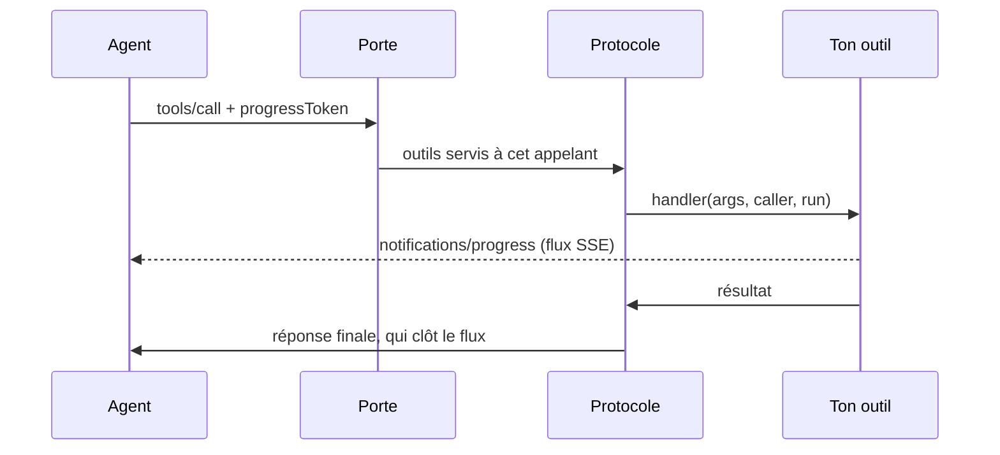

# Boîte à outils MCP — exposer les outils d'une application à un agent

> Un agent d'intelligence artificielle (Claude Code, Cursor, un agent maison) appelle les
> **outils** d'un logiciel par le _Model Context Protocol_. Cette boîte à outils fait de chaque
> module Nodefony un fournisseur d'outils : tu écris une fonction, elle décrit ce qu'elle rend, et
> le protocole — versions, erreurs, autorisation, progression, annulation — est tenu pour toi, une
> fois, selon la norme. Ancrée sur `src/packages/@nodefony/ai/nodefony/mcp/` et `src/nodefony/src/types/IMcpTool.ts`.

📍 [Documentation](../../../../../docs/index.md) › [@nodefony/ai](index.md) › **Boîte à outils MCP**

## 🗺️ Schéma général



Trois étages, trois responsabilités : le **protocole** (ce fichier le décrit), la **porte** (une
route HTTP qui le sert), les **outils** (ce que tes modules déclarent). Le protocole ne sait rien
du transport ; la porte ne sait rien des outils ; un outil ne sait rien des deux.

## 📖 Lexique

| Terme                    | Développé                           | En une ligne                                                                                               |
| ------------------------ | ----------------------------------- | ---------------------------------------------------------------------------------------------------------- |
| **MCP**                  | _Model Context Protocol_            | le protocole par lequel un agent découvre et appelle les outils d'un logiciel                              |
| **JSON-RPC**             | _JSON Remote Procedure Call_        | le format des messages : une requête `{ id, method, params }`, une réponse `{ id, result }` ou `{ error }` |
| **SSE**                  | _Server-Sent Events_                | une réponse HTTP qui reste ouverte et pousse des événements au fil de l'eau, dans un seul sens             |
| **Porte**                | —                                   | la route qui reçoit les messages MCP et les confie au protocole                                            |
| **Outil**                | _tool_                              | une capacité appelable par l'agent : un nom, une description, un schéma d'arguments, une fonction          |
| **Appelant**             | _caller_                            | ce que la porte a ÉTABLI de qui appelle : authentifié ou non, ses scopes, ses rôles                        |
| **Scope**                | —                                   | un droit porté par un jeton OAuth (`admin:read`) ; un outil peut en exiger                                 |
| **Jeton de progression** | `progressToken`                     | l'étiquette que l'agent pose sur sa requête pour recevoir des nouvelles en route                           |
| **Révision**             | _protocol version_                  | la version datée de la norme (`2026-07-28`) que client et serveur négocient                                |
| **RFC 9728**             | _OAuth Protected Resource Metadata_ | le document qui dit à un client quel serveur d'autorisation délivre les jetons de cette porte              |

## Qu'est-ce que MCP — et pourquoi un agent en a besoin

Un agent qui travaille sur ton application a deux façons de la connaître : **lire ses sources**, ou
**lui demander**. Lire les sources donne ce que le code _dit_ ; demander à l'application qui tourne
donne ce qu'elle _fait_ — les routes réellement montées, la configuration effective, la donnée en
base. Un guichet plutôt qu'un plan : le plan peut être périmé, le guichetier ne l'est jamais.

MCP standardise ce guichet. L'agent demande la liste des outils (`tools/list`), lit leur description
— c'est elle qui décide s'il s'en servira — puis en appelle un (`tools/call`) avec des arguments
conformes au schéma publié. La réponse est du contenu (souvent du texte), et un échec métier se dit
dans la réponse (`isError`) plutôt que par une erreur de protocole : « ta demande est recevable,
voici pourquoi elle n'aboutit pas » est une phrase que l'agent sait corriger seul.

## La vision Nodefony

- **Le protocole est une fonction pure.** `handleMcpMessage()` (`server.ts#handleMcpMessage`) reçoit un message
  et rend un statut et un corps : ni socket, ni conteneur, ni horloge. Tout le protocole s'éprouve
  sans serveur, et une seconde porte (HTTP de production, `stdio`) appelle la même fonction.
- **Un outil est un objet ordinaire.** Le contrat `IMcpTool` (`IMcpTool.ts#IMcpTool`) est le même pour
  les outils du framework et pour les tiens : le serveur n'a aucun cas particulier.
- **Rien n'est enregistré au démarrage.** La porte ramasse les outils à chaque requête
  (`collectMcpTools()`, `src/packages/@nodefony/ai/nodefony/mcp/tools.ts#collectMcpTools`) en parcourant les modules : un module ajouté ou rechargé
  apparaît sans cache à invalider. La révision `2026-07-28` a retiré les sessions, et c'est ce qui
  rend ce choix possible : chaque requête porte tout ce qu'il faut pour être servie.
- **L'autorisation se décide à la collecte, une fois.** Un outil réservé est absent de
  `tools/list` ET inappelable en le nommant ; le refus dit « outil inconnu », pas « interdit ».
- **Les règles de la norme vivent dans la boîte à outils, pas dans les outils.** Progression,
  annulation, forme des résultats selon la révision du client, refus normés : un outil n'écrit que
  sa logique, et ne peut pas enfreindre la norme par oubli.

## 🚀 Démarrage rapide

**Ouvrir la porte MCP de ton application** — elle se génère, avec deux outils d'exemple et son
test :

```bash
npx nodefony create controller mcp --kind mcp                  # porte locale : la machine seulement
npx nodefony create controller mcp --kind mcp --expose oauth   # production : jeton exigé (401 sans)
npx nodefony create controller mcp --kind mcp --expose mixte   # outils publics sans jeton, les autres réservés à un scope
```

Tu ajoutes ensuite tes outils à la liste de `nodefony/mcp/mcp-tools.ts` ; la porte
(`nodefony/mcp/mcp-gate.ts`) publie cette liste, et rien d'autre. Chaque outil y porte ses
`annotations` — dit s'il lit ou s'il modifie — et le test généré (`tests/mcp-gate.test.ts`)
refuse celui qui les omet : [Dire ce que fait l'outil](#dire-ce-que-fait-loutil--les-annotations).
Détail des deux expositions : [Monter une porte](#-monter-une-porte).

**Offrir des outils sans ouvrir de porte** — un module les DÉCLARE par `getMcpTools()`, et toute
porte en `tools: "modules"` les ramasse : c'est le cas de la porte de développement de
`@nodefony/devkit`, donc de l'agent de code du développeur. L'exemple ci-dessous expose ainsi deux
outils : une lecture courte, et une opération longue qui signale son avancement et s'arrête si
l'agent abandonne.

```ts
import { Kernel, Module, type IMcpTool } from "nodefony";
import { mcpText } from "@nodefony/ai";

/** Le module « shop » d'une application — il offre deux outils à l'agent. */
export class ShopModule extends Module {
  constructor(kernel: Kernel) {
    super("shop", kernel, import.meta.url, {});
  }

  /** Les outils MCP de ce module — relus à chaque requête de la porte. */
  getMcpTools(): IMcpTool[] {
    return [
      {
        name: "shop_stock",
        description:
          "Stock réel d'une référence produit, lu en base. À utiliser avant " +
          "de proposer une commande — la réponse ne vient pas d'un cache.",
        inputSchema: {
          type: "object",
          properties: { sku: { type: "string", description: "Référence" } },
          required: ["sku"],
        },
        // Lecture dans la base de l'application : rien n'est modifié.
        annotations: { readOnlyHint: true, openWorldHint: false },
        handler: (args) => {
          const sku = typeof args.sku === "string" ? args.sku : "";
          if (sku === "") return mcpText("`sku` est requis", true);
          return mcpText({ sku, available: 12 });
        },
      },
      {
        name: "shop_reindex",
        description:
          "Réindexe le catalogue, lot par lot. Long : signale chaque lot, et " +
          "s'arrête proprement si l'appel est abandonné.",
        inputSchema: { type: "object", properties: {} },
        // Une écriture qui reconstruit l'index sans rien perdre, et que
        // rejouer laisse dans le même état.
        annotations: {
          readOnlyHint: false,
          destructiveHint: false,
          idempotentHint: true,
          openWorldHint: false,
        },
        handler: async (_args, _caller, run) => {
          const lots = 5;
          for (let i = 1; i <= lots; i++) {
            if (run?.signal.aborted) return mcpText("interrompu", true);
            await new Promise((resolve) => setTimeout(resolve, 200));
            run?.progress(i, lots, `lot ${i}/${lots} réindexé`);
          }
          return mcpText(`${lots} lots réindexés`);
        },
      },
    ];
  }
}
```

Ce qu'on observe sur la porte de développement (`@nodefony/devkit`, `POST /nodefony/mcp`) — en
JSON pour la lecture courte, en flux pour l'outil long quand l'agent le demande :

```bash
# Lecture courte : une réponse JSON
curl -sk https://localhost:5152/nodefony/mcp -H 'content-type: application/json' \
  -d '{"jsonrpc":"2.0","id":1,"method":"tools/call","params":{"name":"shop_stock","arguments":{"sku":"A-12"}}}'

# Outil long : jeton de progression + flux accepté → notifications, puis la réponse qui clôt le flux
curl -skN https://localhost:5152/nodefony/mcp -H 'content-type: application/json' \
  -H 'accept: application/json, text/event-stream' \
  -d '{"jsonrpc":"2.0","id":2,"method":"tools/call","params":{"name":"shop_reindex","arguments":{},"_meta":{"progressToken":"r1"}}}'
# data: {"jsonrpc":"2.0","method":"notifications/progress","params":{"progressToken":"r1","progress":1,"total":5,"message":"lot 1/5 réindexé"}}
# …
# data: {"jsonrpc":"2.0","id":2,"result":{"content":[{"type":"text","text":"5 lots réindexés"}]}}
```

Interrompre le second `curl` (Ctrl+C) ferme le flux : `run.signal` est abattu, et l'outil rend la
main au lot suivant.

**Sans jeton de progression, un outil long répond quand même en flux.** Au-delà du délai de grâce
(`MCP_STREAM_GRACE_MS`, 5 s), la porte ouvre le flux sans rien y écrire — le flux bat de lui-même
— et la réponse finale y part. Ce n'est pas une option : la norme (`transports/streamable-http`)
oblige le client à accepter une réponse en flux, et seul un flux ouvert désarme le délai
d'inactivité de la requête (30 s par défaut). Une réponse JSON qui tarde tomberait en `408`, quel
que soit le travail en cours. Un outil qui répond avant le délai de grâce reste en JSON.

## ✍️ Écrire un outil

### Le contrat

| Champ          | Rôle                                                                                                                                                                           |
| -------------- | ------------------------------------------------------------------------------------------------------------------------------------------------------------------------------ |
| `name`         | identifiant d'appel, forme `[a-zA-Z0-9_-]{1,64}` (`NAME_PATTERN`, `src/packages/@nodefony/ai/nodefony/mcp/tools.ts#NAME_PATTERN`) ; préfixe-le par ton module                  |
| `description`  | **le premier critère de déclenchement** : ce que l'outil REND et QUAND s'en servir                                                                                             |
| `inputSchema`  | schéma JSON des arguments ; tout argument non déclaré est REFUSÉ, jamais ignoré                                                                                                |
| `annotations`  | ce que l'outil FAIT (lit ou modifie, efface ou ajoute, sort ou non de l'application) — à poser sur chaque outil : [les annotations](#dire-ce-que-fait-loutil--les-annotations) |
| `scopes`       | scopes OAuth exigés — tous ; absent = outil public                                                                                                                             |
| `requiresAuth` | exige une identité prouvée, sans scope particulier                                                                                                                             |
| `handler`      | `(args, caller, run?) => IMcpToolResult` — synchrone ou promesse                                                                                                               |

Un module écrit en JavaScript n'est contrôlé par aucun compilateur : un champ de mauvaise forme
(`requiresAuth: "oui"`, `scopes: "shop:read"`, `description` absente) fait **écarter l'outil à la
déclaration**, motif dit au journal : elle n'est jamais interprétée. Côté appel, des `arguments` qui ne sont
pas un objet sont refusés en `-32602`.

Trois règles qui évitent les défauts les plus coûteux :

- **Un échec métier se rend en `isError`, jamais en exception.** `mcpText(message, true)`
  (`src/packages/@nodefony/ai/nodefony/mcp/tools.ts#mcpText`). Une exception devient une erreur de protocole (`-32603`), que l'agent lit comme
  « le serveur est cassé » au lieu de « corrige ta demande ». Elle est de plus **opaque** : l'agent
  ne reçoit qu'un message qui nomme l'outil, le message de l'exception part au journal du serveur
  (`ERROR`) — il pourrait porter un chemin ou un secret. `isError` est le seul canal qui parvient à
  l'agent.
- **Un argument non déclaré est refusé.** `unknownArguments()` (`src/packages/@nodefony/ai/nodefony/mcp/tools.ts#unknownArguments`) rend un `isError`
  qui le nomme : un paramètre accepté puis jeté donnerait une réponse qui _a l'air_ d'avoir honoré la
  demande. Un outil qui veut des arguments libres l'écrit (`additionalProperties: true`).
- **Un outil n'invente rien.** Il appelle la brique qui répond déjà à une autre porte (un service,
  le plan d'administration) : un outil qui recalcule sa réponse finit par diverger de la commande
  du même nom.

Un outil écarté à la collecte — nom hors forme, nom déjà pris, handler absent, déclaration qui
lève — le dit en `WARNING` dans le journal du serveur ; les outils intégrés gagnent toute collision.

### Dire ce que fait l'outil — les annotations

Avant d'appeler un outil, l'agent (ou son client) doit décider s'il demande confirmation à
l'humain. La spec lui donne pour cela des **indices de comportement**, les `ToolAnnotations`
(révision `2026-07-28`, `schema/schema.ts` ; `spec/server/tools.mdx`, champ `annotations` de
l'outil). Nodefony les porte dans le contrat (`IMcpToolAnnotations`,
`src/nodefony/src/types/IMcpTool.ts#IMcpToolAnnotations`) et les publie dans `tools/list`.

| Indice            | Ce qu'il promet                                                  | Défaut de la spec | N'a de sens que…            |
| ----------------- | ---------------------------------------------------------------- | ----------------- | --------------------------- |
| `title`           | un titre lisible, préféré au `name` par les interfaces           | —                 | toujours                    |
| `readOnlyHint`    | l'outil ne modifie **rien** de son environnement                 | `false`           | toujours                    |
| `destructiveHint` | une écriture peut **détruire** ; `false` = il ne fait qu'ajouter | `true`            | si `readOnlyHint` = `false` |
| `idempotentHint`  | le rappeler avec les mêmes arguments n'a **aucun effet de plus** | `false`           | si `readOnlyHint` = `false` |
| `openWorldHint`   | il touche un monde **extérieur ouvert** (web, API tierce)        | `true`            | toujours                    |

**Lire les défauts, c'est comprendre pourquoi il faut annoter.** Un outil sans annotation est,
pour la spec, un outil qui **écrit, détruit, et sort de l'application**. Un client prudent demande
alors confirmation pour chaque lecture, ce qui le rend inutilisable ; un client pressé n'en demande
jamais, ce qui le rend dangereux. Deux règles en découlent :

- **un outil qui ne fait que lire le DIT** : `readOnlyHint: true`, et `openWorldHint: false` s'il ne
  quitte pas l'application ;
- **un outil qui modifie le DÉCLARE** : `readOnlyHint: false`, puis `destructiveHint` et
  `idempotentHint` selon ce qu'il fait vraiment (un remboursement : `destructiveHint: false`,
  `idempotentHint: false` — l'appeler deux fois rembourse deux fois).

**Choisir les indices — partir de ce que fait le handler, jamais de son nom.** Une seule question
par indice, posée sur le CODE de l'outil :

| Le handler…                                                  | `readOnlyHint` | `destructiveHint` | `idempotentHint` | `openWorldHint` |
| ------------------------------------------------------------ | -------------- | ----------------- | ---------------- | --------------- |
| lit la base ou un service de l'application, calcule, formate | `true`         | —                 | —                | `false`         |
| lit une API tierce ou le web (météo, cours de bourse)        | `true`         | —                 | —                | `true`          |
| crée une ligne, envoie un courriel, rembourse, met en file   | `false`        | `false`           | `false`          | selon la cible  |
| remplace une valeur par une autre (`set`, `upsert`, `PUT`)   | `false`        | `true`            | `true`           | selon la cible  |
| supprime (`delete`, purge, révocation)                       | `false`        | `true`            | `true`           | selon la cible  |
| reconstruit un dérivé sans perte (index, cache, vue)         | `false`        | `false`           | `true`           | `false`         |

`openWorldHint` vaut `true` dès qu'un appel quitte l'application vers un monde qu'elle ne
maîtrise pas : envoyer un courriel, appeler une API de paiement, publier un message. Une écriture
dans sa propre base reste `false`. Un « — » : l'indice n'a pas de sens pour une lecture, le
client l'ignore ; ne pas le poser.

Les erreurs qui coûtent, de la plus grave à la plus bénigne :

1. **`readOnlyHint: true` sur un outil qui écrit**, même un peu (un compteur de consultation, un
   horodatage « vu le ») : le client exécute sans confirmation ce que l'humain aurait voulu
   valider. C'est un mensonge au client — l'annotation doit décrire le pire de ce que fait le
   handler, pas son intention principale.
2. **`destructiveHint: false` sur un outil qui écrase** : « mettre à jour l'adresse » détruit
   l'ancienne adresse. Remplacer, c'est effacer.
3. **Aucune annotation** : le client tient l'outil pour le pire cas — exactement le problème que
   les annotations résolvent. Le test généré par `nodefony create controller … --kind mcp`
   (`tests/<nom>-gate.test.ts`) refuse un outil sans `readOnlyHint` ni `openWorldHint`, et un
   outil qui écrit sans `destructiveHint` : la question se pose à l'ajout, pas en production.
4. **Recopier les annotations d'un outil voisin** : elles décrivent CE handler. Un outil copié
   puis modifié garde des promesses qui ne sont plus vraies.

Un outil qui change de nature (une lecture qui se met à écrire) change d'annotations dans le même
commit : c'est un changement de comportement que l'agent ne peut voir que par elles.

```ts
const refund: IMcpTool = {
  name: "shop_refund",
  description: "Rembourse une commande du client authentifié.",
  inputSchema: { type: "object", properties: { id: { type: "string" } } },
  scopes: ["shop:billing"],
  annotations: {
    title: "Rembourser une commande",
    readOnlyHint: false,
    destructiveHint: false,
    idempotentHint: false,
    openWorldHint: false,
  },
  handler: (args) => mcpText({ refunded: args.id }),
};
```

Ce que Nodefony fait, et ne fait pas :

- **il ne publie que ce qui est déclaré** (`publishMcpTools`, `src/packages/@nodefony/ai/nodefony/mcp/tools.ts#publishMcpTools`) :
  sans annotation, le champ n'est pas émis et les défauts de la spec s'appliquent. Aucune promesse
  n'est inventée au nom de l'auteur de l'outil ;
- **les sept outils intégrés** (`nodefony_inspect`, `_card`, `_check`, `_symbols`, `_docs`,
  `_admin_list`, `_admin_call`) se publient `readOnlyHint: true`, `openWorldHint: false` : ils lisent
  l'état de l'application et n'en sortent pas — `admin_call` n'atteint que le catalogue de lecture
  du plan d'administration ;
- **un indice n'est JAMAIS une autorisation.** La spec l'impose au client : « clients **MUST**
  consider tool annotations to be untrusted unless they come from trusted servers ». Côté serveur,
  la seule décision reste la collecte : un outil à `scopes` n'est servi qu'à l'appelant qui les
  porte, qu'il soit annoté `readOnlyHint: true` ou non.

### Réserver un outil

```ts
const invoice: IMcpTool = {
  name: "shop_invoice",
  description: "Facture d'une commande du client authentifié.",
  inputSchema: { type: "object", properties: { id: { type: "string" } } },
  scopes: ["shop:billing"],
  annotations: { readOnlyHint: true, openWorldHint: false },
  handler: (args, caller) =>
    mcpText({ id: args.id, owner: caller.subject ?? null }),
};
```

`caller` (`IMcpCaller`, `IMcpTool.ts#IMcpCaller`) porte ce que la porte a **établi** — jamais ce que la
requête prétend : `authenticated`, `scopes`, `roles`, `subject`. Une porte qui n'authentifie personne
rend un appelant anonyme, et un outil à scopes n'y sort jamais : fermé par défaut — à savoir
avant de chercher une panne.

### Agir au nom de l'utilisateur — `actsForUser`

`caller` dit ce que la PORTE a prouvé : un sujet et des scopes. Presque toute logique métier veut
davantage — le COMPTE, ses vrais rôles, et des services qui le voient (« mes commandes », un droit,
une donnée filtrée par propriétaire). Un outil le demande en une ligne :

```ts
import { RequestContext } from "nodefony";

const myOrders: IMcpTool = {
  name: "shop_my_orders",
  description: "Commandes du client au nom duquel l'agent agit.",
  inputSchema: { type: "object", properties: {} },
  annotations: { readOnlyHint: true, openWorldHint: false },
  actsForUser: true, // le compte du propriétaire du jeton, posé AVANT le handler
  scopes: ["shop:read"], // OBLIGATOIRE avec actsForUser — voir ci-dessous
  handler: async () => {
    const user = RequestContext.getAuthenticatedUser(); // le compte, rôles compris
    return mcpText(await orders.listFor(user)); // le service le voit aussi
  },
};
```

Ce que la porte fait pour un tel outil (`gate.ts#runAsAccount`) :

- **Elle retrouve le compte avant le handler**, par le résolveur de l'application
  (`accessAccountResolver`, posé par `@nodefony/security` : compte lié au jeton, actif, non
  verrouillé ; sujet d'un émetteur externe rattaché à son compte). Puis elle exécute le handler
  dans une **requête à lui** : `RequestContext.getAuthenticatedUser()`, tout service appelé et
  `authorization.decide()` y voient ce compte, comme sous une route protégée. Le journal de requête
  nomme qui a agi.
- **Les rôles sont ceux du COMPTE, entiers** — c'est la sémantique d'une zone `jwt` : le jeton ne
  borne pas `ROLE_*`, ses scopes ne mordent que sur les attributs de scope (`@RequireScope`).
  C'est pourquoi **`actsForUser` exige des `scopes`** : sans eux, un jeton étroit d'un compte
  administrateur verrait tout ce que l'administrateur voit. L'outil est refusé au démarrage s'il
  n'en déclare pas.
- **Une identité PROUVÉE, sinon l'outil n'existe pas** : un appelant anonyme, un jeton rejeté servi
  en anonyme, l'opérateur d'une porte non protégée — l'outil reste retenu (absent de `tools/list`,
  « outil inconnu » à l'appel).
- **Fermé à l'échec** : compte introuvable ou verrouillé → `isError` au message uniforme ;
  résolveur absent → `isError` et journal `CRITIC`. Jamais une exécution en anonyme.
- **L'outil meurt avec son jeton** : son `run.signal` s'abat à l'expiration du jeton. Un jeton
  RÉVOQUÉ pendant l'appel n'interrompt pas l'appel en cours — la même fenêtre qu'une socket ouverte.
- **Appel en process** (un agent de l'application, sans porte) : aucune requête n'est ouverte pour
  lui ; l'appelant passe un `caller` authentifié explicite, ou l'outil est retenu.

### Un paramètre qui élargit l'outil — `scopesFor`

Un outil qu'un jeton de LECTURE doit voir peut avoir un paramètre qui fait davantage : agir pour un
autre compte, écrire au lieu de lire. Le mettre dans `scopes` le cacherait à ce jeton. Le scope se
déclare alors à l'APPEL, selon les arguments :

```ts
const report: IMcpTool = {
  name: "shop_report",
  // …
  scopes: ["shop:read"], // pour voir l'outil
  scopesFor: (args) => (args.publish === true ? ["shop:write"] : []), // pour CET appel
  handler: (args) => mcpText(args.publish === true ? publish() : preview()),
};
```

- **Porte protégée** : il manque un scope → `403` et
  `WWW-Authenticate: Bearer error="insufficient_scope", scope="shop:read shop:write"` — TOUS les
  scopes de l'opération en un seul défi, comme la spécification le demande (« Runtime Insufficient
  Scope Errors »). Un client qui sait s'élever redemande un jeton et rejoue ; un client à jeton fixe
  reçoit le message entier, qui nomme le scope à demander. Sans jeton sur une porte mixte : `401`,
  sans code d'erreur.
- **Sans porte protégée, ou en process** : la même règle (`mcpCallScopes`, `tools.ts#mcpCallScopes`)
  rend un résultat `isError`, et le handler ne s'exécute pas.
- **Ces scopes n'entrent pas dans `scopes_supported`** : la spécification veut ce document
  minimal (« the minimal set of scopes necessary for basic functionality »). Un client sans défi en
  demanderait sinon tout, écriture comprise.
- **`scopesFor` est une fonction pure et synchrone.** Elle lève, ou rend autre chose qu'un tableau
  de chaînes : l'appel est refusé, jamais servi sans borne.

### Un outil LONG — progression et annulation

Le troisième paramètre, `run` (`IMcpToolRun`, `IMcpTool.ts#IMcpToolRun`), sert l'outil qui dure :

- **`run.signal`** est abattu quand le client annule : il ferme le flux de la réponse (révision
  courante de MCP), ou envoie `notifications/cancelled` (révision précédente, que le SDK officiel
  emploie encore). Une annulation n'atteint que les appels de l'appelant qui l'envoie — le titulaire
  du jeton, ou à défaut l'adresse distante. Le consulter entre deux étapes, ou le
  passer à ce qu'on attend (`fetch`, une requête de base) ;
- **`run.progress(progress, total?, message?)`** donne signe de vie. Il est sans effet quand
  l'agent n'en a pas demandé, quand la porte ne sait pas tenir de flux, ou une fois l'outil
  terminé : l'outil n'a jamais à s'en soucier.

`run` est optionnel pour l'appelant (un test qui appelle `handler(args, caller)` directement s'en
passe), d'où l'écriture `run?.progress(…)`.

Ce qu'il ne faut PAS chercher : le journal `notifications/message`. La révision `2026-07-28` le
déprécie (« New implementations SHOULD NOT adopt it ») ; ce qu'un outil veut dire en route passe
par le `message` de la progression, et ce qui doit atteindre le **modèle** va dans la réponse
finale — rien ne garantit qu'un client fasse entrer les notifications dans son contexte.

## 🚪 Monter une porte

`@nodefony/ai` ne monte **aucune** route : une porte se **déclare**, par qui en a besoin. La porte
de développement est celle de `@nodefony/devkit` (`DevkitService.mcpGate()`,
`DevkitService.ts#DevkitService.mcpGate`, servie par `McpController.mcp()`, `McpController.ts#McpController.mcp`, `policy: "dev"`).
Une application ouvre la SIENNE — en développement ou en production, selon ses besoins — en deux
temps : la porte se **définit une fois** (`defineMcpGate()`, `gate.ts#defineMcpGate`), puis se **sert** d'une
ligne depuis une action de controller. `npx nodefony create controller <nom> --kind mcp` écrit les
deux, avec ses outils d'exemple et son test ; `--expose` choisit qui peut frapper :

| `--expose`       | Qui passe                                                                                | Ce qui est écrit en plus                                                                                                                                                                                     |
| ---------------- | ---------------------------------------------------------------------------------------- | ------------------------------------------------------------------------------------------------------------------------------------------------------------------------------------------------------------ |
| `local` (défaut) | la machine seulement, sans jeton ; page web → `403`                                      | rien : en production derrière un relais, tout appelant est distant, donc refusé                                                                                                                              |
| `oauth`          | quiconque présente un jeton émis pour la porte                                           | l'émetteur et l'URI publique (`publicBaseUrl`), `allowRemote`, le service qui publie le document RFC 9728 du défi `401`, et l'outil `<nom>_me` qui agit au nom du compte (`actsForUser`, scope `<nom>:read`) |
| `mixte`          | tout le monde pour les outils publics ; un jeton porteur de leurs scopes pour les autres | ce qu'écrit `oauth`, plus `anonymous: true` et `scopes: ["<nom>:write"]` sur l'outil long — le jeton s'émet avec `--scope <nom>:write`                                                                       |

**Une porte publie ce qu'elle CHOISIT** : une liste d'outils importée, comme ci-dessous. `tools:
"modules"` servirait en plus tout outil qu'un module installé déclare, aujourd'hui ou demain — à
réserver à l'outillage, jamais à une porte exposée. Aucune ligne de protocole à écrire :

```ts
import { Controller, route, controller, Body } from "@nodefony/framework";
import { defineMcpGate } from "@nodefony/ai";
import { stockTool, orderTool } from "./tools";

// Définie UNE fois : validée au chargement — une clé mal écrite, une révision
// du protocole inconnue, un outil mal formé arrêtent le démarrage en la nommant.
const shopGate = defineMcpGate({
  name: "shop", // le nom que l'agent voit
  instructions: "Stock et commandes du magasin.", // QUAND l'agent doit s'en servir
  tools: [stockTool, orderTool], // ce que l'agent peut appeler
});

@controller("/api")
class ShopMcpController extends Controller {
  // POST sert le message ; GET et DELETE répondent 405 (verbes retirés par la spec).
  @route("shop-mcp", {
    path: "/mcp",
    requirements: { methods: ["POST", "GET", "DELETE"] },
  })
  mcp(@Body() body: unknown) {
    return shopGate.serve(this, body);
  }
}
```

| Réglage                           | Défaut                                            | Ce qu'il décide                                                                                  |
| --------------------------------- | ------------------------------------------------- | ------------------------------------------------------------------------------------------------ |
| `tools`                           | — (requis)                                        | une liste d'outils, ou `"modules"` pour ceux que déclarent les modules chargés (`getMcpTools()`) |
| `name`, `version`, `instructions` | nom du projet, version de Nodefony, phrase neutre | ce que l'agent lit en arrivant                                                                   |
| `allowRemote`, `allowedOrigins`   | `false`, `[]`                                     | qui peut frapper : la machine locale seulement, aucune page web                                  |
| `authorization`                   | aucune                                            | serveur(s) d'autorisation et URI de la porte : un jeton est alors exigé                          |
| `unprotectedRoles`                | `[]`                                              | rôles accordés SANS jeton — refusé à côté d'une `authorization`                                  |
| `protocol.versions`               | toutes celles du paquet                           | figer les révisions acceptées (porte de production)                                              |
| `cache`                           | `{ ttlMs: 0, scope: "private" }`                  | indices de cache des listes, servis aux clients modernes                                         |
| `enabled`                         | `true`                                            | coupée, la porte répond `404`                                                                    |

⚠️ Figer `protocol.versions` sur la seule révision `2026-07-28` coupe les clients qui parlent encore
l'ancienne forme (`initialize`) — c'est le cas des clients déployés aujourd'hui.

Ce que la mécanique tient pour toi (`gate.respond()`, `gate.ts#IMcpGate.respond`, éprouvable sans serveur) :

- **`checkMcpAccess()`** (`guard.ts#checkMcpAccess`) : un client MCP légitime est un _process_ et n'envoie
  aucun `Origin` ; une page web malveillante en pose toujours un. _Absent_ → on passe, _présent et
  hors allowlist_ → `403`. C'est ce qui referme le DNS rebinding contre un serveur local.
- **Une porte locale refuse un appel RELAYÉ** (`403`) : la requête porte `Forwarded`,
  `X-Forwarded-For`, `X-Real-IP` ou `Via`. Un relais posé sur la même machine (le frontal de
  `proxy:generate`) se connecte depuis le loopback ; sans `trustProxy`, l'adresse vue serait la
  sienne, et la porte servirait Internet sans jeton. La localité ne se prouve pas à travers un
  relais : une porte joignable par un proxy se déclare `allowRemote` et se protège par jeton.
- **`createMcpResponseStream()`** (`stream.ts#createMcpResponseStream`) ouvre le flux SSE au **premier** envoi seulement
  (et seulement si le client l'accepte), enchaîne les envois dans l'ordre, et la réponse finale le
  clôt. Rien envoyé en route → réponse JSON. Pas de reprise (`Last-Event-ID`) : la spec la retire,
  le client rejoue sa requête.
- **L'annulation** est le signal de la requête : fermer le flux de réponse EST l'annulation, que le
  noyau transmet à l'outil — aucun écouteur à ajouter.
- **Une porte non protégée n'accorde AUCUN rôle** (`mcpCallerRoles()`, `caller.ts#mcpCallerRoles`) : ses
  outils réservés (`scopes`) restent retenus. Seule une porte que son PÉRIMÈTRE protège l'élargit,
  et l'écrit (`unprotectedRoles`) — c'est le cas de la porte de développement de devkit.
- **Une porte protégée** (`authorization.authorizationServers`) dérive l'appelant d'un jeton OAuth
  (`authorizeProtectedResource()`, `protectedResource.ts#authorizeProtectedResource`), répond `401` avec
  `resource_metadata` sans jeton, et tire les rôles des scopes. Son document RFC 9728 se publie par
  un service qui expose `publishedProtectedResources()` en rendant `gate.protectedResources()` :
  les scopes publiés sont ceux que le défi exige.
- **Le jeton est jugé par le vérificateur de l'application** (`accessTokenVerifier`, posé par
  `@nodefony/security`), avec l'URI de la porte comme audience. Un jeton que l'application signe
  elle-même (`npx nodefony security:mcp:token --resource <URI de la porte>`) y est **toujours**
  reconnu — sans rien déclarer dans `resourceServer.issuers` — et jugé par les règles de sa zone
  `jwt` : un jeton révoqué, ou celui d'un compte désactivé, est refusé avant son expiration. Les
  neuf contrôles, leur ordre et la réponse de la porte à chaque verdict :
  [Ce que la porte vérifie](../../security/docs/obtenir-un-jeton.md#-ce-que-la-porte-vérifie--un-jeton-de-cette-application-face-à-une-ressource).
- **Mixte — des outils publics ET des outils réservés sur la même porte** :
  `authorization.anonymous: true` sert l'appel SANS jeton avec les seuls outils publics, et un
  outil se réserve par ses `scopes` (absent du catalogue de qui ne les porte pas). Un jeton rejeté
  est alors servi comme un inconnu — jamais mieux —, et le refus part au journal.

### Niveau 2 — de vraies requêtes HTTP au nom d'un compte

`actsForUser` suffit tant que l'outil appelle des services. Un outil qui doit TIRER de vraies
requêtes vers l'application (profiler une page protégée, rejouer un parcours) a besoin d'une
**session** : celle que le pare-feu reconnaît, ouverte par le flux de connexion de l'application,
qui revérifie le compte et écrit l'audit. `defineTicketSessionGate` (`ticketSession.ts#defineTicketSessionGate`)
en est la mécanique, sans route — comme `defineMcpGate` :

```ts
import { defineTicketSessionGate } from "@nodefony/ai";

// Le facteur nomme la connexion dans l'audit (`login.success`, raison « replay »).
export const replayGate = defineTicketSessionGate({ factor: "replay" });

@controller("/api/replay")
class ReplaySessionController extends Controller {
  // Chemin LITTÉRAL : un inventaire des routes doit le voir sans exécuter.
  @route("replay-session", {
    path: "/session",
    requirements: { methods: ["POST"] },
  })
  session() {
    return replayGate.serve(this);
  }
}
```

L'outil émet un ticket (`replayGate.issue(identifiant)`), le présente en boucle locale dans
l'en-tête `x-nodefony-session-ticket`, récupère le cookie de la réponse, tire ses requêtes, puis
détruit la session (`replayGate.close(sessions, ref)`). La réponse se lit par
`readTicketSessionVerdict`, écrit à côté de qui la produit.

- **Le ticket est la garde** : 256 bits d'aléa, usage unique, dix secondes, huit en attente au
  plus, rangé par empreinte — jamais affiché ni journalisé. L'identité est fixée à l'émission : la
  requête de rachat n'en porte aucune, donc n'en choisit aucune.
- **Locale par défaut** (`localOnly: true`) : un appel distant, ou RELAYÉ par un proxy de la même
  machine, est refusé avant que le ticket ne soit consommé — la même règle que la porte MCP
  (`guard.ts#isRelayedRequest`). Une porte distante doit écrire `localOnly: false`.
- **Un refus dit la même chose quelle qu'en soit la cause** (`403`, `TICKET_SESSION_REFUSED`) ;
  `503` quand l'application n'a pas de flux de session (`@nodefony/security` absent).
- **Qui a droit à quel compte n'est PAS décidé ici** : c'est à l'outil. Celui de devkit
  (`nodefony_profile_route`) joue le propriétaire du jeton, ou un autre compte avec `as` — scope
  d'écriture exigé par `scopesFor`, et rôles visés inclus dans ceux du propriétaire (règle
  `rolesWithin`, portée par `@nodefony/security`).

## 📏 Normes appliquées — ce que la boîte à outils tient pour toi

Révision de référence : `2026-07-28` (`MCP_PROTOCOL_VERSION`, `protocol.ts#MCP_PROTOCOL_VERSION`), servie avec les
révisions antérieures que les clients déployés emploient encore (`MCP_SUPPORTED_VERSIONS`,
`protocol.ts#MCP_SUPPORTED_VERSIONS`).

| Exigence de la norme                                                          | Comment elle est tenue                                                                                                                                                            |
| ----------------------------------------------------------------------------- | --------------------------------------------------------------------------------------------------------------------------------------------------------------------------------- |
| une notification acceptée → `202` sans corps                                  | `handleMcpMessage()` rend `{ status: 202, body: null }`                                                                                                                           |
| l'`id` d'une requête est une chaîne ou un entier, jamais `null`               | refus `400` + `-32600` avant tout autre contrôle                                                                                                                                  |
| `params` est un objet nommé                                                   | un tableau → `-32602`, une valeur primitive → `-32600`                                                                                                                            |
| en-tête `MCP-Protocol-Version` ≠ `_meta` → refus                              | `400` + `-32020` (`McpProtocolError`, `protocol.ts#McpProtocolError`) — deux sources de vérité pour une même requête                                                              |
| révision inconnue → refus avec la liste servie                                | `400` + `-32022` et `supported` (`checkProtocolVersion()`, `server.ts#checkProtocolVersion`)                                                                                      |
| `initialize` répond la révision DEMANDÉE quand elle est servie                | `negotiateVersion()` (`server.ts#negotiateVersion`) — annoncer la sienne rendait la porte injoignable                                                                             |
| ère moderne : `resultType` sur chaque résultat                                | `eraResult()` (`server.ts#eraResult`) donne au résultat la forme de l'ère du CLIENT                                                                                               |
| méthode non implémentée → `404` + `-32601`                                    | cas par défaut du protocole                                                                                                                                                       |
| progression : jeton fourni, valeur croissante, cadence bornée, arrêt à la fin | `createProgressReporter()` (`src/packages/@nodefony/ai/nodefony/mcp/progress.ts#createProgressReporter`) ; arrêt dans le `finally` de `tools/call` (`server.ts#handleMcpMessage`) |
| flux : notifications liées à la requête, réponse finale qui le termine        | `createMcpResponseStream()` (`stream.ts#createMcpResponseStream`)                                                                                                                 |
| sur HTTP, fermer le flux = annuler                                            | `run.signal` = le signal de la requête                                                                                                                                            |
| le catalogue peut varier selon l'autorisation, jamais selon la connexion      | collecte à chaque requête, sur les identifiants de CETTE requête                                                                                                                  |

## 🚫 Ce qui n'est pas servi — et pourquoi

| Méthode / capacité                | Réponse                       | Raison                                                                                                                                                                  |
| --------------------------------- | ----------------------------- | ----------------------------------------------------------------------------------------------------------------------------------------------------------------------- |
| `subscriptions/listen`            | `404` + `-32601`, raison dite | le catalogue ne change qu'au rechargement de l'application, qui redémarre son process : le flux casserait au lieu de notifier ; le `tools/list` suivant est à jour      |
| `notifications/message` (journal) | jamais émis                   | déprécié par la révision `2026-07-28`                                                                                                                                   |
| `server/discover`                 | `-32601`                      | servi, il faisait basculer le client dominant sur un fil qu'il n'achève pas (aucun outil enregistré) ; le repli vers `initialize` que prévoit la norme, lui, fonctionne |
| `GET` / `DELETE` sur la porte     | `405` + `Allow: POST`         | flux autonome et fin de session, retirés par la révision `2026-07-28`                                                                                                   |

## 🔐 Sécurité

- **Fermé par défaut.** Appelant anonyme tant que la porte n'authentifie pas ; un outil qui exige
  quoi que ce soit n'est alors ni listé ni appelable.
- **Le catalogue ne se divulgue pas.** Un outil retenu répond « outil inconnu » ; l'annonce
  d'`initialize` dit seulement _combien_ d'outils sont réservés — de quoi faire demander un jeton à
  un agent, sans nommer ce qu'on protège.
- **Un outil lit ce que l'appelant peut lire.** Les outils d'administration intégrés exigent
  `admin:read` et rendent les réponses du plan d'administration, redaction des secrets comprise.
- **En production, le jeton vient d'un serveur d'autorisation EXTERNE** (`authorizationServers`,
  document RFC 9728 publié). `security:mcp:token` est un outil de poste et d'exploitation : qui
  détient `NF_JWT_KEYSET` émet un jeton pour N'IMPORTE QUEL compte — avec `actsForUser`, c'est agir
  en son nom.
- **Avant d'exposer une donnée**, se demander si elle supporterait d'être lue par qui atteint la
  porte. En développement, la porte est bornée par sa garde de transport et par la politique
  `dev` de son module.

## ⚡ Performance & mémoire

- **Rien au démarrage, rien entre deux appels** : aucun registre, aucun cache, aucun état retenu.
- **Une lecture courte ne paie pas le flux** : il n'est ouvert qu'au premier envoi.
- **La progression ne réveille rien par défaut** : sans jeton ou sans flux, le rapporteur est un
  objet partagé qui ne fait rien ; avec, il coûte un appel d'horloge et se tait sous 100 ms
  d'intervalle (`MCP_PROGRESS_MIN_INTERVAL_MS`, `src/packages/@nodefony/ai/nodefony/mcp/progress.ts#MCP_PROGRESS_MIN_INTERVAL_MS`).
- **Aucun écouteur ajouté pour l'annulation** : le signal est celui du contexte, alloué à la
  première lecture et abattu par le noyau.

## ⚠️ Pièges

| Symptôme                                                    | Cause                                                                                                                               | Correction                                                                                                                                        |
| ----------------------------------------------------------- | ----------------------------------------------------------------------------------------------------------------------------------- | ------------------------------------------------------------------------------------------------------------------------------------------------- |
| mon outil n'apparaît pas dans `tools/list`                  | il exige des scopes, et la porte n'authentifie pas — ou son nom est hors forme                                                      | lire le journal : `WARNING` (écarté) ou `DEBUG` (retenu, avec la raison)                                                                          |
| l'agent reçoit « outil inconnu » sur un outil existant      | même cause : un outil retenu est inconnu pour cet appelant, c'est voulu                                                             | présenter un jeton portant les scopes déclarés                                                                                                    |
| aucune notification de progression n'arrive                 | la requête ne porte pas `_meta.progressToken`, ou le client n'accepte pas `text/event-stream`                                       | les deux sont nécessaires ; sans jeton, un outil de plus de 5 s répond quand même en flux, mais sans notifications — c'est le comportement normal |
| un outil long reçoit `408` au bout de 30 s                  | le client n'accepte pas `text/event-stream` : la porte ne peut pas ouvrir de flux, la réponse JSON tombe sous le délai d'inactivité | un client conforme l'accepte toujours ; sinon, borner l'outil sous le délai (`http.timeout`)                                                      |
| la progression s'arrête alors que l'outil avance            | des valeurs qui ne croissent pas, ou plus d'une par 100 ms                                                                          | passer une valeur strictement croissante ; regrouper les étapes rapprochées                                                                       |
| un argument passé « ne fait rien »                          | il n'est pas déclaré dans `inputSchema` — l'appel est refusé en `isError`                                                           | le déclarer, ou `additionalProperties: true` si l'outil prend des arguments libres                                                                |
| un échec métier apparaît comme une panne serveur (`-32603`) | le handler a levé une exception                                                                                                     | rendre `mcpText(message, true)`                                                                                                                   |
| le client demande confirmation pour une simple lecture      | l'outil ne porte pas `annotations` : la spec le tient pour une écriture destructive                                                 | poser `readOnlyHint: true` (et `openWorldHint: false` s'il reste dans l'application)                                                              |
| le client exécute sans confirmation un outil qui écrit      | `readOnlyHint: true` posé sur un handler qui modifie quelque chose                                                                  | `readOnlyHint: false`, puis `destructiveHint` selon ce qu'il efface                                                                               |
| l'outil continue de tourner après l'abandon de l'agent      | il ne consulte pas `run.signal`                                                                                                     | le tester entre deux étapes, ou le passer aux appels qui l'acceptent                                                                              |

## 🧪 Tests & couverture

Trois étages, chacun dans le paquet qui porte ce qu'il éprouve :

- **Sans serveur — `@nodefony/ai` (`npm test`)** : `tests/gate.test.ts` (la porte : définition
  refusée au démarrage, gardes, statuts, appelant, versions par porte, cache, instructions, flux),
  `mcpTools`, `mcpGuard`, `mcpCaller`, `mcpProgress`, `mcpStream` (`tests/*.test.ts`) ;
- **Sans serveur — `@nodefony/devkit` (`npm test`)** : le catalogue `nodefony_*`
  (`tests/mcp.test.ts`, `tests/mcpCatalog.test.ts`), les outils d'administration face à un appelant
  sans droits (`tests/mcpAdminPlane.attack.test.ts`), le document RFC 9728
  (`tests/oauthMetadata.test.ts`) ;
- **Serveur réel — `npm run test:integration`**, lancé par la CI avec le serveur démarré :
  - `@nodefony/ai` `tests/integration/gate-http.test.ts` — la porte témoin d'APPLICATION du
    module `test` (`policy: "dev"`) : requêtes forgées (statuts, codes) et client OFFICIEL
    `@modelcontextprotocol/sdk` (connexion, catalogue, appel, progression SSE) ;
  - `@nodefony/devkit` `tests/integration/mcp-http.test.ts` — la porte de développement : route
    montée, garde `Origin`, autorisation, outils d'un module de l'application, flux SSE et annulation,
    client officiel.

Ces deux suites ne se SAUTENT pas en silence : sans serveur, elles le disent, et en CI leur
rapporteur transforme le saut en échec (« couverture incomplète »).

Chaque garde de la progression et du flux a été vue échouer en la débranchant. Ce qui **n'est pas
couvert** : aucun banc de charge dédié à la porte, et aucun test du flux derrière un proxy inverse
(la tenue d'un flux SSE par un proxy est traitée dans [Server-Sent Events](../../http/docs/sse.md)).
Couverture : `npm run coverage` dans `src/packages/@nodefony/ai`.

## 🔗 Pour aller plus loin

- ⬆️ **Retour au hub** : [@nodefony/ai — vue d'ensemble](index.md) · [Toute la documentation](../../../../../docs/index.md)
- La porte de développement, ses outils intégrés et son autorisation OAuth →
  [devkit](../../devkit/docs/index.md)
- Le flux d'événements serveur sur lequel la porte répond → [Server-Sent Events](../../http/docs/sse.md)
- Le contexte de requête, dont le signal sert l'annulation → [Contexte de requête](../../../../nodefony/docs/request-context.md)
- La norme, hors ligne : skill `nodefony-rfc` (`references/mcp-2026-07-28/`)
