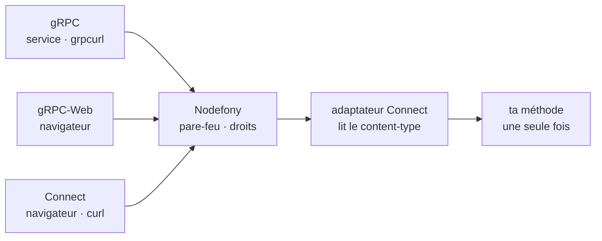

# gRPC — servir un service déclaré par un module

> Un service gRPC se **déclare** comme une route : une classe `GrpcController` marquée
> `@GrpcService(Contrat)`, listée dans `@controllers([...])`. Nodefony le sert sur les ports
> qu'il ouvre déjà, sous le pare-feu et `@IsGranted`, en gRPC, gRPC-Web et Connect à la fois.
> Cette page montre comment écrire le contrat et le contrôleur, puis ce que le framework décide à
> ta place — tailles, échéances, refus, erreurs, arrêt, CORS, journal — et **pourquoi**.
> Surface **expérimentale** : sa forme peut encore changer en version mineure.

📍 [Documentation](../../../../../docs/index.md) › [Framework](index.md) › **gRPC**

## 🧠 Schéma général



Trois protocoles arrivent sur la même route : **gRPC** (un autre service, `grpcurl`, HTTP/2
obligatoire), **gRPC-Web** (un navigateur, qui n'a pas accès aux trailers) et **Connect** (un
navigateur ou `curl`, en JSON ou en binaire). Tu écris ta méthode une fois, elle répond aux trois.

Un appel gRPC traverse **le même pipeline** qu'une requête HTTP ordinaire : une méthode gRPC
**est** une route. Seule la dernière étape change : au lieu d'appeler une action, le contrôleur
remet la requête à l'adaptateur Connect. Celui-ci reconnaît le protocole au `content-type`,
décode le message, appelle ta méthode et écrit la réponse dans le format du client.

## 📖 Lexique

| Terme             | Développé                       | En clair                                                                                                                         |
| ----------------- | ------------------------------- | -------------------------------------------------------------------------------------------------------------------------------- |
| **RPC**           | _Remote Procedure Call_         | appeler une fonction d'un autre programme comme si elle était locale                                                             |
| **gRPC**          | _gRPC Remote Procedure Calls_   | le protocole RPC de la CNCF : messages protobuf sur HTTP/2, statut dans les _trailers_                                           |
| **gRPC-Web**      | —                               | variante de gRPC lisible par un navigateur : statut dans le corps, HTTP/1.1 accepté                                              |
| **Connect**       | protocole Connect               | variante HTTP simple (JSON ou binaire, `curl` suffit) ; aussi le nom de la bibliothèque `@connectrpc/connect` qui sert les trois |
| **protobuf**      | _Protocol Buffers_              | le langage de description des messages et le format binaire qui les encode                                                       |
| **contrat**       | fichier `.proto`                | la liste des services, méthodes et messages ; source unique du client et du serveur                                              |
| **buf**           | outil `buf`                     | compile, vérifie (`lint`, `breaking`) et génère le code d'un contrat                                                             |
| **code généré**   | `*_pb.ts`                       | le TypeScript que `buf generate` tire du contrat : descripteurs et types des messages                                            |
| **unaire**        | _unary_                         | un message envoyé, un message reçu                                                                                               |
| **flux**          | _streaming_                     | plusieurs messages : du serveur, du client, ou des deux (bidirectionnel)                                                         |
| **trailers**      | en-têtes de fin                 | en-têtes envoyés APRÈS le corps ; gRPC y place `grpc-status`                                                                     |
| **Trailers-Only** | —                               | réponse gRPC sans corps, dont les en-têtes portent déjà le statut et la fin du flux                                              |
| **échéance**      | _deadline_                      | délai qu'un client accorde à un appel (en-tête `grpc-timeout`) ; dépassé, statut 4                                               |
| **h2c**           | HTTP/2 _cleartext_              | HTTP/2 sans TLS, pour une passerelle de confiance (port 5153, désactivé par défaut)                                              |
| **ALS**           | `AsyncLocalStorage`             | le contexte de la requête (identité, `requestId`) qui suit le code asynchrone                                                    |
| **CORS**          | _Cross-Origin Resource Sharing_ | ce qu'un navigateur d'une autre origine a le droit d'appeler et de lire                                                          |
| **CSRF**          | _Cross-Site Request Forgery_    | un site tiers fait envoyer une requête par le navigateur de la victime à son insu                                                |
| **OTel**          | OpenTelemetry                   | conventions de nommage des traces et métriques                                                                                   |

## Qu'est-ce que c'est ?

gRPC, c'est **un appel de fonction à travers le réseau, avec un contrat signé des deux côtés**.
Le contrat (`.proto`) dit exactement quelles méthodes existent et quels messages elles prennent ;
un outil en tire le code du client et du serveur, dans n'importe quel langage. Les deux parties ne
peuvent pas se tromper de forme : le compilateur les en empêche.

On le choisit pour trois raisons :

- **entre services** : un contrat typé, un format binaire compact, et des flux dans les deux sens
  sur une seule connexion HTTP/2 ;
- **pour des agents** : A2A (_Agent2Agent_) publie une interface gRPC ;
- **pour des clients hétérogènes** : un service Go, un outil `grpcurl`, un navigateur (par
  gRPC-Web ou Connect) appellent la même méthode.

## La vision Nodefony

**Un service gRPC est un point d'entrée du module, comme une route ou un contrôleur temps réel.**
Trois choix en découlent, chacun avec son pourquoi.

1. **Le pipeline, pas un second serveur.** La bibliothèque de référence `@grpc/grpc-js` ouvre son
   propre serveur : ni pare-feu, ni `@IsGranted`, ni gRPC-Web. Nodefony emploie Connect
   (`@connectrpc/connect-node`, Apache-2.0, aucune dépendance transitive), la seule bibliothèque
   qui fournit une fonction `(requête, réponse)` branchable dans une route. Chaque méthode devient
   une route littérale du Router, et **une seule autorisation** sert HTTP, WebSocket et gRPC
   (`Resolver.ts#Resolver._enforceSecurity`).
2. **Un contrôleur dédié, la logique dans un service.** `GrpcController` est le jumeau de
   `RealtimeController` : le développeur cherche ce qu'un module expose dans `@controllers`, il le
   trouve là. Les gardes se lisent sur la méthode du contrat (`GrpcController.ts#GrpcController.assertScope`).
3. **Le statut se choisit sur l'identité.** Un refus sans identité part en 16
   `UNAUTHENTICATED`, un refus d'un appelant identifié en 7 `PERMISSION_DENIED`, quel que soit le
   statut HTTP. Avec 16, un agent rafraîchit son jeton et se reconnecte ; avec 7, il abandonne
   (`refusal.ts#transportRefusalCode`).

Le compromis assumé : chaque appel paie le pipeline (≈ 24 µs de code Nodefony, mesurés plus bas)
en échange du pare-feu, de l'ALS, des en-têtes de sécurité, du journal et de la trace — les mêmes
que sur toute route. Les décisions et leurs essais sont tracés dans
[ADR-0026](../../../../../docs/adr/0026-service-grpc-declare-par-un-module.md).

## 🚀 Démarrage rapide

Un service `Greet` dans une application générée par `nodefony create app`, appelé par `curl` et
par `grpcurl`.

**1. Les paquets, seulement si tu sers un service gRPC.** Nodefony ne les installe pas et ne les
exige pas : une application sans service gRPC n'en a besoin d'aucun, et rien ne se charge.
Pour servir un service, ajoute le runtime en dépendances (l'installation de production doit
l'avoir) et le générateur en développement :

```bash
npm i @connectrpc/connect @connectrpc/connect-node @bufbuild/protobuf
npm i -D @bufbuild/buf @bufbuild/protoc-gen-es
```

**2. Le contrat**, `proto/greet/v1/greet.proto` à la racine de l'application :

```proto
edition = "2024";

package greet.v1;

service GreetService {
  rpc Greet(GreetRequest) returns (GreetResponse);
}

message GreetRequest {
  string name = 1;
}

message GreetResponse {
  string greeting = 1;
}
```

**3. La génération**, deux fichiers à côté de `proto/` :

```yaml
# buf.yaml
version: v2
modules:
  - path: proto
lint:
  use: [STANDARD]
breaking:
  use: [FILE]
```

```yaml
# buf.gen.yaml
version: v2
inputs:
  - directory: proto
plugins:
  - local: protoc-gen-es
    out: nodefony/gen
    opt: target=ts
```

```bash
npx buf generate   # écrit nodefony/gen/greet/v1/greet_pb.ts — commité, jamais édité
```

**4. Le contrôleur**, `nodefony/controllers/GreetController.ts`. Chaque méthode du contrat est
une méthode de la classe ; une méthode manquante ou mal typée ne compile pas.

<!-- example: GreetController.ts -->

```ts
import { GrpcController, GrpcService } from "@nodefony/framework/grpc";
import type { ContextType } from "@nodefony/http";
import { GreetService } from "../gen/greet/v1/greet_pb";
import type { GreetRequest } from "../gen/greet/v1/greet_pb";

@GrpcService(GreetService)
export class GreetController extends GrpcController {
  constructor(context: ContextType) {
    super("GreetController", context);
  }

  greet(request: GreetRequest) {
    return { greeting: `Bonjour, ${request.name} !` };
  }
}
```

**5. La déclaration**, dans `index.ts` de l'application, à côté des autres contrôleurs :

```ts ignore
import { GreetController } from "./nodefony/controllers/GreetController";

@controllers([HomeController, GreetController])
class App extends Module {
  // …
}
```

**6. Ce qu'on observe**, application démarrée (`npx nodefony development`) :

```bash
# Connect en JSON, HTTP/1.1 — curl suffit
curl -s http://127.0.0.1:5151/greet.v1.GreetService/Greet \
  -H 'content-type: application/json' -d '{"name":"Ada"}'
# → {"greeting":"Bonjour, Ada !"}

# gRPC natif, HTTP/2 + TLS (certificat de développement)
grpcurl -insecure -import-path proto -proto greet/v1/greet.proto \
  -d '{"name":"Ada"}' 127.0.0.1:5152 greet.v1.GreetService/Greet
```

La ligne d'accès nomme l'appel : `POST /greet.v1.GreetService/Greet … RPC : greet.v1.GreetService/Greet`.
Le contrat et le contrôleur de cette page sont les fichiers d'un test du framework, qui monte la
route et appelle la méthode (`grpcQuickstart.test.ts`) : la page ne peut pas dériver du code.

## 🧰 Écrire un service

### Les quatre formes de méthode

La signature vient du code généré ; Nodefony n'y ajoute rien.

```ts ignore
@GrpcService(ChatService)
export class ChatController extends GrpcController {
  // Unaire : un message, une réponse (ou une promesse de réponse).
  send(request: SendRequest, ctx: HandlerContext) {
    return { id: this.chat.post(request.text) };
  }

  // Flux serveur : un générateur asynchrone. Passer ctx.signal aux sources.
  async *follow(request: FollowRequest, ctx: HandlerContext) {
    for await (const message of this.chat.subscribe(request.room, ctx.signal)) {
      yield { text: message };
    }
  }

  // Flux bidirectionnel : on lit pendant qu'on écrit.
  async *converse(requests: AsyncIterable<ConverseRequest>) {
    for await (const request of requests) yield { echo: request.text };
  }
}
```

`ctx` est le `HandlerContext` de Connect : en-têtes reçus (`ctx.requestHeader`), en-têtes et
trailers de réponse, signal d'annulation (`ctx.signal`), échéance du client (`ctx.timeoutMs()`).

### La logique dans un service injecté

Le contrôleur traduit ; le travail vit dans un service, partagé avec les routes HTTP et le temps
réel. L'injection est celle de tout contrôleur.

```ts ignore
@GrpcService(GreetService)
export class GreetController extends GrpcController {
  constructor(
    context: ContextType,
    @Inject("greeter") private readonly greeter: Greeter,
  ) {
    super("GreetController", context);
  }

  greet(request: GreetRequest) {
    return { greeting: this.greeter.greet(request.name) };
  }
}
```

### Protéger une méthode

Les décorateurs de sécurité de toute route s'appliquent, posés sur la méthode du contrat ou sur la
classe. L'identité se lit par `this.user`, comme dans toute action.

```ts ignore
@GrpcService(AccountService)
export class AccountController extends GrpcController {
  @IsGranted("ROLE_ADMIN")
  close(request: CloseRequest) {
    return { closedBy: this.user?.identifier ?? "" };
  }
}
```

Un appel sans jeton reçoit 16, un jeton valide sans le rôle reçoit 7 — section
[Refus et codes](#-refus-et-codes).

### Ce que la déclaration engage

- **Une route par méthode** : `POST /<paquet.Service>/<Méthode>`, plus `GET` pour une méthode
  `option idempotency_level = NO_SIDE_EFFECTS` (le GET de Connect) — `GrpcService.ts#GrpcService`.
  Elles apparaissent dans la liste des routes, le profileur, les hôtes virtuels.
- **Singleton par défaut** : une instance pour tous les appels ; `@Scope("request")` en donne une
  par appel.
- **`@Domain` et `@BypassFirewall`** se placent SOUS `@GrpcService`, lus au montage des routes.
- **Le démarrage refuse**, en nommant la méthode : une classe sans `@GrpcService`, une méthode du
  contrat absente de la classe, un nom réservé par le framework (`serveGrpc`…), un contrat servi par
  deux classes, et un décorateur sans effet en gRPC — `@Body`/`@Param`/`@Query`, schéma de route,
  `@UseSession`, `@Csp`, `@Idempotent`, `@HttpCode`, `@Header`, `@Redirect`
  (`GrpcController.ts#GrpcController.assertScope`). Un décorateur muet laisserait croire à une
  protection qui n'existe pas.

### Où vivent le contrat et le code généré

Une convention, jamais une obligation : Nodefony ne lit aucun de ces fichiers, le contrôleur
importe le code généré par un import ordinaire. Identique dans une application et dans un module.

| Chemin                      | Contenu                         | Pourquoi                                                                                        |
| --------------------------- | ------------------------------- | ----------------------------------------------------------------------------------------------- |
| `proto/<paquet>/v1/*.proto` | le contrat public               | hors du bundler, lisible par les clients d'autres langages                                      |
| `buf.yaml`, `buf.gen.yaml`  | lint, compatibilité, génération | `STANDARD` (dossier = paquet versionné) et `FILE`, la règle de compatibilité la plus stricte    |
| `nodefony/gen/**/*_pb.ts`   | le code généré, **commité**     | Nodefony ne génère rien au build ni au démarrage ; une installation de production n'a pas `buf` |

Pour un contrat neuf, `edition = "2024"` ; `proto3` est accepté. Les types bien connus
(`google/protobuf/*`) viennent de `@bufbuild/protobuf/wkt`, jamais régénérés. Un contrat tiers non
publié sur le registre buf (A2A) se génère depuis son dépôt, version épinglée :
`inputs: - git_repo: …, tag: v1.0.1, subdir: specification`.

## 🔌 Protocoles et ports

**Aucun serveur ni port neuf.** La méthode répond sur chaque serveur actif, avec ce que son HTTP
permet ; le protocole se reconnaît au `content-type`, dans le même gestionnaire.

| Port                  | HTTP            | gRPC | gRPC-Web | Connect |
| --------------------- | --------------- | :--: | :------: | :-----: |
| 5152                  | HTTP/2 + TLS    |  ✅  |    ✅    |   ✅    |
| 5153 (h2c, à activer) | HTTP/2 en clair |  ✅  |    ✅    |   ✅    |
| 5151                  | HTTP/1.1        |  ❌  |    ✅    |   ✅    |

- **gRPC natif exige HTTP/2.** Un client gRPC qui vise 5151 échoue vite et franchement
  (`ERR_HTTP2_ERROR` en une quinzaine de millisecondes, lu 13 `INTERNAL`), jamais à son échéance.
- **h2c n'est jamais ouvert par la déclaration d'un service** : seul `servers.h2c.enabled: true`
  l'allume, et il ne sert que derrière une passerelle de confiance (A2A exige TLS en production) —
  voir [Serveurs](../../http/docs/servers.md).
- **Un service qui ne doit jamais passer en clair** l'exige par le mécanisme de toute route,
  `requirements.scheme`.

**Mettre en situation.**

| Ton besoin                                                      | Ce que tu fais                                         | Ce qui se passe                                 |
| --------------------------------------------------------------- | ------------------------------------------------------ | ----------------------------------------------- |
| Un service Go appelle ton pod derrière un proxy qui termine TLS | `servers.h2c.enabled: true`, le proxy en h2c vers 5153 | gRPC natif servi en clair sur le lien interne   |
| Une page web appelle la même méthode                            | rien                                                   | gRPC-Web ou Connect sur 5151 ou 5152            |
| Interdire gRPC-Web à toute l'application                        | `grpc: { grpcWeb: false }`                             | la méthode ne répond plus qu'en gRPC et Connect |

### Le navigateur ne rouvre pas le CSRF

Un POST Connect exige `application/json` ou `application/proto` (415 sinon) : un formulaire ou un
`text/plain` d'une autre origine est refusé. Un POST JSON d'une autre origine déclenche un
contrôle préalable CORS. Le `GET` n'existe que pour une méthode sans effet de bord. D'où
`requireConnectProtocolHeader: false` par défaut : exiger l'en-tête casserait `curl` et le JSON
écrit à la main sans fermer une faille de plus.

## ⚙️ Configuration

La section `grpc` de la configuration de `@nodefony/http` vaut pour **toute l'application** ; le
grain « par service » s'ajoutera sans rupture s'il trouve un usage (`http/nodefony/config/config.ts#grpcSchema`).

```ts ignore
// nodefony.config.ts
use("@nodefony/http", {
  grpc: { grpcWeb: false, readMaxBytes: 8 * 1024 * 1024 },
});
```

| Clé                            | Type    | Défaut  | Effet                                                      |
| ------------------------------ | ------- | ------- | ---------------------------------------------------------- |
| `grpc`                         | booléen | `true`  | sert gRPC (HTTP/2 seulement)                               |
| `grpcWeb`                      | booléen | `true`  | sert gRPC-Web, sur tous les serveurs                       |
| `connect`                      | booléen | `true`  | sert Connect, `curl` compris                               |
| `readMaxBytes`                 | entier  | 4 Mio   | taille maximale d'un message **reçu**, après décompression |
| `writeMaxBytes`                | entier  | 4 Mio   | taille maximale d'un message **émis**                      |
| `requireConnectProtocolHeader` | booléen | `false` | exige `Connect-Protocol-Version` (400 sans lui)            |

Au moins un protocole doit rester servi : pour n'en servir aucun, ne déclarer aucun service. Une
clé mal orthographiée interrompt le démarrage en la nommant.

## Limites : taille, durée, flux

| Limite                         | Valeur                                     | Au-delà                                     | Pourquoi                                                                                                                   |
| ------------------------------ | ------------------------------------------ | ------------------------------------------- | -------------------------------------------------------------------------------------------------------------------------- |
| message reçu                   | 4 Mio (`readMaxBytes`)                     | 8 `RESOURCE_EXHAUSTED`, méthode non appelée | sans borne, quelques Ko compressés se décompressent en plusieurs Gio ; 4 Mio est la borne des implémentations de référence |
| message émis                   | 4 Mio (`writeMaxBytes`)                    | 8, journalisé chez nous                     | les clients de référence refusent au-delà : l'erreur naît où on la lit                                                     |
| appel unaire                   | `min(échéance du client, responseTimeout)` | 4 `DEADLINE_EXCEEDED`                       | même délai que toute route, au format du protocole                                                                         |
| flux                           | aucune échéance                            | —                                           | un abonnement vit longtemps, comme le veut gRPC                                                                            |
| client de flux qui ne lit plus | 30 s de blocage                            | coupé entre 30 et 45 s                      | sinon un client lent retient la mémoire du serveur                                                                         |

- **`http.maxBodySize` ne borne pas une route gRPC** : son corps est lu en flux par l'adaptateur,
  et seule sa borne par message s'applique.
- **Le délai du serveur n'est pas écrit dans `grpc-timeout`.** `ctx.timeoutMs()` rend l'échéance
  envoyée par le client, et elle seule ; le délai de Nodefony termine l'appel lui-même, même si la
  méthode n'écoute pas son signal (`GrpcCall.ts#GrpcCall.expire`).
- **Un client qui demande plus long n'est pas refusé** : son échéance est rabotée par le délai du
  serveur, jamais rejetée en 3.
- **Un flux** prend une place dans le budget de connexions longues par IP, comme SSE et
  WebSocket, et il est fermé si l'identité qui l'a ouvert est révoquée (16, dans la fenêtre de
  revalidation de 30 s).

## 🔐 Refus et codes

Avant ta méthode, le pipeline refuse dans l'ordre de toute route : provenance CSRF, session, zone
du pare-feu, puis `@IsGranted`. **Le noyau écrit le refus au format du client**, sans construire
l'adaptateur (`refusal.ts#prepareGrpcRefusal`).

| Situation                                                              | Code                  |
| ---------------------------------------------------------------------- | --------------------- |
| refus, aucune identité authentifiée (un anonyme compte comme personne) | 16 `UNAUTHENTICATED`  |
| refus, appelant identifié                                              | 7 `PERMISSION_DENIED` |

- **Pourquoi pas le statut HTTP** : `@IsGranted` répond 403 même sans identité, or la norme gRPC
  interdit `PERMISSION_DENIED` quand l'appelant n'est pas identifié.
- **Le message est le libellé générique du code**, jamais le texte de l'erreur, qui nommait la
  zone refusée. Le détail va au journal, avec le `requestId`.
- **Un client gRPC ne reçoit jamais de redirection** vers une page de connexion : elle exige une
  navigation de navigateur.
- **Un client natif passe le CSRF** : il n'envoie ni `Origin` ni `Sec-Fetch-Site` ; un appel
  d'une autre origine par navigateur est refusé.

### Refus avant ta route : chemin inconnu, débit, hôte

Un refus de **transport** (aucune route, méthode HTTP refusée, débit, hôte) suit la
correspondance normative des statuts HTTP, distincte de celle des erreurs de ton application
(`refusal.ts#transportRefusalCode`) :

| HTTP                    | gRPC                      |
| ----------------------- | ------------------------- |
| 400                     | 13 `INTERNAL`             |
| 401, 403                | 16 ou 7, selon l'identité |
| 404, 405                | 12 `UNIMPLEMENTED`        |
| 421, 429, 502, 503, 504 | 14 `UNAVAILABLE`          |
| autre                   | 2 `UNKNOWN`               |

405 et 421 manquent à la table normative ; Nodefony les ajoute (aucune méthode gRPC à ce chemin ;
réessayer sur une autre connexion). En protocole Connect, le statut HTTP voyage avec la réponse :
le code est alors celui que le client en déduit (405 et 421 → `unknown`), comme la spécification
de Connect le veut.

### La forme écrite, par protocole

| Protocole                          | Statut HTTP                | Corps                                   |
| ---------------------------------- | -------------------------- | --------------------------------------- |
| gRPC (`application/grpc*`)         | 200, _Trailers-Only_       | aucun                                   |
| gRPC-Web (`application/grpc-web*`) | 200, _Trailers-Only_       | aucun                                   |
| Connect unaire                     | celui du refus (401, 403…) | `{"code":"unauthenticated"}`            |
| Connect en flux                    | 200                        | message de fin `{"error":{"code":"…"}}` |

> [!IMPORTANT]
> Un 404 ou un 405 ne lit plus le corps de la requête, pour toute route : un client de flux qui
> attend une réponse avant de finir son envoi (`grpcurl list` sur un chemin inconnu) n'est plus
> bloqué jusqu'à son échéance.

## Erreurs levées pendant un appel

| Ce que ta méthode lève                                | Ce que reçoit le client                                           |
| ----------------------------------------------------- | ----------------------------------------------------------------- |
| `ConnectError`                                        | son code et son message, tels quels                               |
| `HttpError` d'un service partagé avec des routes HTTP | le code de la table ci-dessous                                    |
| toute autre exception                                 | 13 `INTERNAL` ; message en développement, générique en production |

Table des erreurs de l'application, celle de `google/rpc/code.proto`
(`refusal.ts#applicationErrorCode`) :

| HTTP      | gRPC                                                       |
| --------- | ---------------------------------------------------------- |
| 400, 422  | 3 `INVALID_ARGUMENT`                                       |
| 401, 403  | 16 ou 7, selon l'identité                                  |
| 404       | 5 `NOT_FOUND`                                              |
| 409       | 10 `ABORTED` (`ALREADY_EXISTS` : lever une `ConnectError`) |
| 412       | 9 `FAILED_PRECONDITION`                                    |
| 413, 429  | 8 `RESOURCE_EXHAUSTED`                                     |
| 499       | 1 `CANCELLED`                                              |
| 501       | 12 `UNIMPLEMENTED`                                         |
| 502, 503  | 14 `UNAVAILABLE`                                           |
| 408, 504  | 4 `DEADLINE_EXCEEDED`                                      |
| autre 5xx | 13 `INTERNAL`                                              |
| autre     | 2 `UNKNOWN`                                                |

```ts ignore
import { Code, ConnectError } from "@connectrpc/connect";

reserve(request: ReserveRequest) {
  if (this.stock.isEmpty(request.sku)) {
    throw new ConnectError("rupture de stock", Code.FailedPrecondition);
  }
  return this.stock.reserve(request.sku);
}
```

- **Dans un flux serveur ou bidirectionnel, la traduction ne vaut qu'avant le premier message**
  (validation, entité introuvable, droit refusé), là où un service partagé lève. Après, l'erreur
  devient 13 et sa cause part au journal ; pour choisir le code en cours de flux, lever une
  `ConnectError`. Traduire chaque message coûterait une promesse par message pour un travail qui
  ne sert qu'en cas d'erreur (`GrpcEndpoint.ts#FirstMessageTranslator`).
- **Détails riches** (`google.rpc.Status`, `ErrorInfo`) : `ConnectError` les porte (`details`).
  Ils voyagent dans le trailer `grpc-status-details-bin`, que les clients bornent avec les
  en-têtes (8 Kio courants) : les garder petits.

## Arrêt du serveur

À l'arrêt, Nodefony termine les flux avant de vider les connexions, dans cet ordre : sonde de
disponibilité à 503, fermeture 1001 des WebSocket et **fin des flux longs**, puis drain HTTP.

| Ce qui est en vol                    | Ce qui se passe                                                                                    |
| ------------------------------------ | -------------------------------------------------------------------------------------------------- |
| un flux gRPC                         | interrompu en 14 `UNAVAILABLE` (« réessaie, ailleurs ») ; le client rejoue sur un autre exemplaire |
| un appel unaire                      | il finit pendant le drain, comme l'arrêt gracieux de gRPC                                          |
| un appel neuf après l'annonce HTTP/2 | refusé par HTTP/2, le client réessaie                                                              |

- **Passer `ctx.signal` à ses sources** : la méthode est prévenue et termine. Une méthode sourde
  qui produit encore est arrêtée quand même — sa lecture et son écriture suivantes échouent —, au
  plus un message en vol après l'interruption. Une méthode bloquée qui n'écoute rien tombe à
  `shutdownTimeout`, connexion détruite.
- **L'arrêt attend la fin des flux au plus 1 s**, puis le drain commence
  (`http-kernel.ts#HttpKernel.shutdownStreams`).
- **Un appel unaire plus long que le drain** (5 s par défaut) voit sa connexion détruite, et le
  statut lu dépend alors du client : 14 chez `@grpc/grpc-js` et `grpcurl`, 1 `CANCELLED` chez
  `@connectrpc/connect-node`. Une application aux appels longs règle `shutdownTimeout` au-dessus
  de son échéance.

La même liste des flux longs termine aussi SSE et les flux d'octets vivants : une seule
implémentation pour tous (`StreamLifecycle.ts#ShutdownRegistry`).

## 🛡️ CORS — les navigateurs d'une autre origine

**Une seule politique CORS, celle de l'application** : la section `grpc` n'en a pas.

- **Préflight** : dès qu'un service gRPC est déclaré et que CORS est actif, la politique reçoit au
  démarrage l'union de ses listes avec celles de Connect (`grpc-timeout`,
  `connect-protocol-version`, `x-grpc-web`…, méthodes `POST` et `GET`). Le démarrage l'annonce.
  Sans cela, un client gRPC-Web serait refusé au préflight par la liste par défaut.
- **Réponse** : sur une réponse gRPC d'une origine autorisée seulement,
  `Access-Control-Expose-Headers` reçoit `Grpc-Status`, `Grpc-Message`,
  `Grpc-Status-Details-Bin`, `Content-Encoding`, `Connect-Content-Encoding`
  (`GrpcEndpoint.ts#exposeRpcHeaders`) : sans eux, un client gRPC-Web ne lit pas le statut.
- **CSRF** : une origine autorisée par CORS passe ; une autre est refusée en gRPC.

Voir [CORS](../../security/docs/cors.md) pour la politique elle-même.

## 📡 Observabilité

Un appel gRPC se lit dans les journaux comme une requête, avec son code gRPC en plus.

- **Ligne d'accès** : le statut HTTP reste celui du fil, et la ligne ajoute
  `RPC : <paquet.Service/Méthode> <NOM_DU_CODE>` (le nom est omis pour `OK`). Un appel en erreur
  fait **une** ligne, comme une exception de route HTTP ; la cause y figure.
- **Gravité**, convention OTel du serveur gRPC : 0 → INFO ; 2, 4, 12, 13, 14, 15 → ERROR ; les
  autres → WARNING.
- **Le code se lit une fois, à la fermeture de la réponse** (`http-kernel.ts#HttpKernel.settleRpc`).
  Une réponse non terminée parce que le client est parti se lit 1 `CANCELLED`, le même fait que
  le statut 499.
- **`HttpContext.rpc`** porte l'appel : système (`grpc`, `grpc-web`, `connect`), méthode, code,
  nom ; `null` hors RPC. Le journal d'audit JSON et le canal de traçage `nodefony.http.request`
  (`IRequestTrace.rpc`) reçoivent le même champ.
- **`traceparent`** se propage sans rien de plus : les métadonnées gRPC sont des en-têtes HTTP.
- **Rien par message** : ni trace ni ligne, comme pour les trames WebSocket.

Pour une extension OpenTelemetry, la correspondance :

| Attribut OTel              | Source                                     |
| -------------------------- | ------------------------------------------ |
| nom du span                | `rpc.method`                               |
| `rpc.system.name`          | `grpc` (convention stable) ou `connectrpc` |
| `rpc.method`               | `HttpContext.rpc.method`                   |
| `rpc.status_code`          | le nom du code                             |
| `rpc.server.call.duration` | `durationMs / 1000`                        |

## Interopérabilité

Éprouvée contre les clients que l'écosystème emploie, en intégration continue :

- **`@grpc/grpc-js`** (le client du SDK A2A JavaScript) et **`grpcurl`** (bâti sur grpc-go) :
  unaire en h2c et en TLS, flux bidirectionnel entrelacé, erreur métier, échéance, métadonnées
  texte et binaires (`-bin`), compression gzip, requête de 5 Mio, battements HTTP/2 ;
- **la suite de conformité officielle de Connect**, ≈ 4 900 cas sur les trois protocoles ;
- **les trois transports de connect-es** (gRPC, gRPC-Web, Connect).

Deux comportements du serveur viennent de ces essais :

- **un refus gRPC natif finit sur la trame d'en-têtes** : les clients de la famille grpc-go lisent
  `INTERNAL` quand la fin du flux arrive dans une trame de données ;
- **un refus HTTP/2 attend un aller-retour avant de couper le flux** d'un client qui émet encore
  (un `PING`, RFC 9113 §6.7) : Node répond avant d'avoir lu les trames déjà en route, et une coupe
  immédiate frappait des clients qui finissaient d'émettre (`http2StreamGrace.ts#closeStreamAfterGrace`).

Une requête gRPC native qui aboutit à une route **qui n'est pas gRPC** (une page unique en
attrape-tout, par exemple) reçoit 12 `UNIMPLEMENTED`, jamais la page.

## Installation, chargement et stabilité

- **Pairs facultatifs** : `@nodefony/http` déclare les trois paquets, `@nodefony/framework`
  protobuf et Connect, tous en `peerDependencies` facultatives (`^2.3.0` pour Connect, `^2.7.0`
  pour protobuf). L'application qui sert un service les déclare dans ses `dependencies`.
- **Deux sous-chemins** : `@nodefony/framework/grpc` (ce que tu importes) et `@nodefony/http/grpc`
  (le transport). Le point d'entrée principal de chaque paquet ne cite ni Connect ni protobuf,
  même en type : une application sans gRPC compile sans eux.
- **Chargement au démarrage, si un service est déclaré** : 171 ms et 6,6 Mo de tas, une fois par
  processus. Un paquet manquant se voit au déploiement, et le message nomme `npm i <paquet>`.
- **Surface `@experimental`** : `GrpcController`, `@GrpcService` et le transport portent
  l'étiquette TSDoc, visible au survol dans l'éditeur. Ils peuvent changer en version mineure,
  toujours annoncés au changelog ; la liste fait foi dans la
  [politique de compatibilité](../../../../../docs/guides/compatibilite.md).

## ⚡ Performance & mémoire

Mesuré sur secteur, serveur de production, HTTP/2 + TLS, service d'écho de 16 octets (le pire
cas : aucun travail métier), contre l'adaptateur Connect nu sur `http2.createSecureServer`,
médiane de 7 passes en camps alternés (`grpc-unary-overhead.mjs`, skill `nodefony-load-test`) :

| Mesure                                  | Valeur                                                                                 |
| --------------------------------------- | -------------------------------------------------------------------------------------- |
| surcoût du pipeline par appel unaire    | ≈ 84 µs en charge, ≈ 129 µs en série                                                   |
| dont code Nodefony (profil comparé)     | ≈ 24 µs : contexte et ALS, pare-feu, routage, ligne d'accès, en-têtes, code au `close` |
| refus gRPC face au 401 JSON, même route | dans le bruit (×0,93 à ×0,95)                                                          |
| un refus face à un appel servi          | moins de la moitié du coût                                                             |

- **Par message d'un flux** : la relecture de l'interruption, ≈ 34 ns ; aucune allocation de plus.
- **Par appel unaire** : l'échéance réutilise le minuteur que toute requête arme déjà (≈ 24 ns
  pour accrocher la fiche d'appel) ; aucun écouteur par appel à l'arrêt (le registre des flux
  coûte 44 à 77 ns par flux, constant jusqu'à 10 000 flux ouverts).
- **Sans service gRPC** : rien d'installé, rien de chargé, un champ `rpc` `null` par contexte.

## 📜 Normes appliquées

| Norme                                   | Ce qu'elle exige                                                                          | Où Nodefony s'y conforme                                                                                       |
| --------------------------------------- | ----------------------------------------------------------------------------------------- | -------------------------------------------------------------------------------------------------------------- |
| gRPC sur HTTP/2 (`PROTOCOL-HTTP2`)      | `:path` = `/Service/Méthode`, statut en trailers, Trailers-Only pour une erreur immédiate | une route par méthode (`GrpcService.ts#GrpcService`), refus en Trailers-Only (`refusal.ts#prepareGrpcRefusal`) |
| gRPC-Web (`PROTOCOL-WEB`)               | statut dans un cadre de trailers du corps                                                 | écrit par l'adaptateur ; refus en Trailers-Only                                                                |
| Protocole Connect                       | GET pour `NO_SIDE_EFFECTS` seulement ; code d'erreur textuel ; code déduit du statut HTTP | route GET conditionnelle ; `refusal.ts#connectRefusalCode`                                                     |
| Codes de statut gRPC (`statuscodes.md`) | `PERMISSION_DENIED` interdit sans identité                                                | choix 16 ou 7 sur l'identité (`refusal.ts#transportRefusalCode`)                                               |
| Correspondance HTTP → gRPC              | 404 → 12, 429/503 → 14…                                                                   | `refusal.ts#transportRefusalCode`                                                                              |
| `google/rpc/code.proto`                 | table HTTP des erreurs d'application                                                      | `refusal.ts#applicationErrorCode`                                                                              |
| RFC 9113 §6.7 et §8.1                   | `PING` prioritaire ; le serveur PEUT couper un flux après une réponse complète            | grâce d'un aller-retour (`http2StreamGrace.ts#closeStreamAfterGrace`)                                          |
| OpenTelemetry, conventions RPC          | `rpc.method`, `rpc.status_code`, gravité du serveur                                       | `HttpContext.rpc`, gravité de la ligne d'accès                                                                 |

## ⚠️ Pièges (symptôme → cause → correction)

| Symptôme                                                      | Cause                                                                           | Correction                                                              |
| ------------------------------------------------------------- | ------------------------------------------------------------------------------- | ----------------------------------------------------------------------- |
| Le démarrage s'arrête : « … sans effet sur un appel gRPC »    | un décorateur HTTP (`@Body`, `@UseSession`, `@Csp`…) sur une méthode du contrat | le retirer ; un paramètre gRPC est le message, pas la requête HTTP      |
| `Cannot find package '@connectrpc/connect-node'` au démarrage | pair facultatif non installé                                                    | `npm i @connectrpc/connect @connectrpc/connect-node @bufbuild/protobuf` |
| Le client gRPC échoue tout de suite en `INTERNAL`             | il vise 5151 (HTTP/1.1)                                                         | 5152 en TLS, ou 5153 avec h2c activé                                    |
| Un client d'agent abandonne au lieu de se reconnecter         | il a reçu 7 alors que son jeton a expiré                                        | ne pas réécrire le code : Nodefony rend 16 sans identité                |
| Le flux finit en 13 au lieu du code voulu                     | erreur levée APRÈS le premier message                                           | lever une `ConnectError` avec le code choisi                            |
| La méthode tourne encore après l'arrêt ou la révocation       | elle n'écoute pas `ctx.signal`                                                  | passer `ctx.signal` aux sources (base, abonnement, `fetch`)             |
| Le client gRPC-Web voit `UNKNOWN` sans statut                 | réponse d'une origine non autorisée par CORS                                    | autoriser l'origine : l'exposition des en-têtes gRPC suit               |
| Le JSON d'un `google.protobuf.Any` est refusé en 3            | le type emballé est hors du graphe d'imports du contrat                         | importer son `.proto` dans le contrat ; en binaire il passe             |
| Le client lit 4 alors que le serveur journalise 1             | échéance du client et délai du serveur expirent au même instant                 | course sans gravité : les deux disent « trop long »                     |
| `nodefony/gen/` diffère de ce que génère `buf`                | contrat modifié sans régénérer, ou version de `protoc-gen-es` changée           | `npx buf generate` et commiter                                          |

## 🧪 Tests & couverture

Les **chiffres exacts vivent dans la carte de tests** de la page, régénérée depuis les fichiers,
jamais figée dans le texte.

- **unitaires** — `framework/…/unit/grpcService.test.ts` (déclaration, refus au démarrage, routes
  montées, gardes lues sur la méthode du contrat) et `grpcService.types.test.ts` (une méthode
  manquante ou mal typée ne compile pas) ; `http/…/unit/grpcEndpoint.test.ts` (échéance, erreurs
  avant et après le premier message, interruption, code au `close`), `grpcRefusal.test.ts` (les
  deux tables, les formes par protocole), `grpcCors.test.ts` (la copie des listes CORS comparée à
  celle de Connect).
- **intégration** (serveur réel, trois protocoles, trois ports) — `grpc.test.ts` (appels,
  singleton, GET), `grpc-refusal.test.ts` (16/7, CSRF, aucun refus en HTML ni en JSON, corps non
  lus), `grpc-streams.test.ts` (flux longs, client qui ne lit plus), `grpc-context.test.ts` (ALS au
  cinquième message, en-têtes du pipeline, révocation en 16), `grpc-cors.test.ts`,
  `grpc-observability.test.ts` (ligne d'accès, trace, gravité), `grpc-interop.test.ts`
  (`@grpc/grpc-js` et `grpcurl`).
- **conformité** — `npm run test:grpc-conformance` : la suite officielle de Connect contre le
  serveur de développement démarré.
- **charge** — `grpc-unary-overhead.mjs` (surcoût par appel, débit des refus), skill
  `nodefony-load-test`. **Ce qui manque** : un banc de débit d'un flux serveur face à la socket
  binaire, à charge utile égale.

Couverture : `npm run coverage` dans `@nodefony/framework` et `@nodefony/http`.

## 🔗 Pour aller plus loin

- ⬆️ **Retour au hub** : [Framework — vue d'ensemble](index.md) · [Toute la documentation](../../../../../docs/index.md)
- 🧭 **Pages sœurs** : [Contrôleurs](controller.md) (cycle de vie, injection) · [Décorateurs](decorateurs.md) (`@IsGranted`, `@Scope`) · [Routage](routing.md) (hôtes virtuels, ordre)
- Ports, TLS, h2c et proxy inverse → [Serveurs](../../http/docs/servers.md)
- Qui authentifie avant ta méthode → [Firewall](../../security/docs/firewall.md) · [CORS](../../security/docs/cors.md)
- Les décisions et leurs essais → [ADR-0026](../../../../../docs/adr/0026-service-grpc-declare-par-un-module.md)
- Ce qu'« expérimental » engage → [Politique de compatibilité](../../../../../docs/guides/compatibilite.md)
- Signatures exactes → graphe symbolique `.ai/symbols.json`
