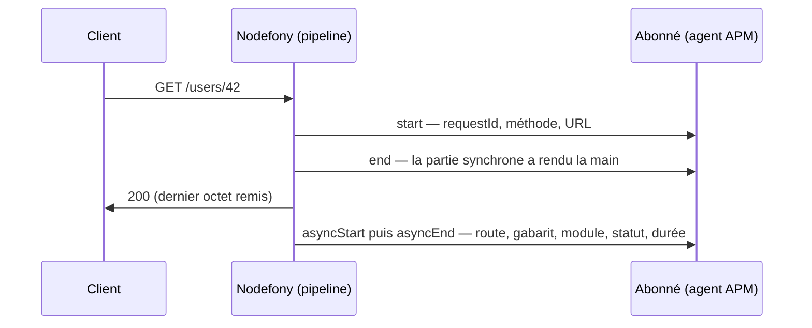
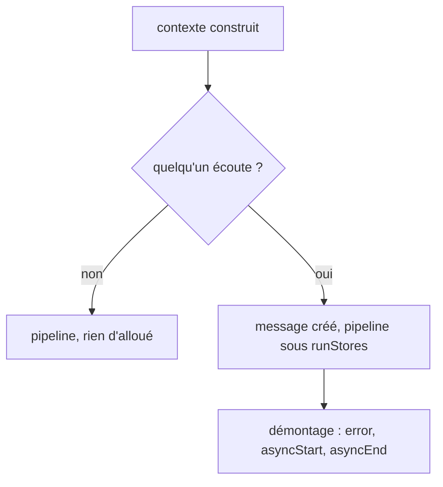

# Canal de diagnostic — le cycle de chaque requête publié sur `diagnostics_channel`

> Nodefony **annonce** le début et la fin de chaque requête HTTP et de chaque handshake WebSocket
> sur un canal natif de Node, `nodefony.http.request`. Un outil d'observation installé dans le même
> process — OpenTelemetry, Datadog, Sentry, ou votre propre code — s'y abonne et reçoit, sans
> monkey-patch, ce que Nodefony est seul à connaître : la **route** qui a répondu, son **gabarit**,
> le **module** signataire, le `requestId`, le statut réel et la durée. Personne n'écoute ? Le canal
> coûte une lecture de booléen par requête, et rien n'est alloué.

📍 [Documentation](../../../../../docs/index.md) › [@nodefony/http](index.md) › **Canal de diagnostic**

## Schéma général



Le **même objet** voyage de `start` à `asyncEnd` : l'abonné y lit à la fin ce qui n'était pas
encore connu au début.

## Lexique

| Terme                     | Sens                                                                                                                                                      |
| ------------------------- | --------------------------------------------------------------------------------------------------------------------------------------------------------- |
| `diagnostics_channel`     | Module natif de Node (`node:diagnostics_channel`) : un bus de publication NOMMÉ, interne au process, fait pour que des outils observent une bibliothèque. |
| Canal                     | Un nom (`tracing:nodefony.http.request:start`) ; publieur et abonné le retrouvent par ce nom, sans s'importer l'un l'autre.                               |
| `TracingChannel`          | La forme « trace » du bus : cinq sous-canaux (`start`, `end`, `asyncStart`, `asyncEnd`, `error`) qui encadrent UNE opération, avec un objet partagé.      |
| `runStores` / `bindStore` | Un abonné lie un `AsyncLocalStorage` au canal (`bindStore`) ; le publieur entre dans ce store pour la durée de l'opération (`runStores`).                 |
| APM                       | _Application Performance Monitoring_ : agent (Datadog, New Relic, Elastic…) qui mesure et trace une application en production.                            |
| OTel                      | _OpenTelemetry_ : standard ouvert de traces, métriques et journaux, et ses conventions de nommage d'attributs (« semconv »).                              |
| Span                      | Une opération chronométrée d'une trace distribuée — ici, une requête serveur.                                                                             |
| Gabarit de route          | Le chemin déclaré (`/users/{id}`), pas l'URL reçue (`/users/42`) : faible cardinalité, donc agrégeable. C'est l'attribut `http.route` d'OTel.             |
| `requestId`               | Identifiant de corrélation de la requête (`X-Request-Id`), voir [Observabilité HTTP](observabilite.md).                                                   |

## Qu'est-ce que c'est ?

Un **haut-parleur interne au process**. Nodefony annonce « une requête commence », puis « elle est
finie, voici son bilan ». Quiconque s'est mis à l'écoute de ce canal, dans le même process, reçoit
l'annonce — immédiatement, sur le même fil, avec le même objet : pas de copie, pas de réseau, pas
de fichier. Rien ne sort du process par lui-même : c'est l'abonné qui décide d'exporter, avec son
propre transport (OTLP vers un collecteur, agent Datadog, Sentry).

Le problème qu'il résout : sans lui, un outil de traçage ne voit d'une application Nodefony que ce
que `node:http` publie — une requête brute, sans route, sans module, sans `requestId`. Pour en savoir
plus, il devrait patcher les classes du framework à l'exécution, ce qui casse à chaque version.
Node publie bien ses propres canaux serveur (`http.server.request.start`,
`http.server.response.finish`), mais ils ne portent que la requête et la réponse brutes : ce que
Nodefony a décidé — quelle route, quel module, quel statut réel derrière un proxy — n'y figure pas.

## La vision Nodefony

- **Un contrat, pas un crochet** : le canal et la forme de son message (`IRequestTrace`) sont une
  API publique de `@nodefony/http`. Un plugin d'APM s'écrit contre eux, et non contre l'intérieur du
  pipeline. C'est un contrat neuf : les agents existants ne le lisent pas d'office, un plugin doit
  le consommer (comme Fastify publie `tracing:fastify.request.handler` pour les siens).
- **Zéro coût sans abonné** : la garde (`requestTrace.ts#hasRequestTraceSubscribers`) est lue UNE
  fois, au début de la requête. Faux → aucun message n'est construit, la fin ne lit qu'un champ
  `null` (`Context.ts#Context.requestTrace`). Pas d'option de configuration : « éteint » veut dire
  « personne n'écoute ».
- **Une seule horloge** : la durée publiée est celle de la ligne d'accès (`Context.ts#Context.stopClock`),
  jamais une mesure propre au canal.
- **La séquence de Node, à la main** : `start` sous `runStores` à l'entrée, `end` quand la partie
  synchrone rend la main (`requestTrace.ts#runTraced`), puis `error`, `asyncStart` et `asyncEnd` au
  démontage, quand le dernier octet est remis (`requestTrace.ts#closeRequestTrace`). C'est l'ordre
  de `TracingChannel.tracePromise`, que les abonnés génériques attendent ; la publication est
  manuelle parce que la fin d'une requête arrive sur l'événement `close` de la réponse, hors de
  toute fonction qu'on pourrait envelopper.
- **Les stores des abonnés sont honorés** : un agent qui lie son `AsyncLocalStorage` au canal
  (`bindStore`) voit son contexte actif pendant tout le traitement — les requêtes SQL et les appels
  sortants d'une route deviennent des enfants de son span.

## Démarrage rapide

Un abonné de dix lignes, dans un fichier chargé AVANT l'application — c'est ainsi que se chargent
les agents d'APM :

```ts
// tracing.ts — chargé par `--import`, avant l'application
import diagnosticsChannel from "node:diagnostics_channel";
import { REQUEST_TRACE_CHANNEL } from "@nodefony/http";
import type { IRequestTrace } from "@nodefony/http";

const channel = diagnosticsChannel.tracingChannel<IRequestTrace>(
  REQUEST_TRACE_CHANNEL,
);

channel.subscribe({
  start: () => {},
  end: () => {},
  asyncStart: () => {},
  asyncEnd: (trace) => {
    console.log(
      `${trace.requestId} ${trace.method} ${trace.routePath ?? "-"} → ${trace.statusCode} en ${trace.durationMs?.toFixed(3)} ms (${trace.module})`,
    );
  },
  error: (trace) => {
    console.error(trace.requestId, trace.error);
  },
});
```

On le charge par `NODE_OPTIONS`, que les process lancés par la commande de développement héritent :

```bash
NODE_OPTIONS="--import ./tracing.ts" npx nodefony development
curl -k https://127.0.0.1:5152/
```

Ce qu'on observe, une ligne par requête servie — ici la page d'accueil d'une application générée :

```text
6f1c…-9e2a GET / → 200 en 3.528 ms (app)
```

Importer `REQUEST_TRACE_CHANNEL` plutôt que recopier la chaîne : le nom vit en un seul endroit.

## Le message — `IRequestTrace`

Déclaré dans `IRequestTrace.ts#IRequestTrace`, exporté par `@nodefony/http`. Tout est en lecture
seule pour l'abonné.

| Champ        | Posé à  | Contenu                                                                                                                  |
| ------------ | ------- | ------------------------------------------------------------------------------------------------------------------------ |
| `requestId`  | `start` | identifiant de corrélation (celui de `X-Request-Id` entrant, sinon généré)                                               |
| `protocol`   | `start` | `"http"` pour une requête, `"websocket"` pour un handshake                                                               |
| `method`     | `start` | méthode de la requête (`"WEBSOCKET"` pour un handshake)                                                                  |
| `scheme`     | `start` | `http`, `https`, `ws`, `wss` — tel que vu par le client, proxy de confiance compris                                      |
| `url`        | `start` | URL complète, **chaîne de requête comprise**                                                                             |
| `route`      | fin     | nom de la route qui a répondu, `null` sans route (fichier statique, 404)                                                 |
| `routePath`  | fin     | gabarit de la route, préfixe compris (`/users/{id}`) ; la racine vaut `/` ; `null` sans route                            |
| `module`     | fin     | module qui a signé la réponse — le même que celui de la ligne d'accès                                                    |
| `statusCode` | fin     | statut rendu : celui de l'amont pour une requête relayée, `101` pour un handshake accepté, `null` si le client est parti |
| `durationMs` | fin     | construction du contexte → dernier octet remis (fin du handshake en WebSocket) ; `null` si `timing.enabled: false`       |
| `error`      | `error` | l'exception attrapée par le pipeline, `null` sinon                                                                       |

Les champs « fin » valent `null` à `start` et `end` : c'est normal, la route et le statut ne sont
pas encore connus. On les lit sur `asyncEnd`.

### Correspondance avec OpenTelemetry

Pour qui écrit un plugin OTel, la table des attributs du span serveur (conventions sémantiques HTTP) :

| Attribut OTel                  | Champ                                                          |
| ------------------------------ | -------------------------------------------------------------- |
| `http.request.method`          | `method`                                                       |
| `url.scheme`                   | `scheme`                                                       |
| `url.path` / `url.query`       | découpés de `url` par l'abonné (`new URL(trace.url)`)          |
| `http.route`                   | `routePath` — jamais `route`, qui est un nom et pas un gabarit |
| `http.response.status_code`    | `statusCode`                                                   |
| `error.type`                   | dérivé de `error` (nom de la classe d'erreur)                  |
| `http.server.request.duration` | `durationMs / 1000` (la métrique OTel est en secondes)         |

Un **4xx sans exception** ne publie pas `error` : pour un span serveur, OTel demande de laisser le
statut d'un 4xx non renseigné. C'est à l'abonné de classer un statut ; `statusCode` est là pour ça.

## La séquence, sortie par sortie

| Situation                               | Événements publiés                                    | `statusCode`         |
| --------------------------------------- | ----------------------------------------------------- | -------------------- |
| HTTP servi                              | `start` · `end` · `asyncStart` · `asyncEnd`           | statut de la réponse |
| HTTP dont le pipeline lève              | `start` · `end` · `error` · `asyncStart` · `asyncEnd` | statut de l'erreur   |
| Handshake WebSocket accepté             | `start` · `end` · `asyncStart` · `asyncEnd`           | `101`                |
| Handshake refusé (origine, pare-feu, …) | `start` · `end` · `error` · `asyncStart` · `asyncEnd` | statut du refus      |
| Client parti pendant la décision        | `start` · `end` · `asyncStart` · `asyncEnd`           | `null`               |

La trace d'un WebSocket couvre le **handshake**, pas la vie de la connexion : elle se ferme au
`101`. Les messages qui suivent ne sont pas publiés sur ce canal.

## Architecture interne



- **Entrée HTTP** — `http-kernel.ts#HttpKernel.handleHttp` : juste après la construction du
  contexte, la garde ; avec abonné, le message est créé (`requestTrace.ts#openRequestTrace`, seule
  allocation du canal) et le pipeline tourne sous `start.runStores`
  (`http-kernel.ts#HttpKernel.dispatchHttpContext`).
- **Fin HTTP** — `http-kernel.ts#HttpKernel.teardownHttp`, sur l'événement `close` de la réponse,
  APRÈS la ligne d'accès : celle-ci a déjà recopié le statut de l'amont d'une requête relayée
  (`HttpContext.ts#HttpContext.logRequest`).
- **Handshake WebSocket** — `http-kernel.ts#HttpKernel.handleWebsocket` ouvre la trace ; elle se
  ferme à l'acceptation (`WebsocketContext.ts#WebsocketContext.connect`, au même point que la ligne
  d'accès), au refus (`WebsocketContext.ts#WebsocketContext.refuseHandshake`, seul endroit où le
  statut du refus est connu), ou en échec (`http-kernel.ts#HttpKernel.closeFailedWebsocketTrace`).
- **Idempotence** — `closeRequestTrace` remet `Context.requestTrace` à `null` avant de publier : un
  handshake a plusieurs sorties, la première ferme la trace, les suivantes ne font rien.

## Configuration

Aucune, à dessein. Lire un réglage à chaque requête coûterait autant que lire la garde elle-même,
pour un résultat identique : sans abonné, rien n'est publié. Pour couper le canal, on ne s'y abonne
pas — ou on se désabonne (`channel.unsubscribe(subscribers)`).

## Normes appliquées

- **Documentation de `node:diagnostics_channel`** — nommage des canaux de trace en
  `tracing:module.function:start` (d'où `nodefony.http.request`) ; et la règle « les événements ne
  sont publiés que si l'abonné était présent **avant le début** de la trace » : un abonné qui arrive
  en cours de requête ne reçoit rien de cette requête, pas même sa fin.
- **Conventions sémantiques HTTP d'OpenTelemetry** — `http.route` exige un gabarit de faible
  cardinalité, d'où `routePath` ; la durée de `http.server.request.duration` doit égaler celle du
  span serveur, d'où une seule horloge.

## Sécurité

- **L'URL complète part chez l'abonné, chaîne de requête comprise** — un jeton passé en `?token=`
  y figure. L'abonné est du code que l'exploitant a choisi d'installer, et les canaux natifs de
  `node:http` exposent déjà la requête entière ; mais un agent qui EXPORTE l'URL doit en retirer les
  paramètres sensibles. Préférer `routePath` pour nommer une opération.
- **Une exception levée par un abonné fait tomber le process** : Node la relance par
  `process.nextTick` en exception non capturée, hors de la pile de Nodefony. Un abonné se protège
  lui-même (`try`/`catch`).
- **Un abonné lent ralentit chaque requête** : il est appelé de façon synchrone, sur le fil du
  serveur.

## Performance & mémoire

Mesuré au micro-banc (Node 26, médiane de 7 passages) :

| Chemin                        | Coût par requête                                                                      |
| ----------------------------- | ------------------------------------------------------------------------------------- |
| Personne n'écoute (le défaut) | une lecture de `hasSubscribers` (~1,6 ns), un champ `null` sur le contexte (8 octets) |
| Un abonné                     | un objet de message, l'appel des abonnés, l'entrée dans les stores liés               |

`diagnostics_channel.hasSubscribers("nom")` coûterait ~41 ns : la garde lit donc le
`TracingChannel` gardé en mémoire de module, jamais une recherche par nom. Le gate mémoire
(`npm run test:memory`) est vert **sans** abonné et **avec** un abonné armé : le message ne retient
ni contexte ni scope.

## Pièges

| Symptôme                                                    | Cause                                                            | Correction                                                              |
| ----------------------------------------------------------- | ---------------------------------------------------------------- | ----------------------------------------------------------------------- |
| L'abonné ne reçoit rien des premières requêtes              | il s'est abonné après leur début — règle des `TracingChannel`    | s'abonner AVANT l'application (`--import`)                              |
| `route`, `statusCode` à `null` dans le gestionnaire `start` | ils ne sont connus qu'à la fin                                   | les lire dans `asyncEnd`                                                |
| Le tableau de bord explose en cardinalité                   | l'opération est nommée d'après `url` (`/users/42`, `/users/43`…) | nommer par `routePath` (`/users/{id}`)                                  |
| Le serveur tombe sur une exception venue de l'agent         | un abonné a levé : Node la relance en exception non capturée     | `try`/`catch` dans chaque gestionnaire de l'abonné                      |
| Un 404 apparaît en erreur dans l'APM                        | l'abonné classe sur l'événement `error` sans regarder le statut  | classer par `statusCode` ; `error` signale une exception, pas un statut |
| `durationMs` toujours `null`                                | `timing.enabled: false` dans la configuration de l'application   | rétablir le défaut — la durée est mesurée partout, production comprise  |

## Tests & couverture

| Type                      | Où                                                                                                                                                                                      |
| ------------------------- | --------------------------------------------------------------------------------------------------------------------------------------------------------------------------------------- |
| Intégration — abonné réel | `integration/request-trace-channel.test.ts` — séquences HTTP servi / en erreur, handshake accepté / refusé, abonné tardif sans fin orpheline, désabonnement, même objet de bout en bout |
| Mémoire                   | `http/memory.test.ts` — le gate, rejoué sans abonné (le défaut) et avec la sonde armée                                                                                                  |

L'abonné vit dans le process du serveur : la sonde `TraceChannelController` du module `test`
(`/nodefony/test/trace-channel/{arm,disarm,events}`) s'abonne à la demande. Ce qui **manque** : pas
de banc unitaire isolé de `requestTrace.ts` (exercé de bout en bout par le banc d'intégration), et
pas de cas « client parti pendant la décision » au banc (sortie couverte par lecture du code).

Suites : `npm run test:integration` (serveur requis), `npm run test:memory`. Skills associés :
`nodefony-check-memory-health`, `nodefony-load-test`.

## Pour aller plus loin

- ⬆️ **Retour au hub** : [@nodefony/http — vue du module](index.md) · [Toute la documentation](../../../../../docs/index.md)
- 🧭 **Pages sœurs** : [Observabilité HTTP](observabilite.md) · [Serveurs](servers.md)
- La durée d'une requête et sa définition → [Observabilité HTTP](observabilite.md)
- Le trajet complet d'une requête → [pipeline-requete](../../../../../docs/architecture/pipeline-requete.md)
- Le proxy inverse (statut de l'amont) → [Proxy inverse](reverse-proxy.md)
