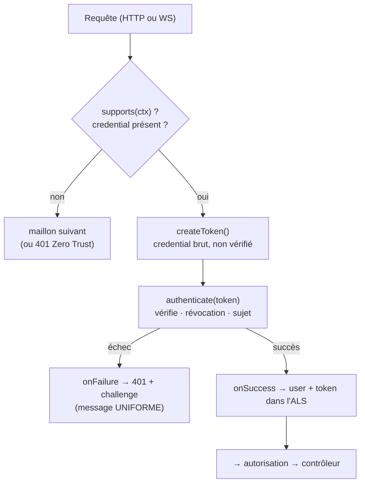

# Authenticators — prouver l'identité

> Un **authenticator** répond à une seule question : _« qui es-tu, et peux-tu le prouver ? »_. Il ne
> décide **pas** des droits (ça, c'est l'autorisation / les voters) — il établit une **identité**.
> Le firewall enchaîne les authenticators déclarés par une zone jusqu'à obtenir une preuve valide,
> sinon il ferme en 401 (Zero Trust). Nodefony en fournit **sept** intégrés, tous ancrés ici sur le
> code (`src/packages/@nodefony/security/nodefony/src/authenticator/`).

📍 [Documentation](../../../../../docs/index.md) › [Sécurité](index.md) › **Authenticators**

## 🧠 Le cycle d'un authenticator



C'est `Firewall.#authenticate()` (`firewall.ts#Firewall.#authenticate`) qui déroule ce cycle pour chaque maillon de la
zone, dans l'ordre déclaré. Le succès pose l'identité dans l'ALS ; l'échec remonte au firewall qui
pose le 401 et son challenge — l'authenticator, lui, ne touche jamais à la réponse.

## 📖 Lexique

| Terme            | Sens                                                                                                               |
| ---------------- | ------------------------------------------------------------------------------------------------------------------ |
| Authentification | Établir **qui** est l'appelant (≠ autorisation, qui établit ce qu'il a le **droit** de faire).                     |
| Authenticator    | Une stratégie de preuve d'identité (`session`, `jwt`…) implémentant `IAuthenticator`.                              |
| BFF              | _Backend For Frontend_ : le web s'authentifie par **session serveur** (cookie opaque), pas par jeton exposé au JS. |
| Bearer           | Schéma `Authorization: Bearer <jeton>` (RFC 6750) — porté par les API.                                             |
| PAT              | _Personal Access Token_ : une clé API personnelle, bearer **opaque** révocable.                                    |
| JWS/JWT          | Jeton signé auto-porté (structure compacte `a.b.c`).                                                               |
| JWKS             | _JSON Web Key Set_ : le trousseau de clés publiques qui vérifie les signatures JWT.                                |
| EdDSA            | Algorithme de signature asymétrique (Ed25519) — le seul accepté par le vérificateur JWT.                           |
| CRC              | Somme de contrôle embarquée dans une clé API — filtre les valeurs malformées avant la base.                        |
| ALS              | _AsyncLocalStorage_ : le contexte ambiant de la requête où le firewall pose `user` + `token`.                      |
| Challenge        | En-tête `WWW-Authenticate` renvoyé avec un 401 (RFC 9110 §11) indiquant comment s'authentifier.                    |
| Zero Trust       | Sur une zone protégée, **aucune preuve valide ⇒ 401** ; l'anonymat n'est accepté que s'il est déclaré.             |

## Qu'est-ce qu'un authenticator — et quelle faille il ferme

Un serveur qui expose des données doit distinguer un appelant légitime d'un inconnu. Le faire « à la
main » dans chaque contrôleur, c'est garantir qu'un endpoint finira par être oublié — la faille la
plus banale et la plus grave.

Nodefony **centralise** la preuve d'identité dans le firewall : une zone déclare _quelles preuves
elle accepte_, et rien n'atteint le contrôleur sans être passé par là. Chaque authenticator ferme une
classe d'attaque précise — détaillées brique par brique dans le catalogue :

- **énumération de comptes** (messages d'échec uniformes) ;
- **brute-force et DoS par hachage** (backoff NIST avant tout hash) ;
- **algorithm confusion / injection de clé JWT** (allowlist + JWKS local) ;
- **jeton volé non révocable** (denylist `jti`, PAT opaque révocable) ;
- **identité périmée** (sujet re-vérifié à chaque requête).

## La vision Nodefony — un contrat, un registre, un firewall agnostique

### Le contrat `IAuthenticator`

Tout authenticator implémente le même cycle (`IAuthenticator.ts#IAuthenticator`), ce qui rend le firewall
totalement agnostique de la stratégie :

| Méthode               | Rôle                                                                                                                           |
| --------------------- | ------------------------------------------------------------------------------------------------------------------------------ |
| `supports(ctx)`       | Test **bon marché** : le credential de cette stratégie est-il présent ? (sinon, maillon suivant)                               |
| `createToken(ctx)`    | Extrait le credential **brut, non vérifié**, dans un `UserToken`.                                                              |
| `authenticate(token)` | **Vérifie** (signature/hash/session), applique la **révocation**, **re-résout le sujet** — ou lève un 401.                     |
| `onSuccess(ctx,tok)`  | Effet de bord au succès (poser l'identité en session, audit).                                                                  |
| `onFailure(ctx,err)`  | Slot d'audit (le 401 + challenge sont posés par le firewall).                                                                  |
| `challenge()`         | **Optionnel** (`IAuthenticator.ts#IAuthenticator.challenge`) — la valeur `WWW-Authenticate` (RFC 9110 §11) des 401 de la zone. |

### Le registre pluggable

Les authenticators sont résolus par **nom** : `Firewall.#instantiateAuthenticators()`
(`firewall.ts#Firewall.#instantiateAuthenticators`) interroge `getAuthenticatorFactory()` (`authenticatorRegistry.ts#getAuthenticatorFactory`) — jamais
un `if (name === "jwt")` dans le firewall, qui trahirait la promesse « pluggable ».

- Les **six builtins HTTP** (`anonymous`, `userpassword`, `session`, `jwt`, `external-jwt`, `apikey`)
  s'enregistrent à l'import du module via `registerAuthenticatorFactory()`
  (`authenticatorRegistry.ts#registerAuthenticatorFactory`) — donc toujours avant le boot.
- Le septième, `firewall-realtime`, n'est **pas dans le registre** : c'est le firewall qui le câble
  lui-même au handshake WS des zones protégées (`Firewall.#wireRealtime()`, `firewall.ts#Firewall.#wireRealtime`).
- La fabrique ne fait que **construire** ; les résolutions de services coûteuses (`users`,
  `tokenStore`, keystore) restent **lazy** dans l'instance (cold path).
- Un nom inconnu en config = boot **fail-closed** — `#configError` posé + log CRITIC
  (`firewall.ts#Firewall.#configError`) : jamais de zone « protégée » silencieusement ouverte à cause d'une
  faute de frappe.

## 🚀 Démarrage rapide

### Une zone, trois preuves — la même API pour le web et les machines

Dans une app `nodefony create app`, on déclare quelles preuves une zone accepte — un **objet par
nom**, validé Zod au boot (`areas: z.record(...)`, `config.ts#oauth2Schema`) :

```typescript
// nodefony.config.ts (extrait)
use("@nodefony/security", {
  areas: {
    // Une seule zone, trois preuves : le navigateur (cookie de session),
    // un service (JWT), un script CI (clé API). `mode: "first"` (défaut) :
    // le premier maillon qui reconnaît la requête authentifie.
    api: {
      pattern: "^/api",
      authenticators: ["session", "jwt", "apikey"],
    },
  },
});
```

> [!IMPORTANT]
> **Le login est FOURNI** : `POST /nodefony/security/api/auth/login` (body `{ username, password }`
> → `Set-Cookie` de session, ID régénéré anti-fixation), avec `logout` et `me`
> (`SessionAuthController.ts#SessionAuthController`). Pas de LoginController à écrire — tes routes ne font que
> consommer l'identité.

### Ce que TU écris : le controller qui consomme l'identité

```typescript
// nodefony/controllers/WhoAmIController.ts — complet, compile tel quel
import {
  controller,
  Controller,
  Get,
  IsGranted,
  CurrentUser,
} from "@nodefony/framework";
import type { IUser } from "@nodefony/user";

@controller("/api/v1")
class WhoAmIController extends Controller {
  // Zone `api` : le firewall a DÉJÀ validé une des trois preuves (session,
  // JWT ou clé API) — sinon 401 avant ce code. @IsGranted ajoute le rôle.
  @IsGranted(["ROLE_USER"])
  @Get("/whoami")
  async whoami(@CurrentUser() user: IUser) {
    // La même réponse quelle que soit la preuve présentée par le client.
    return this.renderJson({ identifier: user.identifier, roles: user.roles });
  }
}

export default WhoAmIController;
```

### Ce qu'on observe

```bash
# 1) Sans preuve : Zero Trust → 401 + challenge du premier maillon qui en déclare
curl -si http://localhost:5151/api/v1/whoami | grep -E "^(HTTP|WWW)"
# HTTP/1.1 401 Unauthorized
# WWW-Authenticate: Bearer

# 2) Web — login BFF (compte dev seedé admin/nodefony-dev-42) → cookie de session
curl -si -c /tmp/jar -H 'Content-Type: application/json' \
  -d '{"username":"admin","password":"nodefony-dev-42"}' \
  http://localhost:5151/nodefony/security/api/auth/login | head -1
# HTTP/1.1 200 OK

# 3) La même route, deux preuves différentes → la même identité
curl -s -b /tmp/jar http://localhost:5151/api/v1/whoami            # session (web)
curl -s -H 'Authorization: Bearer nf_…' \
  http://localhost:5151/api/v1/whoami                              # clé API (CI)
# {"identifier":"admin","roles":["ROLE_NODEFONY_ADMIN", …]}
```

Requête par requête, qui répond :

| Le client envoie…                    | Maillon (`supports()`) | Résultat                                                                    |
| ------------------------------------ | ---------------------- | --------------------------------------------------------------------------- |
| le cookie de session                 | `session`              | identifié — rôles frais re-résolus en base                                  |
| `Authorization: Bearer eyJ…` (a.b.c) | `jwt`                  | identifié — signature EdDSA + claims vérifiés                               |
| `Authorization: Bearer nf_…`         | `apikey`               | identifié — clé vérifiée au store, révocable                                |
| rien                                 | aucun                  | **401** + `WWW-Authenticate: Bearer` (`firewall.ts#Firewall.#authenticate`) |

## 🔐 Les authenticators intégrés

| Nom                 | Credential                                          | Vérité     |   Révocable    | Pour…                                      |
| ------------------- | --------------------------------------------------- | ---------- | :------------: | ------------------------------------------ |
| `anonymous`         | (aucun)                                             | —          |       —        | accepter l'anonymat explicitement          |
| `userpassword`      | `Authorization: Basic base64(id:mdp)`               | verifier   |      n/a       | outils/scripts, brique login               |
| `session`           | cookie de session (identifiant en blob)             | serveur    |   immédiate    | le **web** après login (BFF)               |
| `jwt`               | `Authorization: Bearer <a.b.c>`                     | auto-porté |    via état    | API service↔service, agents                |
| `external-jwt`      | `Authorization: Bearer <a.b.c>` d'un émetteur TIERS | émetteur   | via l'émetteur | jetons d'un serveur d'autorisation externe |
| `apikey`            | `Authorization: Bearer nf_…`                        | serveur    |   immédiate    | API/CI/scripts d'un user                   |
| `firewall-realtime` | identité déjà résolue au handshake (ALS)            | serveur    |   1 fenêtre    | le **WebSocket** de toute identité         |

### `anonymous` — accepter explicitement l'anonymat

Le seul authenticator autorisé à produire un token **non authentifié** sans déclencher le Zero Trust
(`AnonymousAuthenticator.ts#AnonymousAuthenticator`).

- `supports()` accepte tout (`AnonymousAuthenticator.ts#AnonymousAuthenticator.supports`) ; le token porte le **singleton gelé**
  `anonymousUser` — zéro allocation d'utilisateur (`AnonymousToken.ts#AnonymousToken`).
- À ne lister **que volontairement** : `["jwt", "anonymous"]` en mode `first` signifie « identifié
  si preuve présente, sinon visiteur anonyme accepté ». En mode `all`, utile en **dernier** :
  « canal prouvé (ex. mTLS), identité utilisateur optionnelle ».
- Sans lui, zone protégée + aucune preuve = 401 : la défense en profondeur du firewall n'accepte un
  token non authentifié que si `anonymous` est le maillon déclaré (`firewall.ts#Firewall.handleSecurity`).
- **Faille fermée** : l'anonymat _implicite_ — ici il est un choix explicite et auditable, jamais un
  défaut.

### `userpassword` — HTTP Basic + backoff NIST

Schéma **HTTP Basic** (RFC 7617) : `Authorization: Basic base64(id:mdp)`, charset UTF-8, scheme
case-insensitive (`UserPasswordAuthenticator.ts#BASIC_SCHEME`) ; `createToken()` split au **premier** `:` —
le mot de passe peut en contenir (`UserPasswordAuthenticator.ts#UserPasswordAuthenticator.createToken`).

- **La vérification est déléguée** au `IPasswordVerifier` (le `UserService`) : hash, comparaison,
  leurre anti-timing, re-hash transparent — l'authenticator ne voit que le verdict.
- **Message uniforme** `INVALID_CREDENTIALS` quelle que soit la cause — identifiant inconnu, compte
  verrouillé, mot de passe faux (`UserPasswordAuthenticator.ts#INVALID_CREDENTIALS`) → anti-énumération de comptes.
- **Throttling NIST SP 800-63B AVANT le verifier** : `#throttler.check()` sur l'identifiant saisi
  (`UserPasswordAuthenticator.ts#UserPasswordAuthenticator.authenticate`) — un identifiant bloqué ne coûte **aucun hash** → le
  throttle protège aussi le serveur du **DoS argon2**. Échec compté, succès remis à zéro
  (`UserPasswordAuthenticator.ts#UserPasswordAuthenticator.authenticate`). `ThrottledError` → **429 + `Retry-After`**
  (`firewall.ts#Firewall.handleSecurity`).
- **Le throttler est PARTAGÉ** avec le login JSON du BFF — même `loginThrottler` du container : un
  attaquant ne contourne pas le backoff en changeant de porte (`authenticatorRegistry.ts`).
- **En production, un mot de passe reçu en clair est refusé avant d'être décodé** :
  `createToken()` interroge la politique `credentialTransport`
  (`UserPasswordAuthenticator.ts#UserPasswordAuthenticator.createToken`) → **403**, sans challenge — un `Basic` ferait renvoyer le
  mot de passe par le même canal (`firewall.ts#Firewall.handleSecurity`). Voir [Mot de passe en clair](#mot-de-passe-en-clair--refusé-en-production).
- Challenge : `Basic realm="nodefony", charset="UTF-8"` (`UserPasswordAuthenticator.ts#UserPasswordAuthenticator.authenticate`).
- **Piège** : le login par formulaire (JSON) n'est **pas** ici — c'est le BFF
  (`/nodefony/security/api/auth/login`). Basic sert l'outillage (scripts, CLI).

### `session` — la preuve du web (BFF)

Après le login, chaque requête web prouve son identité par la **session serveur** (cookie opaque).
Credential = l'**identifiant** posé dans le blob de session, jamais un secret.

- **N'ouvre jamais la session lui-même** : `supports()` exige une session **déjà reprise** porteuse
  d'un utilisateur (`SessionAuthenticator.ts#SessionAuthenticator.supports`) — le pipeline http démarre la session _avant_
  le firewall ; c'est `AuthFlow.login()` qui ouvre et régénère l'ID (anti-fixation).
- **L'identité est re-résolue à CHAQUE requête** via `resolveSessionIdentity`
  (`SessionAuthenticator.ts#SessionAuthenticator.authenticate`) → rôles frais, révocation immédiate. Les contrôles d'état sont
  partagés avec `AuthFlow.me()` : `isLocked()`/`isActive()` → rejet (`sessionIdentity.ts#resolveSessionIdentity`).
- `onSuccess()` pose l'identifiant sur le contexte — la persistance de session lie le blob au
  principal courant (`SessionAuthenticator.ts#SessionAuthenticator.onSuccess`).
- **Pas de `challenge()`** : session absente = 401 nu → le front redirige vers son écran de login,
  jamais une popup Basic (`SessionAuthenticator.ts#SessionAuthenticator`).

### `jwt` — Bearer signé pour les API (RFC 6750 + BCP RFC 8725)

Réservé aux **API service↔service / agents** (le web reste sur la session). Vérifie un access token
**EdDSA** signé par le keystore du serveur ; `supports()` ne réclame que la structure compacte
`a.b.c` (`COMPACT_JWS`, `JwtAuthenticator.ts#COMPACT_JWS`). Les défenses **dures** du JWT BCP, toutes
prouvées en test :

| Défense                                | Comment                                                                                                           | Attaque fermée                                                     |
| -------------------------------------- | ----------------------------------------------------------------------------------------------------------------- | ------------------------------------------------------------------ |
| **Allowlist d'algorithmes**            | `algorithms: ["EdDSA"]` — jamais l'algo de l'en-tête du token (`JwtAuthenticator.ts#JwtAuthenticator.#verify`)    | `alg=none`, algorithm confusion (§3.1)                             |
| **Clé par `kid` du keyset LOCAL**      | `createLocalJWKSet` — jamais `jku`/`jwk` de l'en-tête (`JwtAuthenticator.ts#JwtAuthenticator.#ensureGetKey`)      | injection de clé / SSRF (§3.5)                                     |
| **`aud` + `iss` + `typ` obligatoires** | `typ: "at+jwt"` (§3.11) sépare access et refresh (`JwtAuthenticator.ts#JwtAuthenticator.verifyForResource`)       | refresh présenté comme access, token d'un autre service (§3.8-3.9) |
| **Révocation**                         | denylist `isJtiDenied` + seuil `invalidBefore` par porteur (`JwtAuthenticator.ts#JwtAuthenticator.#verify`)       | jeton auto-porté volé, logout global                               |
| **Sujet revérifié**                    | `loadUserByIdentifier(sub)` → disparu/inactif/verrouillé = rejet (`JwtAuthenticator.ts#JwtAuthenticator.#verify`) | compte banni encore « valide » via son token (§3.10)               |

Le **message d'échec est uniforme** (`INVALID_TOKEN`, `JwtAuthenticator.ts#INVALID_TOKEN`) : la cause fine
(expiré, `aud`, signature, sujet banni) part en **audit**, jamais au client — anti-oracle. Le token
promu porte `scopes`, `jti`, `claims` en attributs (`JwtAuthenticator.ts#JwtAuthenticator.#verify`). `jose` est
importé **lazy** — dépendance lourde (`JwtAuthenticator.ts#JwtAuthenticator.#jose`).

Les six premiers se déclarent dans une zone (registre `authenticatorRegistry.ts`) ;
`firewall-realtime` ne se déclare pas — le firewall le câble lui-même au handshake WebSocket.

### `external-jwt` — un jeton émis par un serveur d'autorisation TIERS

Là où `jwt` ne vérifie que les jetons signés par Nodefony, `external-jwt` accepte un jeton d'un
émetteur de confiance déclaré (`resourceServer.issuers`), vérifié contre ses clés publiques, et
rattache son sujet à un compte local. `jwt` et `external-jwt` s'aiguillent par l'émetteur (`iss`) :
leur ordre dans la zone ne décide de rien. Tout le détail — audience, espace de noms du sujet, panne
de l'émetteur en 503 — est dans **[Jetons d'un émetteur tiers](external-jwt.md)**.

### `apikey` — PAT opaque révocable

Clé API personnelle en `Authorization: Bearer nf_…` (préfixe `apiKeys.prefix`, défaut `nf`).
Contrairement au JWT (auto-porté), un PAT est un **bearer opaque** dont la vérité vit **côté
serveur** (`ITokenStore`) → **révocable immédiatement**. Défenses :

- **Forme + CRC validés AVANT tout accès au store** (`parseApiKey`, `ApiKeyAuthenticator.ts#ApiKeyAuthenticator.authenticate`)
  → une valeur malformée n'atteint jamais la base (**anti-DoS**).
- **Lookup par hash SHA-256** (`findByHash`, `ApiKeyAuthenticator.ts#ApiKeyAuthenticator.authenticate`) — le secret n'existe
  **nulle part au repos**.
- **Révocation** (`revokedAt`) + **expiration** (`expiresAt`) (`ApiKeyAuthenticator.ts#ApiKeyAuthenticator.authenticate`) +
  **ban en masse** du porteur (`invalidBefore` vs `createdAt`, `ApiKeyAuthenticator.ts#ApiKeyAuthenticator.authenticate`).
- **Sujet revérifié** à chaque requête → rôles frais (`ApiKeyAuthenticator.ts#ApiKeyAuthenticator.authenticate`).
- **`lastUsedAt` throttlé** : aucune écriture sur le hot path tant que la fenêtre
  `apiKeys.lastUsedThrottleS` n'est pas dépassée (`ApiKeyAuthenticator.ts#IApiKeyAuthenticatorRuntime.lastUsedThrottleS`).

Le token promu porte `scopes`, `apiKeyId`, `tenantId` (`ApiKeyAuthenticator.ts#ApiKeyAuthenticator.authenticate`).

### `firewall-realtime` — la promotion, en WebSocket, de l'identité déjà posée

> [!IMPORTANT]
> Ce n'est **pas** « l'authenticator de la session ». Il promeut **toute** identité que le firewall
> a résolue — y compris un agent authentifié par jeton porteur, sans cookie ni session. Son nom
> d'origine (`SessionRealtimeAuthenticator`) décrivait le premier mode branché, pas son rôle ; la
> confusion a coûté un durcissement pensé pour la session appliqué à toutes les identités
> (`FirewallRealtimeAuthenticator.ts#FirewallRealtimeAuthenticator`).

Sur un handshake WS (une requête upgrade HTTP qui traverse **le même pipeline**), `startSession`
puis `handleSecurity` ont **déjà** tourné : session chargée, identité re-résolue, `IUser` posé dans
l'ALS. `FirewallRealtimeAuthenticator.supports()` ne fait que le constater
(`FirewallRealtimeAuthenticator.ts#FirewallRealtimeAuthenticator.supports`).

- **Perf : il ne relit pas la base.** `authenticate()` réutilise l'identité de l'ALS
  (`FirewallRealtimeAuthenticator.ts#FirewallRealtimeAuthenticator.authenticate`) au lieu de refaire deux lectures base par connexion —
  un coût évitable sur le différenciateur temps réel.
- **Câblé automatiquement** par `Firewall.#wireRealtime()` (`firewall.ts#Firewall.#wireRealtime`) pour toute zone
  protégée `realtime !== false` — une instance par zone au handshake (`firewall.ts#Firewall.#build`).
- **Le mode de preuve suit le jeton du firewall**, il n'est pas deviné : absent (zone historique),
  on retombe sur le mode le plus strict, la session (`FirewallRealtimeAuthenticator.ts#FirewallRealtimeAuthenticator.authenticate`).
- **Filet Zero Trust** : il câble un revalidateur appelé avant chaque action data plane
  (`FirewallRealtimeAuthenticator.ts#FirewallRealtimeAuthenticator.authenticate`) — la socket peut survivre à l'identité qui l'a
  ouverte (logout, changement de compte, `jti` denylisté). En mode session,
  `buildSessionRevalidator()` re-lit `storage.read(id)` et compare l'identifiant ; toute erreur de
  lecture invalide, fail-closed (`FirewallRealtimeAuthenticator.ts#SessionLike.storage`). En mode jeton porteur, la
  preuve est autre : `exp`, `jti` denylisté, `invalidBefore`
  (`FirewallRealtimeAuthenticator.ts#FirewallRealtimeAuthenticator.#buildBearerRevalidator`).

> [!NOTE]
> **Asymétrie de révocation HTTP↔WS (assumée)** : le jeton realtime est figé au handshake (les
> frames lisent un cache O(1)) → une révocation prend effet **en une fenêtre** (tick du hub, et devant chaque `api.request`), pas à la frame
> suivante. C'est l'état de l'art (Socket.IO/Phoenix figent aussi au handshake) ; la révocation
> immédiate forte passe par le JWT + un canal « token révoqué ».

## ⚙️ Composer une zone — ordre, mode, cohabitation

La liste `area.authenticators` se lit **dans l'ordre**, déroulée par `Firewall.#authenticate()`
(`firewall.ts#Firewall.#authenticate`) selon le `mode` de la zone (`first` par défaut, `config.ts#areaSchema`).

### Situation 1 — humains ET machines sur la même API (`first`)

Ton back-office est appelé par le **navigateur** des utilisateurs connectés ET par un **script CI**.
Deux preuves différentes, mêmes routes — c'est la config du Démarrage rapide ci-dessus. Deux règles
de lecture :

- un maillon dont `supports()` est faux est simplement **sauté** en mode `first`
  (`firewall.ts#Firewall.#rebuildSecurityHeaders`) ;
- un credential **présenté mais invalide échoue immédiatement** — l'échec d'`authenticate()`
  remonte, jamais de fallback silencieux vers le maillon suivant (`firewall.ts#Firewall.#authenticate`). Une clé
  API révoquée donne un 401 direct, même si un autre maillon aurait pu réussir.
- aucune preuve présentée sur toute la chaîne → `handleSecurity()` lève l'`AuthenticationError`
  Zero Trust (`firewall.ts#Firewall.handleSecurity`).

### Situation 2 — le piège de l'ordre (`anonymous` toujours EN DERNIER)

Tu veux « identifié si connecté, sinon visiteur » :

```typescript
authenticators: ["session", "anonymous"],   // ✅ session d'abord
authenticators: ["anonymous", "session"],   // ❌ anonymous accepte TOUT le monde
```

> [!WARNING]
> `AnonymousAuthenticator.supports()` accepte **toutes** les requêtes — placé en premier en mode
> `first`, il court-circuite la liste : **personne n'est jamais identifié**, même avec un cookie
> valide. L'ordre est ta politique.

### Situation 3 — empiler les preuves (`all`)

En mode `all`, **chaque** maillon est obligatoire : `supports()` faux = 401 immédiat
(`firewall.ts#Firewall.applySecurityHeaders`) et le **dernier** token de la chaîne porte l'identité (`firewall.ts#Firewall.unregisterCspOrigins`) —
utile pour exiger une preuve de canal (mTLS) **et** une identité, ou un « sudo mode » session +
re-saisie du mot de passe. Scénario complet côté zones : [firewall](./firewall.md).

### Cohabitation JWT + clé API dans une même zone

Les deux sont des `Bearer`, mais Nodefony les **discrimine sur la forme** — un JWT a la structure
compacte `a.b.c` (`COMPACT_JWS`, `JwtAuthenticator.ts#COMPACT_JWS`), un PAT porte le préfixe `nf_` sans
point (`looksLikeApiKey`, `ApiKeyAuthenticator.ts#ApiKeyAuthenticator.constructor`). Chaque `supports()` ne réclame que _son_
format → aucun conflit, aucune double vérification.

## Le fil rouge : le message d'échec uniforme

Les cinq authenticators vérifiants renvoient **le même message** (`"Invalid credentials"` /
`"Invalid token"` / `"Invalid session"`) quelle que soit la cause réelle. Ce n'est pas de la
paresse : c'est une **défense anti-énumération / anti-oracle**.

Distinguer « compte inconnu » de « mot de passe faux », ou « token expiré » de « signature
invalide », donnerait à un attaquant une sonde. La cause fine part **toujours** en log d'audit ; le
client n'obtient qu'un 401 + son challenge — posé par le firewall, premier maillon de la zone qui
en déclare un (`Firewall.#setChallenge()`, `firewall.ts#Firewall.#setChallenge`).

## Mot de passe en clair — refusé en production

Un mot de passe, ou un code de second facteur, qui arrive sur une requête HTTP en clair a déjà
traversé le réseau en lisible : le vérifier ne le protège plus. En production, toutes les
portes qui reçoivent un secret le refusent donc **avant toute vérification** — formulaire de
session, second facteur, Basic, émission de jeton (`/nodefony/security/api/token`), et les
endpoints d'administration marqués `credentials: true` (création d'un compte, changement de mot
de passe — cf la doc du plan d'administration de `@nodefony/framework`) :

- **403**, message constant `Credentials must be sent over HTTPS`
  (`INSECURE_TRANSPORT_MESSAGE`, exporté par `nodefony`) ; la page de connexion le reconnaît et
  n'affiche pas « mot de passe incorrect ».
- Le refus précède le throttle et le verifier : aucun hash calculé, aucun échec compté. Il est
  audité (`reason: "insecure_transport"`).
- Le **premier** refus du process part en WARNING, les suivants non : un pod mal configuré
  refuserait chaque connexion (`#warned`, `CredentialTransportPolicy.ts#CredentialTransportPolicy.#warned`).
- **La décision se prend sur le scheme EFFECTIF** (`context.scheme`), pas sur le transport du
  pod. Derrière un proxy qui termine TLS — le cas de la plupart des déploiements — il suffit de
  déclarer ce proxy de confiance : `trustProxy` dans la config de `@nodefony/http`, pour que
  `X-Forwarded-Proto: https` soit lu.
- Une seule décision, posée au conteneur par le firewall au boot (`credentialTransport`,
  `firewall.ts#Firewall.#provisionSharedServices`) : production ⇒ refus, sauf échappement **écrit**
  `security.allowInsecureCredentials: true` (`CredentialTransportPolicy.ts#shouldEnforceCredentialTransport`). Hors
  production, rien n'est refusé.

Pourquoi un 403 et pas un 401 : aucune preuve n'a été jugée. Le client ne corrigera rien dans
son secret — c'est le canal qu'il doit changer.

## 🧩 Ajouter un authenticator maison

```typescript
import { registerAuthenticatorFactory } from "@nodefony/security";

registerAuthenticatorFactory("ldap", ({ container, config }) => {
  return new LdapAuthenticator(() => container.get("ldapClient"));
});
// puis en config : areas.<zone>.authenticators = ["ldap", "anonymous"]
```

À faire au chargement du module (avant le boot). Trois règles, calquées sur les builtins :

- implémenter le contrat `IAuthenticator` (`IAuthenticator.ts#IAuthenticator`) — `challenge()` seulement si
  un en-tête `WWW-Authenticate` a du sens pour la stratégie ;
- renvoyer le **message uniforme** en cas d'échec (la cause fine part en audit) ;
- laisser les résolutions de services **lazy** dans l'instance — la fabrique ne fait que
  construire (`authenticatorRegistry.ts#IAuthenticatorFactoryContext`).

## 📜 Normes appliquées

<!-- prettier-ignore -->
| Domaine | Norme | Ancrage |
| --- | --- | --- |
| Challenge d'auth (401) | RFC 9110 §11 | `Firewall.#setChallenge()` (`firewall.ts#Firewall.#setChallenge`) |
| Bearer | RFC 6750 | `readBearerHeader()` (`runtime/bearer.ts#readBearerHeader`, cœur) — une porte UNIQUE au cœur, plus une constante par authenticator |
| JWT (BCP) | RFC 7519, 8725 | `jwtVerify` durci : allowlist + claims (`JwtAuthenticator.ts#JwtAuthenticator.#verify`) |
| HTTP Basic | RFC 7617 | `UserPasswordAuthenticator` (`UserPasswordAuthenticator.ts#UserPasswordAuthenticator`) |
| Backoff de login | NIST SP 800-63B | `#throttler.check()` avant le verifier (`UserPasswordAuthenticator.ts#UserPasswordAuthenticator.authenticate`) |
| Rate limit (429) | RFC 6585 | `Retry-After` posé par le firewall (`firewall.ts#Firewall.handleSecurity`) |
| Anti-énumération | OWASP | `INVALID_TOKEN` (`JwtAuthenticator.ts#INVALID_TOKEN`) · `INVALID_CREDENTIALS` (`UserPasswordAuthenticator.ts#INVALID_CREDENTIALS`) |

## ⚡ Performance & mémoire

- `supports()` est un test **bon marché** (en-tête + regex) — et n'est payé que sur zone protégée
  (le chemin chaud/froid vit dans le [firewall](./firewall.md)).
- Résolutions **lazy** : le verifier `#resolveVerifier` est mémoïsé au premier login
  (`UserPasswordAuthenticator.ts#UserPasswordAuthenticator.#resolveVerifier`) ; keystore, `tokenStore` et `users` sont résolus du
  container au premier usage ; `jose` est importé lazy (`JwtAuthenticator.ts#JwtAuthenticator.#jose`).
- `anonymous` : singleton gelé `anonymousUser`, zéro allocation d'utilisateur
  (`AnonymousToken.ts#AnonymousToken`).
- `apikey` : écriture `lastUsedAt` **coalescée** — pas une écriture par requête
  (`ApiKeyAuthenticator.ts#ApiKeyAuthenticator.authenticate`).
- `firewall-realtime` : **zéro lecture base** au handshake — réutilise l'ALS
  (`FirewallRealtimeAuthenticator.ts#FirewallRealtimeAuthenticator.authenticate`).
- Le throttle NIST **avant** le hash : un 429 ne coûte aucun argon2.

## ⚠️ Pièges (symptôme → cause → correction)

<!-- prettier-ignore -->
| Symptôme | Cause (dans le code) | Correction |
| --- | --- | --- |
| 401 systématique sur une zone protégée | Aucune preuve + `anonymous` non listé — Zero Trust (`firewall.ts#Firewall.handleSecurity`) | Ajouter `anonymous` en dernier si l'anonymat est voulu |
| 401 générique + log ERROR « service `users` » | Câblage : pas de `UserService` au container (`authenticatorRegistry.ts`) | Enregistrer un `UserService` au boot de l'app |
| JWT rejeté alors qu'il « semble » valide | `aud`/`iss`/`typ` non conformes, ou `alg` ≠ EdDSA (`JwtAuthenticator.ts#JwtAuthenticator.#verify`) | Émettre via le `TokenService` (mêmes iss/aud/typ) |
| Clé API révoquée encore acceptée quelques secondes | Confusion avec un JWT (auto-porté) — `revokedAt` est lu à chaque requête (`ApiKeyAuthenticator.ts#ApiKeyAuthenticator.authenticate`) | Un PAT est révoqué immédiatement ; vérifier `revokedAt` |
| Révocation WS pas immédiate | Identité figée au handshake — asymétrie assumée du `FirewallRealtimeAuthenticator` (`FirewallRealtimeAuthenticator.ts#FirewallRealtimeAuthenticator`) | Attendre la fenêtre de re-validation, ou utiliser JWT + canal révocation |
| Brute-force pas ralenti | `loginThrottler` absent du container — `rateLimit.enabled` off (`firewall.ts#Firewall.#describeDefenses`) | Configurer `rateLimit` pour poser le throttler |
| 403 `Credentials must be sent over HTTPS` sur TOUTES les connexions en production | Pod en HTTP derrière un proxy TLS non déclaré de confiance : `context.scheme` reste `http` (`CredentialTransportPolicy.ts#shouldEnforceCredentialTransport`) | Déclarer le proxy dans `trustProxy` (`@nodefony/http`) ; `allowInsecureCredentials` seulement si le clair est un choix assumé |

## 🧪 Tests & couverture

Trois familles couvrent la brique — les **chiffres exacts vivent dans la carte de l'aperçu**
(régénérée par `gen-counters.mjs` depuis vitest, jamais figée ici) :

- **unit** (`security/tests/unit/`) : la chaîne + les modes (`authenticators`), les défenses JWT
  RFC 8725 (`jwt.attack`) et le pipeline JWT bout en bout (`jwtPipeline`), la clé API — flux,
  service et forme/CRC (`apiKeyAuthenticator`, `apiKeyService`, `apiKeyFormat`), la session
  (`sessionAuthenticator`), le backoff NIST (`loginThrottler`), le step-up 2FA (`mfaStepUp`) ;
- **intégration** (serveur réel, `@nodefony/http`) : le flux clé API de bout en bout
  (`apikey-flow`), un JWT autorisé sur WebSocket (`ws-isgranted-jwt`) ;
- l'**émission** des jetons (keystore, tokenStore) est couverte sur la page
  [tokens](./tokens.md) ; les bancs d'attaque transverses (csrf, cors) sur leurs pages.

Couverture : `npm run coverage` dans `@nodefony/security`.

## 🔗 Pour aller plus loin

- ⬆️ **Retour au hub** : [Sécurité — vue d'ensemble](index.md) · [Toute la documentation](../../../../../docs/index.md)
- 🧭 **Pages sœurs** : [Firewall](firewall.md) · [Jetons](tokens.md)

- Le firewall qui enchaîne les authenticators (zones, modes, en-têtes) → [firewall](./firewall.md)
- L'autorisation (voters, rôles, scopes) après l'authentification → [authorization](./authorization.md)
- Émission/révocation des jetons (keystore, tokenStore) → [tokens](./tokens.md)
- Les autres preuves — flux BFF, pas des authenticators de zone : [oauth2](./oauth2.md) ·
  [webauthn](./webauthn.md) · [totp](./totp.md)
- Vue d'ensemble sécurité → [index](./index.md)
