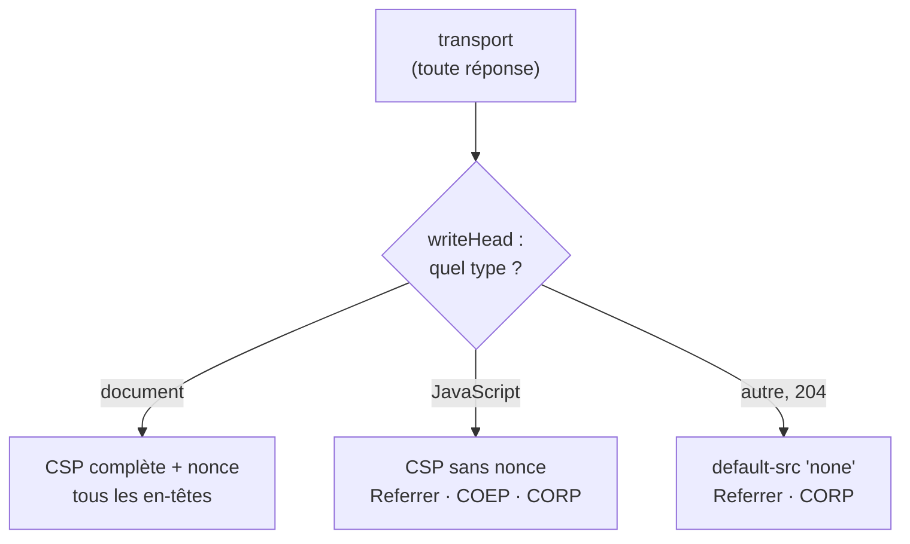

# En-têtes de sécurité — le contrat passé au navigateur

> Ton serveur ne contrôle pas le navigateur de tes visiteurs — il ne peut que **lui donner des
> ordres**, et ces ordres sont des en-têtes HTTP. Une douzaine de lignes ferment des classes
> entières d'attaques : XSS, clickjacking, sniffing MIME, fuite d'URL, downgrade HTTPS. Nodefony
> les pose en **deux couches, une seule autorité par en-tête** : le socle **transport**
> (`@nodefony/http`, dès l'entrée brute — couvre aussi les fichiers statiques et les erreurs) et la
> couche **applicative** (`@nodefony/security`, dans le pipeline — CSP, Referrer-Policy, isolation
> cross-origin). Ancré sur `SecurityHeaders` (`securityHeaders.ts#SecurityHeaders`) et
> `Firewall.applySecurityHeaders()` (`firewall.ts#Firewall.applySecurityHeaders`).

📍 [Documentation](../../../../../docs/index.md) › [Sécurité](index.md) › **En-têtes de sécurité**

## 🧠 Le modèle mental — deux couches, deux moments

Un en-tête de sécurité n'a de valeur que s'il est **sur toutes les réponses**. Le piège classique
n'est pas d'en oublier un : c'est de le poser **de façon inégale** — présent sur les routes de
contrôleur, absent sur un fichier statique ou une page d'erreur 404, c'est-à-dire exactement là où
un attaquant dépose son contenu.

D'où le découpage : ce qui doit couvrir **tout ce qui sort du process** est posé au plus tôt ; ce
qui dépend de la **réponse applicative** (le CSP, qui doit connaître le nonce, la route et le
**type** de la réponse) est posé au moment où la réponse écrit ses en-têtes : le pare-feu, armé au
routage, choisit alors sa politique sur le `Content-Type`.



**Une seule source par en-tête** : `@nodefony/security` ne ré-émet **jamais** les trois en-têtes
transport — c'est écrit noir sur blanc dans le contrat de la couche applicative
(`ISecurityHeadersOptions`, `securityHeaders.ts#ISecurityHeadersOptions`). Pas de double émission, donc pas de valeurs
contradictoires sur la même réponse.

## 📖 Lexique

| Terme                  | Développé — et ce que ça veut dire                                                                                                                                                     |
| ---------------------- | -------------------------------------------------------------------------------------------------------------------------------------------------------------------------------------- |
| CSP                    | _Content-Security-Policy_ : liste blanche des sources autorisées (scripts, styles, images…). Première barrière anti-XSS.                                                               |
| XSS                    | _Cross-Site Scripting_ : un attaquant fait exécuter **son** JavaScript dans la page de ta victime, avec ses cookies.                                                                   |
| Nonce                  | _number used once_ : jeton aléatoire régénéré à **chaque requête**, qui autorise un `<script>` inline **précis** et lui seul.                                                          |
| Clickjacking           | Ton site est chargé en `<iframe>` transparente au-dessus d'un piège : la victime croit cliquer ailleurs, elle clique chez toi.                                                         |
| MIME sniffing          | Le navigateur ignore le `Content-Type` et **devine** le type d'un fichier — un `.txt` uploadé peut finir exécuté comme script.                                                         |
| HSTS                   | _HTTP Strict-Transport-Security_ (RFC 6797) : le navigateur mémorise « ce domaine, c'est HTTPS uniquement ».                                                                           |
| Referrer               | En-tête que le navigateur envoie au site suivant pour dire d'où l'on vient — donc une **fuite d'URL** potentielle.                                                                     |
| COOP                   | _Cross-Origin-Opener-Policy_ : coupe le lien entre ta **page** et les fenêtres d'une autre origine qu'elle ouvre ou qui l'ont ouverte (`window.opener`). Lu sur un document seulement. |
| COEP                   | _Cross-Origin-Embedder-Policy_ : ta **page** (ou ton worker) refuse toute ressource tierce qui n'a pas dit « tu peux m'inclure ». Lu sur un document ou un script de worker.           |
| CORP                   | _Cross-Origin-Resource-Policy_ : posé sur une **ressource** (image, script, JSON), dit quelles origines ont le droit de l'inclure. C'est la réponse que COEP attend.                   |
| Isolation cross-origin | COOP `same-origin` + COEP `require-corp` : la page est seule dans son processus (`crossOriginIsolated`), condition de `SharedArrayBuffer` et des horloges fines.                       |
| OAC                    | _Origin-Agent-Cluster_ : demande au navigateur d'isoler l'origine dans son propre processus/heap.                                                                                      |
| Permissions-Policy     | Coupe l'accès aux API sensibles du navigateur (caméra, micro, géolocalisation) pour la page **et ses iframes**.                                                                        |
| Fragment CSP           | Directives additionnelles déclarées par un module (`directive → sources`), fusionnées dans le CSP de base.                                                                             |
| Downgrade              | Un attaquant réseau force la connexion en HTTP clair pour la lire ou la modifier.                                                                                                      |

## Qu'est-ce que c'est ? — un panneau d'instructions collé sur chaque réponse

Imagine que tu envoies un colis. Le contenu, c'est ton HTML. Les en-têtes de sécurité, c'est
l'**étiquette** collée dessus : « ne pas ouvrir avec un autre outil que celui-ci », « ne pas
transporter dans un autre camion », « interdiction de recopier l'adresse de l'expéditeur ». Le
transporteur — le navigateur — les respecte. Sans étiquette, il improvise, et improviser c'est
exactement ce qu'un attaquant attend.

Chaque en-tête ferme **une** faille concrète :

- **CSP** — un attaquant réussit à injecter `<script src="https://evil.tld/x.js">` dans un
  commentaire de ton site ; sans CSP, le navigateur l'exécute avec la session de la victime.
- **X-Frame-Options / `frame-ancestors`** — un site pirate charge ta page « Supprimer mon compte »
  en iframe invisible sous un bouton « Jouer » : la victime clique, c'est chez toi que ça s'applique.
- **`nosniff`** — un avatar téléversé est en réalité du JavaScript ; un navigateur « serviable »
  devine le type et l'exécute **sur ton origine**, donc avec tes cookies.
- **Referrer-Policy** — un clic vers l'extérieur transmet ton URL interne complète
  (`/admin/facture/8123?client=ACME`) dans le `Referer` du site suivant.
- **HSTS** — sur un Wi-Fi public, la première requête part en clair et peut être interceptée puis
  maintenue en HTTP ; HSTS mémorisé force le HTTPS **avant** toute émission.
- **COOP / COEP / CORP** — isolent ton document des autres origines (fenêtres ouvrantes, ressources
  embarquées) : réponse aux canaux auxiliaires type Spectre et au vol d'assets par inclusion.

Le détail de chaque en-tête — menace, valeur par défaut, compromis — est dans le catalogue plus bas.

## La vision Nodefony — pré-calculé au boot, quasi gratuit par requête

Un framework qui recalcule ses en-têtes à chaque requête paie ce confort en allocations. Nodefony
fait l'inverse : **tout ce qui est constant est calculé une fois au démarrage**.

- `SecurityHeaders` (`securityHeaders.ts#SecurityHeaders`) construit **au boot** la table des en-têtes constants
  (Referrer-Policy, COOP/COEP/CORP, Origin-Agent-Cluster, Permissions-Policy, et le CSP quand il est
  statique) et la **gèle** avec `Object.freeze` (`securityHeaders.ts#SecurityHeaders.constructor`). Par requête, le firewall
  se contente de la parcourir et de la poser : zéro concaténation, zéro objet créé.
- Côté transport, même principe : `HttpKernel.computeSecurityHeaderCaches()`
  (`http-kernel.ts#HttpKernel.computeSecurityHeaderCaches`) précalcule la chaîne HSTS (`max-age`, `includeSubDomains`, `preload`) au
  boot ; `onHttpRequest` (`http-kernel.ts#HttpKernel.onHttpRequest`) ne fait plus que trois `setHeader`.
- Le seul coût variable est le **nonce CSP**, et il est **paresseux** : `Context.cspNonce`
  (`Context.ts#Context.#cspNonce`) ne tire ses 128 bits (16 octets CSPRNG, en base64) d'un pool amorti (`randomFillSync`, 4 Ko pour 256 nonces) qu'à la première lecture,
  puis mémoïse. Une réponse qui n'a aucun script inline à signer ne paie aucun appel crypto.

Le second parti pris est la **séparation d'autorité** décrite plus haut : un seul émetteur par
en-tête, donc un comportement prévisible et testable — le banc live vérifie les deux couches sur la
même réponse (`security-headers.test.ts`).

> [!IMPORTANT]
> `@nodefony/security` est **optionnel**, pas le socle. Une app Nodefony sans module security émet
> quand même `nosniff`, `X-Frame-Options` et HSTS : c'est du _secure-by-default_. Ce que tu perds
> sans security, c'est le CSP, la Referrer-Policy et l'isolation cross-origin.

## 🚀 Démarrage rapide

Point de départ : une app générée par `nodefony create app`. Les en-têtes sont **déjà actifs** — ce
que tu écris ci-dessous, ce sont tes **écarts** au défaut.

### 1. Déclarer la politique dans `nodefony.config.ts`

```typescript
// nodefony.config.ts — l'app n'écrit QUE ses écarts ; le reste prend le défaut du framework.
import { defineConfig, use } from "nodefony";

export default defineConfig(() => ({
  modules: [
    "@nodefony/http",
    "@nodefony/framework",
    use("@nodefony/security", {
      headers: {
        // `{{nonce}}` est substitué par un jeton FRAIS à chaque requête (cf plus bas).
        csp:
          "default-src 'self'; script-src 'nonce-{{nonce}}' 'strict-dynamic' 'self'; " +
          "style-src 'self' 'unsafe-inline' 'nonce-{{nonce}}'; style-src-attr 'unsafe-inline'; " +
          "img-src 'self' data:; " +
          "object-src 'none'; base-uri 'self'; form-action 'self'",
        cspNonces: true,
        // Ne fuiter que l'origine, et rien vers un site en clair.
        referrerPolicy: "strict-origin-when-cross-origin",
        // Isolation cross-origin : ABSENTE par défaut, on l'active explicitement.
        coop: "same-origin",
        corp: "same-origin",
        permissionsPolicy: "camera=(), microphone=(), geolocation=()",
      },
    }),
  ],
}));
```

Les clés sont **typées et auto-complétées** : le module augmente le registre `NodefonyModuleConfig`
du core (`index.ts#nodefony`), donc `use("@nodefony/security", …)` propose les clés **et** les valeurs
d'enum (`referrerPolicy`, `coop`, `corp`…). Une valeur hors enum casse le boot, pas la production.

### 2. Ce qu'on observe

```bash
# Une PAGE : socle transport + couche applicative complète, sur la MÊME réponse.
curl -sI http://localhost:5151/nodefony/test/html

# HTTP/1.1 200 OK
# X-Content-Type-Options: nosniff              ← transport (@nodefony/http)
# X-Frame-Options: DENY                        ← transport (@nodefony/http)
# Content-Type: text/html; charset=utf-8
# Content-Security-Policy: default-src 'self'; script-src 'nonce-vZ9…' 'strict-dynamic' 'self'; …
# Referrer-Policy: strict-origin-when-cross-origin
# Cross-Origin-Opener-Policy: same-origin
# Cross-Origin-Resource-Policy: same-origin
# Permissions-Policy: camera=(), microphone=(), geolocation=()

# Une réponse d'API : la politique courte, et seulement ce qu'un JSON fait lire.
curl -sI http://localhost:5151/nodefony/test/index

# Content-Type: application/json
# Content-Security-Policy: default-src 'none'; frame-ancestors 'none'
# Referrer-Policy: strict-origin-when-cross-origin
# Cross-Origin-Resource-Policy: same-origin
```

```bash
# Le nonce change à CHAQUE requête — deux appels, deux jetons.
curl -sI http://localhost:5151/nodefony/test/html | grep -o "nonce-[^']*"
curl -sI http://localhost:5151/nodefony/test/html | grep -o "nonce-[^']*"
# nonce-2Qk1r0h8…      (≠)
# nonce-Xa7pLd3f…

# Une URL inexistante : le socle transport est TOUJOURS là (l'applicatif ne s'exécute pas).
curl -sI http://localhost:5151/nodefony/test/__inexistant__ | grep -i x-content-type
# X-Content-Type-Options: nosniff
```

### 3. Un besoin ponctuel : élargir le CSP d'UNE route

Tu dois embarquer une iframe YouTube sur une seule page. Élargir le CSP global serait une faute :
tu ouvrirais l'ensemble du site. `@Csp` déclare l'écart **à l'échelle de l'action**.

```typescript
// nodefony/controllers/EmbedController.ts — complet, compile tel quel.
import { controller, Controller, Get, Csp } from "@nodefony/framework";

@controller("/embed")
class EmbedController extends Controller {
  // `frame-src` n'existe QUE sur cette route ; le reste du site garde le CSP strict.
  @Csp({ "frame-src": ["https://www.youtube.com"] })
  @Get("/video")
  video() {
    return this.renderJson({ embed: true });
  }
}

export default EmbedController;
```

```bash
curl -sI http://localhost:5151/embed/video | grep -i content-security-policy
# … ; frame-src https://www.youtube.com      ← ajouté ICI seulement
curl -sI http://localhost:5151/nodefony/test/index | grep -c youtube
# 0                                          ← isolation prouvée (security-headers.test.ts)
```

## 🛡️ Le catalogue des en-têtes

Choisir en cinq secondes — puis le détail dans les cartes.

| En-tête                        | Ce qu'il bloque                      | Défaut Nodefony                            | Qui l'émet          |
| ------------------------------ | ------------------------------------ | ------------------------------------------ | ------------------- |
| `Content-Security-Policy`      | XSS, injection de source             | politique « secure-but-usable » + nonce    | security (pipeline) |
| `X-Frame-Options`              | Clickjacking                         | `DENY`                                     | http (transport)    |
| `X-Content-Type-Options`       | MIME sniffing                        | `nosniff`                                  | http (transport)    |
| `Strict-Transport-Security`    | Downgrade HTTPS → HTTP               | `max-age=31536000; includeSubDomains`, TLS | http (transport)    |
| `Referrer-Policy`              | Fuite d'URL vers des tiers           | `no-referrer`                              | security (pipeline) |
| `Cross-Origin-Opener-Policy`   | Attaques par fenêtre ouvrante        | **absent** (opt-in)                        | security (pipeline) |
| `Cross-Origin-Embedder-Policy` | Chargement de ressources non signées | **absent** (opt-in)                        | security (pipeline) |
| `Cross-Origin-Resource-Policy` | Inclusion de tes assets par un tiers | **absent** (opt-in)                        | security (pipeline) |
| `Origin-Agent-Cluster`         | Partage de heap entre origines       | **absent** (opt-in)                        | security (pipeline) |
| `Permissions-Policy`           | Accès caméra/micro/géoloc            | **absent** (opt-in)                        | security (pipeline) |

### `Content-Security-Policy` — la liste blanche des sources

**La menace** : n'importe quelle entrée non échappée (commentaire, nom d'utilisateur, paramètre
réfléchi) devient un vecteur d'exécution de code. Le CSP est le filet quand l'échappement a raté.

**Le défaut Nodefony** est délibérément « secure-but-usable » (`config.ts#headersSchema`) : `script-src`
est **strict** — `'nonce-{{nonce}}' 'strict-dynamic' 'self'`, ce qui est la vraie défense XSS ;
`style-src` exige le même nonce des `<style>` (voir plus bas). Le reste couvre les besoins réels
d'une app moderne (images `data:`/`blob:`, workers, fetch/WS same-origin) et ajoute les durcissements
gratuits :
`object-src 'none'`, `base-uri 'self'`, `form-action 'self'`, `upgrade-insecure-requests`.

**Aucun hôte tiers dans le défaut.** `img-src` vaut `'self' data: blob:` : les photos de profil
d'un fournisseur de connexion ne sont autorisées que s'il est **configuré** — chaque fournisseur
porte l'hôte de ses avatars dans son enregistrement (`oauthProviderRegistry.ts#registerOAuthProvider`,
option `imageSources`), et la connexion sociale le déclare au démarrage. Studio autorise
`https://www.gravatar.com` sur **ses seules pages** (`@Csp` de `StudioController.ts#StudioController`).
Une application qui affiche d'autres images tierces les ajoute par `headers.cspSources` (ci-dessous),
sans réécrire la politique.

**`'strict-dynamic'` : seul le nonce autorise une balise.** Un navigateur CSP3 ignore alors
`'self'` et les hôtes (`'self'` ne reste que pour les navigateurs CSP2). Sans lui, tout fichier
JavaScript posé sur ton origine — un téléversement, une réponse mal typée — s'exécutait dès qu'une
injection écrivait `<script src="/uploads/x.js">`. En retour, un `<script>` sans nonce — en ligne
ou `src`, même servi par ton origine — ne s'exécute plus. Dans une vue rendue par `renderView`, le
framework le signe pour toi (ci-dessous) ; dans du HTML écrit à la main, écris
`<script nonce="${this.context?.cspNonce}" src="…">`. Ce que ce script charge ensuite (un
`import()`, un script qu'il crée) hérite de sa confiance : un chargeur tiers signé (paiement,
carte) charge ses propres scripts sans que tu déclares leurs hôtes.

Deux cas où il n'y a pas de nonce, et où `'strict-dynamic'` part avec lui pour ne pas bloquer
toute la page :

- **une page servie telle quelle** — un `.html` de `public/`, une réponse relayée par le proxy
  inverse : aucun gabarit ne l'a écrite. Elle reçoit la politique sans nonce ni `'strict-dynamic'`,
  et `'self'` décide, comme avant. C'est sans perte : un fichier sert les mêmes octets à tous, il
  n'a pas de point d'injection côté serveur ;
- **`cspNonces: false`** : le nonce est retiré de la politique, `'strict-dynamic'` aussi — sauf si
  la directive garde un hash (`'sha256-…'`), qui continue d'autoriser ses scripts.

Une politique que tu écris toi-même sans `{{nonce}}` n'est jamais retouchée.

**Styles : le même nonce, et rien à faire dans une application générée.** Le défaut écrit
`style-src 'self' 'unsafe-inline' 'nonce-{{nonce}}'; style-src-attr 'unsafe-inline'`. En présence
d'un nonce, le navigateur ignore `'unsafe-inline'` : un `<style>` injecté dans ta page — qui peut
exfiltrer un jeton par des sélecteurs d'attribut, sans une ligne de JavaScript — est bloqué. Un
attribut `style="…"` reste permis : il ne porte pas de sélecteur. Ce qui est déjà en place :

- les feuilles en `<link rel="stylesheet">` de ton origine passent par `'self'` ; les styles que
  React ou Vue écrivent par le CSSOM (`element.style`) ne sont pas gouvernés par la politique ;
- chaque document rendu par le framework annonce son nonce par
  `<meta property="csp-nonce" nonce="…">` (`cspNonce.ts#cspNonceMetaTag`). Le client de Vite
  y signe les styles du rechargement à chaud ; l'entrée Angular générée le donne à `CSP_NONCE` ;
- un `<style>` que **ton** code crée à l'exécution : `adoptStyles(css)` (`nodefony/client`) le pose
  en feuille construite, que la politique ne gouverne pas ; une bibliothèque qui veut un nonce le
  lit par `readCspNonce()` (Mantine : `getStyleNonce`, Emotion : `createCache({ nonce })`) ;
- dans une vue Eta rendue par `renderView` : **rien à faire** — le framework signe chaque
  `<script>` et `<style>` écrit dans le gabarit (`viewNonce.ts#signTemplateTags`), jamais ce
  que les données y insèrent ; le nonce reste lisible ailleurs par `<%= it.cspNonce %>`. Un
  `<script>` dont un attribut vient des données (`src="<%= it.url %>"`) n'est pas signé : le
  signer exécuterait l'URL qu'elles apportent. Si tu la tiens pour sûre, signe-le toi-même
  (`<script nonce="<%= it.cspNonce %>" src="<%= it.url %>">`).

**Une bibliothèque CSS-in-JS**, dans cet ordre de préférence :

1. **« zéro runtime »** (vanilla-extract, Linaria, Panda CSS…) : elle écrit des feuilles au build,
   servies en `<link>` par `'self'` — rien à signer, rien à régler ;
2. **qui accepte un nonce** : donne-lui `readCspNonce()` (`nodefony/client`) — Emotion :
   `createCache({ key: "css", nonce: readCspNonce() })`, Mantine : `getStyleNonce`, goober :
   `window.__nonce__ = readCspNonce()` avant son premier appel. Cherche ce crochet avant de
   conclure qu'il n'existe pas : il porte souvent un nom de variable globale ;
3. **sans option de nonce** : elle crée un `<style>` conteneur que la politique refuse, et ses
   styles ne s'appliquent pas, même si elle y écrit ensuite par le CSSOM. Signe toi-même les
   `<style>` que les scripts créent, AVANT d'importer la bibliothèque (premier import de ton
   entrée) :

```ts
import { readCspNonce } from "nodefony/client";

const nonce = readCspNonce();
if (nonce) {
  // Une bibliothèque qui réécrit `nonce` avec une valeur vide (`undefined`) écraserait la
  // signature sans un mot : l'affectation d'une valeur vide rend le nonce de la page.
  const base = Object.getOwnPropertyDescriptor(HTMLElement.prototype, "nonce");
  if (base?.get && base.set) {
    const { get, set } = base;
    Object.defineProperty(HTMLStyleElement.prototype, "nonce", {
      configurable: true,
      get() {
        return get.call(this);
      },
      set(value: unknown) {
        const usable =
          typeof value === "string" && value !== "" && value !== "undefined";
        set.call(this, usable ? value : nonce);
      },
    });
  }
  Document.prototype.createElement = new Proxy(
    Document.prototype.createElement,
    {
      apply(target, thisArg, args) {
        const element: unknown = Reflect.apply(target, thisArg, args);
        if (element instanceof HTMLStyleElement) element.nonce = nonce;
        return element;
      },
    },
  );
}
```

Le geste ne signe que ce qu'un script CRÉE : un `<style>` glissé dans la page par une injection
HTML (`innerHTML`, gabarit) reste refusé. Il modifie deux méthodes natives pour toute la page —
c'est ce qui le réserve à ce cas. Éprouvé sous Chrome, Firefox et WebKit, écriture par nœud
texte comme par `insertRule`.

Dernier recours, et global : retirer le nonce des seuls styles en réécrivant la politique — la
défense des scripts reste entière, seule celle contre l'exfiltration par CSS injecté tombe.

```ts
use("@nodefony/security", {
  headers: {
    // Le défaut, sauf `style-src` : plus de nonce pour les styles, scripts inchangés.
    csp:
      "default-src 'self'; script-src 'nonce-{{nonce}}' 'strict-dynamic' 'self'; " +
      "style-src 'self' 'unsafe-inline'; img-src 'self' data: blob:; font-src 'self' data:; " +
      "connect-src 'self'; worker-src 'self' blob:; object-src 'none'; base-uri 'self'; " +
      "form-action 'self'; upgrade-insecure-requests",
  },
});
```

Un `@Csp` de route ne peut pas le faire à sa place : il AJOUTE des sources, et un navigateur
ignore `'unsafe-inline'` tant qu'un nonce figure dans la directive (CSP3 § « Does a source list
allow all inline behavior »).

Là où le nonce est retiré (page servie telle quelle, `cspNonces: false`), `'unsafe-inline'`
reprend la main : la page garde ses styles.

**Derrière un proxy inverse (nginx, haproxy, CDN) : la politique à nonce vient de
l'application, jamais du proxy.** Le nonce change à chaque réponse et n'existe que dans
l'application, qui l'écrit à la fois dans l'en-tête et dans la page. Un proxy relaie l'en-tête
tel quel — éprouvé derrière de vrais nginx et haproxy (`reverse-proxy.test.ts`) : une seule
politique, le même nonce que la page, `upgrade-insecure-requests` posé seulement quand le client
arrive en `https`. Trois configurations de proxy cassent ce contrat :

- **le proxy AJOUTE sa propre CSP** (`add_header Content-Security-Policy …`,
  `http-response add-header …`) : le navigateur applique alors les DEUX politiques, et une
  ressource doit passer chacune (CSP3 § « The effect of multiple policies »). Celle du proxy n'a
  pas le nonce : tes scripts et tes styles signés sont bloqués. N'y mets rien qui touche aux
  scripts ou aux styles — ou rien du tout ;
- **le proxy REMPLACE la CSP** (`proxy_hide_header` puis `add_header`) : le nonce disparaît de la
  politique, il ne protège plus rien. Si l'exploitation tient à écrire la politique au proxy,
  coupe celle de l'application (`csp: ""`) : c'est alors une politique sans nonce, en
  connaissance de cause ;
- **le proxy ou le CDN MET EN CACHE une page signée** : il sert le même nonce à tous les
  visiteurs, et un nonce connu d'avance n'autorise plus rien de façon sûre. Nodefony envoie
  `Cache-Control: private, no-cache` sur toute page à nonce (sauf si ton contrôleur en écrit un
  autre) : un cache qui respecte la norme ne la garde pas. Une règle qui l'ignore
  (`proxy_ignore_headers Cache-Control`, « tout mettre en cache » d'un CDN) la remet en cache :
  n'en pose jamais sur une page à nonce. Les fichiers JS, CSS et images gardent leur cache long.

#### Poser la CSP au proxy (nginx, ingress)

Tu préfères écrire la politique dans nginx ou l'ingress ? C'est permis, en un réglage :
l'application se retire au lieu de doubler la politique.

```ts
// nodefony/config/security.ts
export default (ctx) =>
  ({
    headers: { csp: "" }, // l'application n'envoie plus de CSP : le proxy décide seul
  }) satisfies ISecurityConfigInput;
```

- **Au proxy, une politique sans nonce** : il ne connaît pas celui que l'application écrit dans la
  page. Point de départ sûr : la politique par défaut (`npx nodefony inspect config`,
  clé `headers.csp` de `@nodefony/security`) privée de ses `'nonce-{{nonce}}'` et de
  `'strict-dynamic'` — celle que Nodefony pose déjà sur une page servie telle quelle.
- **Ce que tu perds** : la politique ne juge plus que l'origine. Un script injecté qui pointe vers
  un fichier de ton propre domaine (fichier téléversé, JSONP) passe, là où le nonce le bloquait.
- **Ce qui ne change pas** : `Referrer-Policy`, COOP et les autres en-têtes restent posés par
  l'application. Aucun `Cache-Control` n'est imposé : sans nonce, la page redevient cachable.
- **Rejoue tes pages derrière le proxy avant de conclure** : un script écrit en ligne dans la page,
  sans nonce, y est bloqué.
- **Jamais les deux à la fois** : CSP de l'application ET CSP du proxy, le navigateur applique les
  deux (première puce ci-dessus).

**`upgrade-insecure-requests` ne part que sur une page servie en `https`.** Le navigateur réécrit
alors en `https` chaque sous-ressource écrite en `http://` (image, script, socket) au lieu de la
charger en clair. Sur une page servie en `http` — le développement sur `http://localhost` — la
même réécriture viserait un `https` que le serveur ne sert pas, et la page perdrait ses
ressources : la directive y est donc retirée. Les deux variantes de la politique sont composées au
démarrage (`securityHeaders.ts#SecurityHeaders`) ; par réponse, Nodefony lit seulement le schéma
de la requête, qui tient compte du proxy de confiance. Derrière un proxy qui termine le TLS,
régler `trustProxy` du module http, sinon la page est vue en clair et la directive ne part pas.
Pour la couper partout, la retirer de `csp` ; pour l'avoir dans une politique écrite à la main,
l'y ajouter.

`base-uri` reste à `'self'` plutôt qu'à `'none'` : `'self'` empêche déjà une balise `<base>`
injectée de détourner les scripts vers un hôte tiers, et `'none'` casserait les applications qui
posent `<base href="/">` ou vivent sous un sous-chemin.

**Pourquoi ce compromis** : un CSP qui casse l'application est désactivé par le premier développeur
pressé. Un CSP strict là où ça compte (`script-src`) et permissif là où ça ne coûte rien (styles,
images) survit en production — c'est celui-là qui protège vraiment.

Le CSP couvre aussi le clickjacking, via `frame-ancestors`, plus finement que `X-Frame-Options`
(liste d'origines plutôt que tout-ou-rien). Les deux cohabitent : un navigateur CSP ignore
`X-Frame-Options` dès que `frame-ancestors` est présent, l'ancien en-tête reste le filet des
autres. **Un seul réglage pilote les deux** — `frameOptions` du module http (section suivante) :
security en dérive `frame-ancestors` (`csp.ts#withFrameAncestors`), sauf si ta politique déclare
déjà la directive. C'est ainsi qu'on autorise un portail tiers à t'encadrer :

```ts
use("@nodefony/security", {
  headers: {
    csp: "default-src 'self'; script-src 'nonce-{{nonce}}' 'self'; frame-ancestors https://portail.example",
  },
});
```

### `X-Frame-Options` — non, tu ne m'encadres pas

**La menace** : le clickjacking. Ta page est superposée, invisible, à une page appât ; le clic de la
victime est capté par ton interface.

Posé par le **transport** depuis un cache calculé au boot — `secFrameOptions`
(`http-kernel.ts#HttpKernel.secFrameOptions`) — et configuré côté `@nodefony/http` avec `frameOptions`
(`http/nodefony/config/config.ts#securityHeadersSchema`), qui vaut `DENY` par défaut. `SAMEORIGIN` si ton propre site
s'auto-encadre. C'est un des trois en-têtes que security **ne ré-émet pas** : il doit valoir aussi
pour un HTML statique servi directement depuis `public/`.

Le même réglage fixe `frame-ancestors` dans la politique de contenu :

| `frameOptions`  | `X-Frame-Options` | `frame-ancestors` |
| --------------- | ----------------- | ----------------- |
| `DENY` (défaut) | `DENY`            | `'none'`          |
| `SAMEORIGIN`    | `SAMEORIGIN`      | `'self'`          |
| `null`          | absent            | absent            |

Une édition à chaud de `frameOptions` prévient le pare-feu
(`firewall.ts#Firewall.onTransportHeadersChanged`) : les deux en-têtes ne divergent jamais.

### `X-Content-Type-Options` — arrête de deviner

**La menace** : le MIME sniffing. Un fichier téléversé, servi avec un `Content-Type` imprécis, est
« deviné » par le navigateur — et un fichier deviné exécutable s'exécute sur **ton** origine, donc
avec tes cookies.

Valeur unique reconnue : `nosniff`, posée depuis le cache `secContentTypeOptions`
(`http-kernel.ts#HttpKernel.secContentTypeOptions`). C'est **l'en-tête qui justifie le mieux la couche transport** : le danger
vient précisément des fichiers servis hors pipeline applicatif — un banc live le prouve sur une 404
(`security-headers.test.ts`).

### `Strict-Transport-Security` — HTTPS, et rien d'autre

**La menace** : le downgrade. Sur un réseau hostile, la toute première requête en clair suffit à
installer un intercepteur.

La chaîne est assemblée au boot par `HttpKernel.computeSecurityHeaderCaches()`
(`http-kernel.ts#HttpKernel.computeSecurityHeaderCaches`) : `max-age`, puis `includeSubDomains` et `preload` selon la config.

Elle n'est posée que **sur une réponse HTTPS ou HTTP/2** — le cache `secHsts` est conditionné au type
de serveur (`http-kernel.ts#HttpKernel.secHsts`). C'est conforme à la RFC 6797, qui veut qu'un HSTS reçu en clair
soit ignoré : l'émettre sur du HTTP simple ne ferait que polluer. Défaut : un an, sous-domaines
inclus.

> [!CAUTION]
> `preload: true` (`http/nodefony/config/config.ts#strictTransportSecuritySchema`) inscrit ton domaine dans la liste
> pré-chargée des navigateurs. C'est un **engagement quasi irréversible** : tout sous-domaine
> incapable de servir en HTTPS devient inaccessible, et la sortie de liste prend des mois. À ne
> jamais activer « pour voir ».

### `Referrer-Policy` — ne raconte pas d'où tu viens

**La menace** : la fuite d'URL. Chemins parlants, identifiants de session dans une query, jetons de
réinitialisation — tout part chez le site suivant via le `Referer`.

Défaut Nodefony : `no-referrer` (`security/nodefony/config/config.ts#headersSchema`), la valeur la plus stricte. La valeur est un
**enum W3C fermé** — huit valeurs validées au boot, donc pas de faute de frappe qui passerait en
silence (l'écriture libre `no-refferer` casserait la protection sans prévenir).

Le choix usuel pour un site public reste `strict-origin-when-cross-origin` : URL complète en
interne, origine seule vers l'extérieur, rien du tout vers du HTTP en clair.

### `Cross-Origin-Opener-Policy` — coupe le lien avec la fenêtre ouvrante

**La menace** : une page ouverte par la tienne (ou qui t'a ouverte) garde une référence
`window.opener` et partage un groupe de contexte de navigation — surface d'attaque pour du
_tabnabbing_ et pour les canaux auxiliaires type Spectre.

`same-origin` (`securityHeaders.ts#SecurityHeaders.constructor`) rompt ce lien. C'est aussi, avec COEP, l'une des deux
conditions de l'**isolation cross-origin**, indispensable si tu veux `SharedArrayBuffer` ou des
timers haute résolution.

**Lu sur** : un document (page HTML) ouvert dans une fenêtre. Sur un JSON, une image, un script,
le navigateur l'ignore — aucune fenêtre n'y est ouverte.

**Exemple** : ta page de connexion ouvre la fenêtre d'un fournisseur OAuth. Sans COOP, ce site
garde `window.opener` et peut, s'il est compromis, rediriger ton onglet vers une copie de ta page
(_tabnabbing_). Avec `same-origin`, la référence vaut `null`. ⚠️ Un flux de connexion par fenêtre
surgissante qui renvoie son résultat par `window.opener.postMessage` cesse alors de fonctionner :
`same-origin-allow-popups` garde le lien vers les fenêtres que TA page ouvre.

### `Cross-Origin-Embedder-Policy` — je n'embarque que du consenti

**La menace** : ta page embarque des ressources tierces qui n'ont jamais donné leur accord, et les
place dans ton processus.

`require-corp` (`securityHeaders.ts#SecurityHeaders.constructor`) exige que **chaque** ressource tierce s'annonce comme
partageable (CORP ou CORS). C'est le complément de COOP pour l'isolation complète.

**Lu sur** : un document, et le script d'un worker (un worker charge lui aussi des ressources).
Sur une image ou un JSON, il ne contrôle rien.

**Exemple** : ta page affiche ``. Avec
`require-corp`, l'image ne s'affiche que si le CDN répond `Cross-Origin-Resource-Policy:
cross-origin` (ou sert l'image en CORS). `credentialless` est le compromis : la ressource tierce
est chargée SANS cookies, et n'a plus besoin de consentir.

> [!WARNING]
> `coep: "require-corp"` **casse toutes les ressources tierces non conformes** — polices Google,
> images de CDN, iframes de paiement. C'est pour cette raison qu'il est absent des défauts, et
> volontairement exclu du banc de test (`security-headers.test.ts`). À activer seulement si tu
> as besoin de l'isolation cross-origin, et après audit de tes assets.

### `Cross-Origin-Resource-Policy` — mes assets ne s'incluent pas ailleurs

**La menace** : symétrique du précédent. Un site tiers inclut tes images ou tes scripts pour les
mesurer, les mettre en cache, ou monter une attaque par inclusion.

`same-origin` (`securityHeaders.ts#SecurityHeaders.constructor`) interdit toute inclusion externe ; `same-site` autorise tes
propres sous-domaines ; `cross-origin` ouvre — c'est ce qu'il faut sur une CDN publique assumée.

**Lu sur** : toute ressource incluse sans CORS — image, script, média, JSON appelé par une balise.
C'est l'en-tête des **ressources**, là où COOP et COEP sont ceux des **pages**.

**Exemple** : `https://evil.example` écrit ``. Le navigateur
y joint les cookies de sa victime, et la réponse — son profil — atterrit dans le processus de la
page hostile, où une attaque de type Spectre peut la lire. Avec `same-origin`, le navigateur
bloque la réponse AVANT qu'elle n'entre dans ce processus.

### `Origin-Agent-Cluster` — un bac à sable par origine

**La menace** : plusieurs origines partageant heap et processus, donc des canaux auxiliaires
mesurables.

Nodefony l'émet comme un **booléen de champ structuré** RFC 9651 : la valeur est littéralement `?1`
(`securityHeaders.ts#SecurityHeaders.constructor`). C'est une **demande**, pas une garantie — le navigateur décide.

### `Permissions-Policy` — coupe le micro par défaut

**La menace** : une iframe tierce (widget, publicité) demande la caméra, le micro ou la position, et
la boîte de dialogue s'affiche sous **ton** nom de domaine.

Valeur libre — le champ `permissionsPolicy` est recopié tel quel (`securityHeaders.ts#ISecurityHeadersOptions.permissionsPolicy`),
typiquement `camera=(), microphone=(), geolocation=()` : la
liste vide signifie « personne, pas même moi ». Absent par défaut car la liste des fonctionnalités
dépend entièrement de l'application.

## ⚙️ Configuration — deux sections, deux modules

Réflexe à acquérir : **le nom du module dit qui pose l'en-tête**. Chercher `frameOptions` dans la
config security est la première source de confusion sur ce sujet.

### Couche applicative — `use("@nodefony/security", { headers })`

Dérivé du schéma Zod `headersSchema` (`config.ts#headersSchema`).

<!-- prettier-ignore -->
| Option | Type | Défaut | Effet |
| --- | --- | --- | --- |
| `enabled` | booléen | `true` | Coupe toute la couche applicative. |
| `csp` | chaîne | politique « secure-but-usable » | Valeur de `Content-Security-Policy`. |
| `cspNonces` | booléen | `true` | Active la substitution de `{{nonce}}` par requête. |
| `referrerPolicy` | enum W3C (8 valeurs) | `no-referrer` | Valeur de `Referrer-Policy`. |
| `coop` | enum, optionnel | absent | `Cross-Origin-Opener-Policy`. |
| `coep` | enum, optionnel | absent | `Cross-Origin-Embedder-Policy`. |
| `corp` | enum, optionnel | absent | `Cross-Origin-Resource-Policy`. |
| `originAgentCluster` | booléen, optionnel | absent | Émet `Origin-Agent-Cluster: ?1`. |
| `permissionsPolicy` | chaîne, optionnelle | absent | Valeur de `Permissions-Policy`. |

### Socle transport — `use("@nodefony/http", { securityHeaders })`

Dérivé de `securityHeadersSchema` (`http/nodefony/config/config.ts#securityHeadersSchema`). Ces trois réglages sont
**éditables à chaud** (`runtimeMutable`) : `HttpKernel.onConfigChanged()` (`http-kernel.ts#HttpKernel.onConfigChanged`)
recalcule les caches, donc la valeur suivante s'applique sans redémarrage.

| Option                                      | Type              | Défaut     | Effet                                                                      |
| ------------------------------------------- | ----------------- | ---------- | -------------------------------------------------------------------------- |
| `contentTypeOptions`                        | chaîne ou `null`  | `nosniff`  | `X-Content-Type-Options` ; `null` = ne pas émettre.                        |
| `frameOptions`                              | chaîne ou `null`  | `DENY`     | `X-Frame-Options` ET `frame-ancestors` ; `SAMEORIGIN` si auto-encadrement. |
| `strictTransportSecurity`                   | objet ou `null`   | activé     | `null` = pas de HSTS du tout.                                              |
| `strictTransportSecurity.maxAge`            | entier (secondes) | `31536000` | Durée mémorisée par le navigateur (un an, recommandé OWASP).               |
| `strictTransportSecurity.includeSubDomains` | booléen           | `true`     | Étend la contrainte à tous les sous-domaines.                              |
| `strictTransportSecurity.preload`           | booléen           | `false`    | Inscription à la liste pré-chargée — **irréversible en pratique**.         |

> [!WARNING]
> Les clés `hsts`, `hstsMaxAgeS`, `frameguard` et `noSniff` **existent** dans la config security
> (`config.ts#headersSchema`) mais **ne pilotent rien** : la couche
> applicative ne les lit pas (`securityHeaders.ts#ISecurityHeadersOptions`). `frameguard` est
> **dépréciée** (retrait à la prochaine version majeure). Pour changer réellement `X-Frame-Options`
> et `frame-ancestors`, c'est `securityHeaders.frameOptions` **du module http**. Même remarque pour `hidePoweredBy` (`config.ts#headersSchema`) : Nodefony n'émet aucun
> `X-Powered-By`, l'option est un no-op documenté.

## 🏗️ Le CSP en détail — deux régimes, trois façons de l'étendre

### Régime 1 — CSP statique (0 allocation par requête)

Si le CSP ne contient pas `{{nonce}}`, ou si `cspNonces` est à `false`, la chaîne est rangée telle
quelle dans la table gelée du boot (`securityHeaders.ts#SecurityHeaders.constructor`). Par requête : une lecture, un
`setHeader`. Rien d'autre.

Détail de robustesse : si tu désactives `cspNonces` en laissant le placeholder dans la chaîne, le
token résiduel `'nonce-{{nonce}}'` est **purgé** (`securityHeaders.ts#SecurityHeaders.constructor`). Sans ça, tu servirais un
CSP contenant un nonce littéral jamais émis — donc un `script-src` qui bloque **tout**, y compris tes
propres scripts. `'strict-dynamic'` part avec lui quand la directive n'a plus ni nonce ni hash : seul,
il ferait ignorer `'self'` et bloquerait aussi tout. Le code refuse de produire un CSP cassé.

### Régime 2 — nonce par requête (la vraie défense anti-XSS)

Un nonce autorise **l'inline que tu as toi-même rendu**, et lui seul. Un script injecté par un
attaquant ne peut pas deviner la valeur : il est refusé même s'il est syntaxiquement identique.

Le chemin complet, sans surprise :

1. **Au boot**, la chaîne CSP est **pré-découpée** autour de `{{nonce}}` (`securityHeaders.ts#SecurityHeaders.constructor`).
   Aucun parsing ni regex n'aura lieu pendant une requête.
2. **Par requête**, `Firewall.applySecurityHeaders()` (`firewall.ts#Firewall.applySecurityHeaders`) lit `context.cspNonce` —
   ce qui **génère** le jeton à cet instant (`Context.ts#Context.#cspNonce`) — puis appelle
   `SecurityHeaders.cspFor()` (`securityHeaders.ts#SecurityHeaders.cspFor`) : un seul `join`.
3. **Dans la vue**, le contrôleur relit `context.cspNonce`, qui est **mémoïsé** : l'en-tête et le
   `<script nonce="…">` portent forcément la même valeur. C'est le motif employé par le contrôleur
   de Studio (`StudioController.ts#StudioController.renderStudio`).

`SecurityHeaders.hasNonce` (`securityHeaders.ts#SecurityHeaders.hasNonce`) est le drapeau qui décide du régime : à `false`,
pas une seule opération crypto. Il n'y a **aucun setter** pour `cspNonce` : un jeton serveur doit
rester imprévisible, jamais pilotable par le client — contrairement au `requestId`, qui, lui, accepte
une corrélation entrante.

**Placement dans le pipeline** : `applySecurityHeaders` est appelé **après le resolve** et **avant**
le repli statique et le `writeHead` (`http-kernel.ts#HttpKernel.runHttpPipeline`). Cet ordre n'est pas cosmétique : il
faut que le routeur ait posé les directives `@Csp` de la route pour pouvoir les fusionner, et il faut
être avant l'écriture des en-têtes pour pouvoir en poser.

### Quelle politique sur quelle réponse — le type décide

Une politique de contenu ne protège que ce que le navigateur **rend** : une page, un SVG, le
script d'un worker. Sur un JSON ou une image, elle ne gouverne rien — sauf l'encadrement. Le
pare-feu choisit donc la politique au moment où la réponse écrit ses en-têtes, d'après son
`Content-Type` (`securityHeaders.ts#responseKindOf`, ADR-0024 §C11) :

| La réponse est…                                                      | Content-Security-Policy                                                 | Autres en-têtes applicatifs   |
| -------------------------------------------------------------------- | ----------------------------------------------------------------------- | ----------------------------- |
| un document : HTML, ou tout type XML (`text/xml`, `*+xml`, dont SVG) | complète, avec nonce                                                    | tous                          |
| un document servi tel quel (fichier de `public/`, relais)            | complète, sans nonce ni `'strict-dynamic'` (styles : `'unsafe-inline'`) | tous                          |
| du JavaScript (`text/javascript`…)                                   | complète, **sans** nonce (celle qu'un worker prend)                     | `Referrer-Policy`, COEP, CORP |
| autre chose : JSON, CSS, image, police, média, 204                   | `default-src 'none'`, plus le `frame-ancestors` de la complète          | `Referrer-Policy`, CORP       |
| un `304 Not Modified` du pipeline (contrôleur)                       | **aucune**                                                              | aucun                         |

Pourquoi chaque ligne :

- **Le nonce n'est tiré que pour un document.** Une réponse d'API ne paie plus le générateur
  aléatoire, et sa politique passe de ~360 octets à ~40.
- **L'encadrement suit la politique complète** : avec `http.securityHeaders.frameOptions:
"SAMEORIGIN"`, un PDF ou une image que ta page encadre le reste.
- **Une page XML est un document** : le navigateur la rend. Sous la politique courte, un formulaire
  injecté n'y relèverait d'aucun `form-action` — `default-src` ne couvre ni `form-action` ni
  `base-uri`.
- **Un `304` du pipeline ne porte rien** : ses en-têtes REMPLACENT ceux de la page gardée en cache
  (RFC 9111 §4.3.4). Une politique courte y réduirait la page, un nonce neuf la désaccorderait de
  ses balises. Un fichier statique en `304` porte en revanche la politique de son `200` : le serveur
  statique écrit ses en-têtes avant de savoir la copie fraîche. C'est sans effet : c'est
  exactement la politique de son `200`, qui ne porte pas de nonce.
- **Une réponse sans contenu** (204, corps vide) prend la courte, même si un `Content-Type` y a été
  posé : rien n'y sera rendu.
- **Un fichier statique** est rangé d'après son extension. Sans extension connue — l'`index.html`
  d'un dossier, ou toute adresse qui finit par `/` —, il est traité en document : jamais une
  politique plus faible par défaut. Un document servi ainsi reçoit la politique sans nonce (voir
  `'strict-dynamic'` plus haut).

Ce que l'application écrit n'est **jamais réduit** :

- une route `@Csp` sert SA politique quel que soit son type (un `frame-ancestors` posé sur un PDF) ;
- un en-tête posé à la main par le contrôleur (`this.response.setHeader(…)`) gagne sur celui du
  pare-feu ;
- `headers.csp: ""` coupe toute politique, courte comprise.

### Étendre le CSP — quatre portées, une seule mécanique

| Portée             | Outil                           | Pour quoi                                       | Recalculé           |
| ------------------ | ------------------------------- | ----------------------------------------------- | ------------------- |
| Application        | `headers.csp` en config         | ta politique de base                            | au boot             |
| Application        | `headers.cspSources` en config  | **ajouter** des sources sans réécrire la base   | au boot             |
| Module             | `Firewall.registerCspOrigins()` | besoin **permanent** d'un module (ex. Vite)     | à l'enregistrement  |
| Route / contrôleur | `@Csp({ … })`                   | besoin **ponctuel** d'une réponse (iframe, CDN) | par requête décorée |

**`headers.cspSources` — ajouter sans réécrire.** Recopier toute la politique pour y ajouter un
hôte la figerait : elle ne suivrait plus le défaut. On déclare plutôt des sources **par contribution
nommée** :

```ts
use("@nodefony/security", {
  headers: { cspSources: { cdn: { "img-src": ["https://cdn.example.com"] } } },
});
```

Indexée par NOM, et non par directive, parce que la fusion de configuration remplace un tableau case
par case : un module qui complète la section par `module-security` sous un autre nom s'ajoute,
il n'écrase pas. Une contribution malformée est ignorée et journalisée, l'application démarre ; une
source ouverte à tout hôte est gardée (c'est ton choix) et signalée. Sans effet quand `csp` vaut `""`.

Les quatre convergent vers `mergeCspFragments()` (`csp.ts#mergeCspFragments`), et c'est un **merge structuré**, pas
une concaténation. Pourquoi c'est vital : en CSP, une directive **répétée est ignorée** après sa
première occurrence (W3C CSP Level 3 §3, rationnel documenté `csp.ts#CspFragment`). Concaténer
`"script-src 'self'"` et `"script-src https://cdn"` produirait un en-tête où la seconde est purement
et simplement jetée — une extension silencieusement sans effet, le pire des deux mondes.

Le merge fusionne donc les sources **dans une seule directive**, dédoublonnées, base d'abord ; une
directive absente est ajoutée en fin. La fonction est **pure et déterministe** (`parseCsp()`
`csp.ts#parseCsp` → `serializeCsp()` `csp.ts#serializeCsp`), ce qui rend l'en-tête stable d'une requête à l'autre et
les tests fiables.

**Coût** : le merge d'un module est payé **une fois**, au (dés)enregistrement
(`Firewall.#rebuildSecurityHeaders()`, `firewall.ts#Firewall.#rebuildSecurityHeaders`), jamais par requête. Le merge d'une route
`@Csp` est payé **uniquement sur les routes décorées** (`SecurityHeaders.cspForExtra()`,
`securityHeaders.ts#SecurityHeaders.cspForExtra`) ; le cas courant reste le simple `join`.

### Rapports de violation — voir ce que la politique bloque

Une politique stricte casse sans bruit : le navigateur bloque une image ou un script, et le serveur
n'en sait rien. Par défaut, la politique **demande donc ses rapports** — `report-uri` (lu par tous
les navigateurs) et `report-to nodefony-csp` (Reporting API, honorée seulement vers une origine
sûre : https ou localhost), avec l'en-tête `Reporting-Endpoints` qui nomme le groupe :

```http
Content-Security-Policy: …; report-uri /nodefony/security/api/csp-report; report-to nodefony-csp
Reporting-Endpoints: nodefony-csp="/nodefony/security/api/csp-report"
```

Le navigateur poste ses rapports sur `POST /nodefony/security/api/csp-report`
(`CspReportController.ts#CspReportController`). Cette porte est publique — le navigateur n'envoie
aucun identifiant — donc tout ce qu'elle reçoit est traité comme écrit par un attaquant
(`cspReports.ts#CspReportCollector`) :

- corps lu en flux et **borné à 8 Ko** (`CSP_REPORT_MAX_BYTES`), 413 au-delà ;
- deux types de contenu seulement, `application/csp-report` et `application/reports+json` ;
- **quota par adresse** (120 rapports par minute) ;
- URL **expurgées** de leur requête, de leur fragment et de leurs identifiants — une requête peut
  porter un jeton ; une URL qui n'est pas HTTP(S) se réduit à son schéma ;
- l'**extrait de code n'est jamais gardé** : c'est une chaîne de l'attaquant ;
- stockage **en mémoire seule**, dédoublonné (une répétition incrémente un compteur), 200 violations
  distinctes au plus ; le journal dit chaque violation neuve une fois, 20 lignes par minute au plus.

La réponse est toujours 204 : l'émetteur n'apprend rien de ce qui a été gardé. L'administrateur lit
les violations sur `GET /nodefony/security/api/csp-reports` (rôle `ROLE_NODEFONY_ADMIN`), la plus
récente d'abord — champs à afficher comme du **texte**.

| `headers.cspReport`   | Effet                                                                           |
| --------------------- | ------------------------------------------------------------------------------- |
| `true` (défaut)       | rapports vers la route du framework, collectés et lisibles par l'administrateur |
| `"https://…"`, `"/…"` | rapports vers **ton** collecteur ; aucune route de réception côté application   |
| `false`               | aucun rapport demandé                                                           |

Une politique que tu écris avec son propre `report-uri` ou `report-to` est servie telle quelle. Une
URL qu'un en-tête ne peut pas porter est retirée et journalisée en `ERROR` — l'application démarre
sans rapports plutôt que de ne pas démarrer.

## 🧩 Extension — déclarer un fragment CSP depuis son module

Un module qui a besoin d'origines supplémentaires ne doit **jamais** poser l'en-tête lui-même : il en
émettrait un second, et le navigateur applique alors l'intersection la plus stricte — au mieux
inefficace, au pire il casse la page. Il **déclare** son besoin, security fusionne.

```typescript
// Dans le service d'un module — le firewall est résolu PAR NOM et typé par le
// contrat de @nodefony/http (aucun import de security).
import type { IFirewallGate } from "@nodefony/http";

this.get<IFirewallGate>("firewall")?.registerCspOrigins?.("mon-module", {
  "connect-src": ["https://api.partenaire.tld"],
  "img-src": ["https://cdn.partenaire.tld"],
});
```

Quatre propriétés à retenir :

- **À tout moment** : une contribution reçue avant que le firewall ait composé sa politique
  (`onBoot`) est gardée, puis fusionnée à la composition (`firewall.ts#Firewall.registerCspOrigins`) — l'ordre
  des modules ne décide de rien. Seul le service `firewall` doit déjà exister : un module qui
  déclare au démarrage le fait donc à `onReady`, comme `@nodefony/realtime` pour une socket servie
  sur une autre origine (`realtime.publicOrigin`, `RealtimeService.ts#RealtimeService.init`).
- **Aucun couplage** : la résolution par nom de service évite un cycle de dépendances, et
  `registerCspOrigins` est optionnel — un module fonctionne dans une app **sans** security.
- **Réversible** : `Firewall.unregisterCspOrigins()` (`firewall.ts#Firewall.unregisterCspOrigins`) retire le fragment et
  reconstruit le CSP de base. C'est ce que fait `@nodefony/frontend` à l'arrêt du serveur Vite.
- **Idempotent** : la reconstruction repart **toujours** du `headers.csp` d'origine
  (`firewall.ts#Firewall.#rebuildSecurityHeaders`), jamais d'un CSP déjà fusionné — pas d'accumulation entre deux
  enregistrements.

L'exemple de référence vit dans le framework : en développement, `@nodefony/frontend` déclare les
origines du serveur Vite et `'unsafe-eval'` (exigé par le Fast Refresh de React) via
`FrontendService.#viteCspFragment()` (`FrontendService.ts#FrontendService.#viteCspFragment`) — ce qui explique qu'un CSP observé
en dev soit plus large qu'en production, où ce fragment n'existe pas.

## 📜 Normes appliquées

| Domaine                              | Norme                            | Ancrage dans le code                                                                      |
| ------------------------------------ | -------------------------------- | ----------------------------------------------------------------------------------------- |
| Politique de sécurité du contenu     | W3C CSP Level 3                  | `mergeCspFragments()` (`csp.ts#mergeCspFragments`), directive non dupliquée               |
| Nonce CSP (unicité, imprévisibilité) | W3C CSP Level 3 §6.7.4           | `Context.cspNonce` — 128 bits CSPRNG (`Context.ts#Context.#cspNonce`)                     |
| HSTS                                 | RFC 6797                         | posé sur TLS uniquement (`http-kernel.ts#HttpKernel.getErrorRenderer`)                    |
| Champ structuré booléen              | RFC 9651                         | `Origin-Agent-Cluster: ?1` (`securityHeaders.ts#SecurityHeaders.constructor`)             |
| Referrer-Policy                      | W3C Referrer Policy (enum fermé) | 8 valeurs validées au boot (`config.ts#headersSchema`)                                    |
| Isolation cross-origin               | WHATWG HTML (COOP/COEP/CORP)     | `securityHeaders.ts#SecurityHeaders.constructor`                                          |
| Anti-MIME-sniffing                   | WHATWG Fetch (`nosniff`)         | `secContentTypeOptions` (`http-kernel.ts#HttpKernel.secContentTypeOptions`)               |
| Durcissement en-têtes                | OWASP Secure Headers             | `computeSecurityHeaderCaches()` (`http-kernel.ts#HttpKernel.computeSecurityHeaderCaches`) |

## ⚡ Performance & mémoire

Le coût est concentré au boot, par construction :

- **En-têtes constants** : une seule table, gelée (`securityHeaders.ts#SecurityHeaders.constructor`). Par requête, une boucle
  `for…in` sur un objet de 1 à 6 entrées et autant de `setHeader`. Aucune allocation.
- **CSP statique** : rien de plus — la chaîne est dans la table.
- **CSP à nonce** : un tirage dans le pool plus une concaténation `préfixe + nonce + suffixe` par requête. C'est le seul coût variable, et il
  n'existe **que** si le CSP porte un placeholder : `hasNonce` (`securityHeaders.ts#SecurityHeaders.hasNonce`)
  court-circuite entièrement ce chemin sinon. La paresse de `Context.cspNonce` (`Context.ts#Context.#cspNonce`)
  protège en plus les chemins internes qui n'atteignent jamais le firewall.
- **Merge CSP** : jamais dans le chemin chaud. Le fragment d'un module est fusionné à
  l'enregistrement (`firewall.ts#Firewall.currentRevalidator`) ; celui d'une route ne coûte que sur les routes `@Csp`.
- **Socle transport** : trois `setHeader` sur des chaînes précalculées (`http-kernel.ts#HttpKernel.dispatchHttpRequest`), avec
  un test `!== null` qui annule le coût des en-têtes désactivés.

Le module n'attache aucun écouteur d'événement et ne conserve aucun état par requête : il n'entre pas
dans le périmètre du gate mémoire, qu'il ne peut structurellement pas dégrader.

## 📡 Observabilité — Studio

L'écran **Firewall** de Studio affiche la section « En-têtes de sécurité » — pilotée par
`headers.enabled` (`FirewallDefenses.tsx#FirewallDefenses`) — avec le CSP effectif, l'état du nonce par requête, la
Referrer-Policy et les valeurs d'isolation. Les données
viennent de `Firewall.describe()` (`firewall.ts#Firewall.describe`), qui projette la config **sans aucun secret**,
exposée par `GET /nodefony/security/api/firewall`.

L'onglet **Configuration** de Studio rend les mêmes options depuis le schéma Zod — chaque champ y
porte sa description, ce qui en fait la référence toujours à jour des défauts.

> [!NOTE]
> La ligne « frameguard » de cet écran reflète la valeur réellement ÉMISE par le transport, lue
> chez le noyau HTTP (`firewall.ts#Firewall.describe`), pas la clé inerte de la config security.
> La réponse HTTP elle-même reste la preuve : `curl -I` tranche en une seconde.

## ⚠️ Pièges (symptôme → cause → correction)

| Symptôme                                                 | Cause dans le code                                                                                           | Correction                                                                                                   |
| -------------------------------------------------------- | ------------------------------------------------------------------------------------------------------------ | ------------------------------------------------------------------------------------------------------------ |
| `frameguard: "sameorigin"` en config security sans effet | Clé **inerte** — non lue par la couche applicative (`securityHeaders.ts#ISecurityHeadersOptions`)            | Régler `securityHeaders.frameOptions` du module **http**                                                     |
| `<script>` inline bloqué                                 | Le template ne reprend pas le nonce                                                                          | Rendre `<script nonce="…">` depuis `context.cspNonce`                                                        |
| CSP contenant `'nonce-{{nonce}}'` littéral               | `cspNonces` désactivé, placeholder laissé                                                                    | Nodefony purge le résiduel (`securityHeaders.ts#ISecurityHeadersOptions.cspNonces`) ; retirer le placeholder |
| Une extension `script-src` de module sans effet          | Second en-tête / directive dupliquée (ignorée, W3C CSP3 §3)                                                  | Déclarer un fragment via `registerCspOrigins()`, jamais un `setHeader`                                       |
| Assets tiers cassés après activation de l'isolation      | `coep: "require-corp"` exige CORP/CORS sur **chaque** ressource                                              | Retirer `coep` ou faire annoncer les ressources                                                              |
| HSTS absent en développement                             | Posé sur TLS uniquement (`http-kernel.ts#HttpKernel.getErrorRenderer`)                                       | Comportement conforme RFC 6797 — vérifier sur le port HTTPS                                                  |
| Le CSP est plus large en dev qu'en prod                  | `@nodefony/frontend` déclare les origines Vite (`FrontendService.ts#FrontendService.#buildEntries`)          | Attendu : le fragment n'existe pas en production                                                             |
| Violation en console, mais aucun rapport reçu            | Le navigateur n'envoie pas de rapports — Brave les bloque (vie privée), en `report-uri` comme en `report-to` | Éprouver sous Chrome, Edge ou Firefox ; l'onglet Réseau doit montrer `POST csp-report` → 204                 |
| Aucun rapport reçu en `report-to` en développement       | La Reporting API n'envoie que vers une origine sûre (https, localhost)                                       | Attendu : `report-uri` porte les rapports en http ; tester sur le port HTTPS                                 |
| Aucun en-tête applicatif                                 | Module security absent ou `headers.enabled: false`                                                           | Le socle transport reste actif ; réactiver security pour CSP/Referrer/isolation                              |
| Domaine injoignable après activation de `preload`        | Inscription à la liste pré-chargée, sortie très lente                                                        | Ne jamais activer sans plan HTTPS sur **tous** les sous-domaines                                             |

## 🧪 Tests & couverture

Trois familles couvrent la brique — les compteurs exacts vivent dans la carte de l'aperçu, régénérée
depuis vitest :

- **Unitaires** (`@nodefony/security`) — `securityHeaders.test` : la table figée, la séparation
  transport/applicatif prouvée par l'absence des trois en-têtes transport, les avancés opt-in, les
  deux régimes CSP, la purge du résiduel, et `cspForExtra` (fusion, ajout, substitution du nonce) ;
  `csp.test` : parse, merge et sérialisation des fragments.
- **Intégration sur serveur réel** (`@nodefony/http`, port 5151) — `security-headers.test` vérifie les
  deux couches sur une **vraie** réponse. Quatre invariants y sont prouvés :
  - le socle transport survit à une 404, avec `x-content-type-options` sur une route inexistante
    (`security-headers.test.ts`) ;
  - le CSP applicatif complète cette réponse avec `content-security-policy`
    (`security-headers.test.ts`) ;
  - une route décorée voit sa directive `frame-src` fusionnée, sans dupliquer `img-src`
    (`security-headers.test.ts`) ;
  - deux requêtes concurrentes reçoivent deux nonces différents (`security-headers.test.ts`).

  `headers.test` et `security.test` couvrent le reste du contrat d'en-têtes.

- **Absent, assumé** : pas de banc d'**attaque** dédié à cette brique (contrairement à CSRF, CORS ou
  l'autorisation, qui ont leur `*.attack.test.ts`), et pas de test de **charge** propre — le coût est
  structurellement nul par requête, et le pipeline complet est déjà couvert par le gate mémoire de
  `@nodefony/http`.

Couverture : `npm run coverage` dans `@nodefony/security`. Revue de sécurité d'un diff touchant cette
brique : skill `nodefony-security-review`.

## 🔗 Pour aller plus loin

- ⬆️ **Retour au hub** : [Sécurité — vue d'ensemble](index.md) · [Toute la documentation](../../../../../docs/index.md)
- 🧭 **Pages sœurs** : [CORS](cors.md) · [CSRF](csrf.md)

- Le pare-feu qui pose la couche applicative → [firewall](./firewall.md)
- CORS, l'autre famille d'en-têtes (`Access-Control-*`) → [cors](./cors.md)
- CSRF, la défense complémentaire contre les requêtes forcées → [csrf](./csrf.md)
- Vue d'ensemble du module → [index](./index.md)
- Où les deux couches s'insèrent dans le pipeline → [pipeline-requete](../../../../../docs/architecture/pipeline-requete.md)
