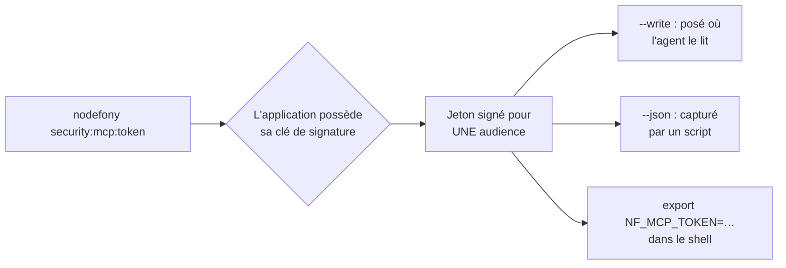

# Obtenir un jeton — hors bande, sans serveur ni mot de passe

> [tokens](tokens.md) décrit l'**émission par la porte HTTP** : un client présente un credential,
> l'application répond un couple access/refresh. Cette page décrit l'autre voie, celle dont un
> client MCP ou un script d'exploitation a besoin : **l'application signe elle-même un jeton, en
> ligne de commande**, sans qu'aucun serveur n'écoute et sans qu'aucun mot de passe ne transite.
> Ancré sur `src/packages/@nodefony/security/nodefony/command/security-mcp-token.ts`.

📍 [Documentation](../../../../../docs/index.md) › [Sécurité](index.md) › **Obtenir un jeton**

## 🧠 Le modèle mental — qui signe, pour quelle porte, pour combien de temps

Trois questions, et une seule commande y répond.



**Aucun serveur n'est en marche.** La commande démarre le noyau jusqu'à `onReady` — services prêts,
aucune écoute réseau (`security-mcp-token.ts#options`). C'est ce qui la rend utilisable quand l'application
ne tourne pas, en intégration continue, ou dans un conteneur d'amorçage.

**Le jeton vise une porte, et une seule.** L'audience est celle de la porte visée — la porte MCP par
défaut, `/nodefony/mcp` (`src/nodefony/src/cli/aiMcpReport.ts#MCP_ENDPOINT_PATH`). Un jeton d'une autre audience est
refusé, et c'est toute la raison d'être de la liaison d'audience
([RFC 8707](https://www.rfc-editor.org/rfc/rfc8707.html)).

## 📖 Lexique

- **MCP** — _Model Context Protocol_ : le protocole par lequel un agent d'intelligence artificielle
  appelle les outils d'un logiciel. Sa porte est une route de votre application, pas un processus à
  lancer.
- **Hors bande** — obtenu par un canal qui n'est pas celui qu'on va ensuite utiliser. Ici : le
  jeton s'obtient au clavier, il servira sur HTTP.
- **Audience** — la ressource pour laquelle un jeton est valable. Déclarée par l'émetteur ; un
  porteur ne choisit pas la sienne.
- **Scope** — un pouvoir nommé, porté par le jeton. `admin:read` lit, `admin:write` mute
  (`src/nodefony/src/kernel/adminPlane/adminCaller.ts#ADMIN_SCOPE_READ`).

## Qu'est-ce que ça résout — la faille du `curl` avec mot de passe

Le jeton s'obtenait par un appel au grant : trouver l'URL, composer un JSON, y mettre un mot de
passe **en clair dans l'historique du shell**, et surtout avoir un serveur en marche. Trois défauts,
et le troisième suffit à tout bloquer : dans une application neuve, on veut le jeton **avant** que
quoi que ce soit ne réponde.

L'application possède sa clé de signature ; elle n'a personne à qui demander. Donc : pas de serveur,
pas de mot de passe, pas de réseau — et rien à effacer d'un historique.

## 🚀 Démarrage rapide

```bash
# 1) Le jeton, pour la porte MCP de cette application
npx nodefony security:mcp:token

# 2) Le poser là où l'agent le lit — jamais dans un fichier suivi par git
npx nodefony security:mcp:token --write

# 3) Pour un script : la sortie machine
npx nodefony security:mcp:token --json
# {
#   "access_token": "eyJ…",
#   "resource": "http://localhost:5151/nodefony/mcp",
#   "scopes": ["admin:read"],
#   "requested": ["admin:read"],
#   "expires_in": 900
# }
```

Sans `--write` et dans un terminal, la commande **propose** de poser la valeur : un jeton de quatre
cents caractères ne se recopie pas à la main.

### Déclarer l'audience de la porte — le préalable

Un émetteur ne signe pas pour n'importe quelle ressource : les audiences sont une **liste blanche**
([RFC 8707](https://www.rfc-editor.org/rfc/rfc8707.html)). Sans cette déclaration, la commande
refuse — c'est le premier refus qu'on rencontre dans une application neuve.

```typescript
// nodefony.config.ts (extrait) — la porte pour laquelle cette application signe
use("@nodefony/security", {
  jwt: {
    // L'URI COMPLÈTE de la porte, pas seulement l'hôte : c'est elle que le
    // porteur présentera, et c'est elle qui sera comparée.
    audiences: ["http://localhost:5151/nodefony/mcp"],
  },
});
```

Puis `npm run build` — le runtime lit le `dist`, pas la source.

### Les options, et ce que chacune décide

| Option                 | Défaut                                       | Ce qu'elle change                                        |
| ---------------------- | -------------------------------------------- | -------------------------------------------------------- |
| `[identifier]`         | `admin`                                      | le compte porteur du jeton                               |
| `-s, --scope <liste>`  | `admin:read`                                 | les pouvoirs demandés — ajouter `admin:write` pour muter |
| `-r, --resource <uri>` | la porte MCP de l'application                | viser une **autre** audience                             |
| `-a, --agent <noms>`   | ceux détectés                                | quels agents servir — `none` pour aucun                  |
| `-t, --ttl <minutes>`  | 8 h avec `--write`, sinon la config (15 min) | la durée de validité, **bornée à 30 jours**              |
| `-w, --write`          | proposé en terminal                          | poser `NF_MCP_TOKEN` chez les agents présents            |
| `-j, --json`           | —                                            | sortie machine, sans invite                              |

Le plafond de `--ttl` n'est pas décoratif : un jeton posé dans un fichier **est une clé**, et une
clé se remplace (`security-mcp-token.ts#ttlSeconds`).

**Posé chez un agent, le jeton vit 8 h par défaut** (`security-mcp-token.ts#tokenTtlSeconds`). L'en-tête d'un
agent est figé : rien ne le rafraîchit, et le défaut de la configuration (15 min, taillé pour un
client d'API qui renouvelle son jeton) produisait un 401 au bout d'un quart d'heure. Huit heures
couvrent une journée de travail et bornent une fuite à quelques heures ; `--ttl` explicite
l'emporte toujours, et le défaut global `jwt.accessTtlS` ne bouge pas. La commande affiche l'heure
d'**expiration** (`expires_at` en `--json`) : c'est elle qui explique le 401 du lendemain.

### Où `--write` pose la valeur

La variable est `NF_MCP_TOKEN` (`src/nodefony/src/cli/aiMcpReport.ts#MCP_TOKEN_ENV`). La commande ne sert que
les agents dont la présence est **constatée** dans le projet — on ne crée pas la configuration d'un
outil que personne n'utilise ici. La table des cibles vit au cœur
(`src/nodefony/src/cli/agentTargets.ts#AGENT_TARGETS`) : Claude, Gemini, Vibe, Codex.

Deux garanties qui ne se négocient pas :

- **jamais dans un fichier suivi par git** — un jeton commité est un jeton publié, et c'est la seule
  faute de cette commande qui serait irrattrapable ;
- **jamais par-dessus une valeur existante** — une rotation est un geste explicite, pas un effet de
  bord.

Si aucun agent n'est reconnu, la commande le dit et donne le geste qui vaut pour tous :

```bash
export NF_MCP_TOKEN=<le jeton>
```

Vibe et Codex prennent le **nom** de la variable, pas le secret — la porte se déclare une fois :

```bash
vibe mcp add nodefony --transport streamable-http \
  --url http://localhost:5151/nodefony/mcp --api-key-env NF_MCP_TOKEN
codex mcp add nodefony --url http://localhost:5151/nodefony/mcp \
  --bearer-token-env-var NF_MCP_TOKEN
```

Pour câbler `.mcp.json` d'un seul geste : `npx nodefony ai:mcp --auth`. La déclaration de la porte
appartient à [devkit](../../devkit/docs/index.md) ; cette page ne fait qu'émettre le porteur.

## 🔐 Ce que la porte vérifie — un jeton de cette application face à une ressource

Une ressource protégée — une porte MCP d'application (`nodefony create controller <nom> --kind mcp
--expose oauth`), ou la porte de développement quand elle déclare un serveur d'autorisation — ne
vérifie pas le jeton elle-même : elle le confie au service `accessTokenVerifier`, avec **son** URI
comme audience. Ce service reconnaît **toujours** l'émetteur de l'application, dès que sa capacité
JWT est active (`security.jwt.enabled`, vrai par défaut), **sans rien déclarer** dans
`resourceServer.issuers` (`src/packages/@nodefony/security/nodefony/service/accessTokenVerifier.ts#AccessTokenVerifierService.#build`).
Une application qui signe un jeton pour sa propre porte peut donc l'y présenter.

**L'aiguillage se fait sur l'émetteur revendiqué, comparé EXACTEMENT** à `security.jwt.issuer`
(`accessTokenVerifier.ts#AccessTokenVerifierService.#build`). Égal : le jeton est jugé par les règles de l'authentificateur `jwt`,
par la même fonction (`src/packages/@nodefony/security/nodefony/src/authenticator/JwtAuthenticator.ts#JwtAuthenticator.#verify`).
Différent : il est jugé par la liste fermée des émetteurs tiers (Keycloak…, voir
[Accepter les jetons d'un émetteur tiers](external-jwt.md)) — inconnu d'elle, il est refusé sans
aucune requête sortante.

Un jeton de l'application n'est accepté que si **chaque** contrôle passe, dans cet ordre :

| #   | Contrôle                                                    | Refusé, par exemple                                                                   | Norme                                                                   |
| --- | ----------------------------------------------------------- | ------------------------------------------------------------------------------------- | ----------------------------------------------------------------------- |
| 1   | signature par une clé du jeu LOCAL, algorithme `EdDSA` seul | `alg: none`, `HS256` signé avec la clé publique, clé d'un tiers sous le même `kid`    | [RFC 8725](https://www.rfc-editor.org/rfc/rfc8725.html) §3.1, §3.5      |
| 2   | `iss` = l'émetteur de l'application                         | `https://app.example/` quand l'émetteur est `https://app.example` (aiguillé ailleurs) | RFC 8725 §3.8                                                           |
| 3   | `aud` contient l'URI de la porte                            | un jeton émis pour une AUTRE porte de la même application                             | [RFC 8707](https://www.rfc-editor.org/rfc/rfc8707.html), RFC 8725 §3.9  |
| 4   | `typ: at+jwt`                                               | un jeton de rafraîchissement présenté comme jeton d'accès, un `typ` absent            | [RFC 9068](https://www.rfc-editor.org/rfc/rfc9068.html), RFC 8725 §3.11 |
| 5   | `exp` et `nbf`                                              | expiré, pas encore valide                                                             | [RFC 7519](https://www.rfc-editor.org/rfc/rfc7519.html) §4.1.4-5        |
| 6   | `sub` et `jti` présents                                     | un jeton sans identifiant — donc impossible à révoquer                                |                                                                         |
| 7   | `jti` absent de la liste de révocation                      | un jeton révoqué individuellement                                                     |                                                                         |
| 8   | émis APRÈS le seuil `invalidBefore` du compte               | tout jeton antérieur à un changement de mot de passe ou à une déconnexion globale     |                                                                         |
| 9   | le compte existe, est actif et n'est pas verrouillé         | le jeton d'un compte désactivé, verrouillé ou supprimé                                | RFC 8725 §3.10                                                          |

Les contrôles 7 et 8 viennent **avant** la lecture du compte : un jeton révoqué est refusé sans
interroger l'annuaire (`JwtAuthenticator.ts#JwtAuthenticator.#verify`). Une PANNE de la liste de révocation est un
`503` ; une panne de l'annuaire, elle, se lit comme un compte absent — `401`. Dans les deux cas le
jeton n'est jamais servi : c'est une limite de diagnostic, pas d'accès. Le jeton accepté donne à la porte un principal :
son sujet (`sub`, l'identifiant du compte local) et ses scopes, qui décident des outils servis.

| Verdict du vérificateur                                        | Réponse de la porte                                            |
| -------------------------------------------------------------- | -------------------------------------------------------------- |
| principal                                                      | servi — les outils réservés que ses scopes ouvrent en plus     |
| refus (l'un des contrôles)                                     | `401` + `WWW-Authenticate`, qui désigne le document RFC 9728   |
| invérifiable (clés, liste de révocation ou annuaire absents)   | `503`, et le journal crie — jamais un jeton accepté par défaut |
| aucun vérificateur (capacité JWT coupée, aucun émetteur tiers) | `503`                                                          |

**Révoquer un jeton émis**, c'est révoquer le compte qui le porte : `npx nodefony
security:user:password <compte>` pose le seuil du contrôle 8 — le prochain appel reçoit `401`, avant
l'expiration du jeton. C'est éprouvé sur un serveur réel par le banc de vérité du générateur
(étape « la porte MCP protégée s'ouvre… et se referme révoquée »).

**Ce que la règle n'élargit pas.** Aucun jeton nouveau ne devient valide : l'émetteur ne signe que
pour les audiences de `jwt.audiences`, et l'audience reste exigée à chaque porte. La zone de
pare-feu `external-jwt` ne prend, elle, que les jetons des émetteurs qu'ELLE déclare : la règle ne
lui ouvre rien. Et si `resourceServer.issuers` est mal configurée, **aucun** vérificateur n'est
posé, jetons de l'application compris — une configuration fausse ne se sert pas à moitié
(`accessTokenVerifier.ts#AccessTokenVerifierService.#build`).

> ⚠️ **En production, pose `NF_JWT_ISSUER`.** Sans elle, l'émetteur vaut `"nodefony"`, qui n'est
> pas une URL : les jetons se vérifient, mais l'application ne publie ni ses clés ni ses métadonnées,
> et une porte qui annonce `https://…` comme serveur d'autorisation désigne une adresse dont
> l'émetteur réel n'est pas celui des jetons.

Pour une porte d'application, l'audience à déclarer est l'URI publique de la porte. Dans une
application générée, écris-la **sur place** dans `jwt.audiences` de `nodefony/config/security.ts` :

```typescript
audiences: ctx.isProd
  ? []
  : [
      // … les audiences du gabarit
      `${publicBaseUrl(ctx.env)}/api/mcp`,
    ],
```

⚠️ N'y importe pas la fonction `…GateResource` du fichier de la porte : ce fichier importe
`security.ts`, et le cycle ferait lire `publicBaseUrl` avant sa définition — `ReferenceError` au
démarrage.

## 🔄 Renouveler — c'est réémettre, pas rafraîchir

Il n'y a pas de refresh token ici : ce jeton est signé hors bande, pour une porte, avec une durée
courte. Le renouveler, c'est **relancer la commande** : `--write` **remplace** le jeton chez les
agents qui le portent déjà, sans reposer de question, et ne câble aucun agent nouveau sans le
proposer (`agentTargets.ts#poseVariable`). Puis relancer l'agent, qui lit sa configuration au
démarrage.

```bash
npx nodefony security:mcp:token --write --ttl 1440
```

Un jeton expiré ne casse rien de visible chez l'agent : la porte le sert en **anonyme** et retient
les outils réservés. `nodefony doctor` le signale dans sa famille « Fraîcheur du build », avec
cette commande pour geste (`freshness.ts#checkAgentTokens`) — pour les fichiers du projet
seulement : le dossier de l'utilisateur est partagé entre applications, et `nodefony ai:mcp` en
rend compte.

Le flux de rotation **avec détection de rejeu** est celui des refresh tokens de la porte HTTP — il
est décrit dans [tokens](tokens.md), pas ici.

## ⚠️ Pièges (symptôme → cause → correction)

| Symptôme                                                              | Cause                                                                                                                                    | Correction                                                                                                         |
| --------------------------------------------------------------------- | ---------------------------------------------------------------------------------------------------------------------------------------- | ------------------------------------------------------------------------------------------------------------------ |
| `impossible d'émettre un jeton pour cette porte ici`                  | **en développement** : l'audience n'est pas déclarée à l'émetteur — c'est une liste blanche, pas un défaut ouvert                        | `use("@nodefony/security", { jwt: { audiences: ["<la porte>"] } })`, puis `npm run build`                          |
| Le même message, mais l'environnement affiché n'est pas `development` | la porte MCP est servie par un module `policy: "dev"` : **elle n'existe pas** dans cet environnement                                     | `NODE_ENV=development npx nodefony security:mcp:token`, ou viser une autre porte avec `--resource`                 |
| Le jeton est émis, mais avec **moins** de scopes que demandé          | l'émetteur retire ceux que ce porteur ne peut pas obtenir, et il le dit ([RFC 6749](https://datatracker.ietf.org/doc/html/rfc6749) §3.3) | lire le champ `scopes` de la sortie — c'est celui qui fait foi (`security-mcp-token.ts#SecurityMcpToken.generate`) |
| L'agent reçoit `401` alors que le jeton vient d'être posé             | la valeur a été écrite dans un dossier que **cet** agent ne lit pas                                                                      | `--agent <nom>` pour viser explicitement, ou l'`export` dans le shell qui lance l'agent                            |
| `--write` ne fait rien et n'écrit aucun fichier                       | aucun agent n'est **constaté** dans ce projet                                                                                            | la commande liste alors les emplacements connus et donne la ligne d'`export`                                       |

> 🔴 **Le premier réflexe est faux.** Devant un refus, on cherche un serveur éteint — la commande
> n'en utilise aucun. Le message écarte cette fausse piste dès sa deuxième ligne
> (`security-mcp-token.ts#SecurityMcpToken.generate`) ; il a lui-même été corrigé pour cesser d'accuser une cause unique
> qu'il ne constatait pas.

## 🧪 Tests & couverture

- **unit** : `accessTokenVerifier.attack.test.ts` éprouve la vérification d'un jeton de
  l'application face à une ressource — chacun des neuf contrôles ci-dessus par un jeton qui le viole,
  l'aiguillage entre émetteur local et tiers, les entrées hostiles, la configuration fausse — et
  chacune de ses règles a été vue tomber en la débranchant ;
- **serveur réel** : le banc de vérité du générateur (`verify-generated.mjs`) ouvre la porte
  d'une application engendrée avec `security:mcp:token`, la voit refuser un jeton d'une autre audience,
  puis refuser le premier jeton après `security:user:password` ;
- **unit** : `securityCommands.test.ts` couvre les deux règles pures de la commande — un jeton
  **mort-né** doit s'annoncer avant d'être copié, et `--ttl` doit s'écrire en minutes, refuser une
  valeur aberrante et se borner à 30 jours (`ttlSeconds` est exportée pour cela).
- **manque assumé** : l'écriture chez les agents (`--write`) n'a pas de banc de bout en bout — sa
  garantie la plus forte, « jamais dans un fichier suivi par git », repose sur `git check-ignore` et
  `git ls-files`, constatés à l'exécution et non simulés.

Les chiffres exacts vivent dans la carte de l'aperçu, régénérée depuis vitest — jamais figés ici.
Les bancs sur serveur réel se **skippent sans leurs variables d'infra**, et un skip compte comme
vert : lire ce que la suite déclare ne pas avoir exercé.

## 🔗 Pour aller plus loin

- ⬆️ **Retour au hub** : [Sécurité — vue d'ensemble](index.md) · [Toute la documentation](../../../../../docs/index.md)
- 🧭 **Pages sœurs** : [tokens](tokens.md) · [api-keys](api-keys.md) · [oauth2](oauth2.md)

- L'émission par la porte HTTP, la rotation et la révocation → [tokens](tokens.md)
- Les jetons opaques pour machines, montrés une seule fois → [api-keys](api-keys.md)
- La vérification du porteur et les zones qui l'exigent → [authenticators](authenticators.md) · [firewall](firewall.md)
- Ce qu'un scope autorise → [authorization](authorization.md)
- Déclarer la porte MCP et lui ajouter vos outils → [devkit](../../devkit/docs/index.md)
